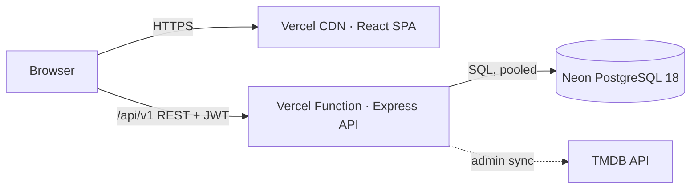

# CineBook — preventing double bookings under concurrent demand

**A BookMyShow-style ticket-booking system, and a reproducible empirical study of how such
systems guarantee that a seat is never sold twice.**

| | |
|---|---|
| 🎬 **Live demonstration** | https://cinebook-eight-chi.vercel.app |
| 📄 **Research report (PDF, 8 pp.)** | [`docs/research-report.pdf`](docs/research-report.pdf) |
| 📚 **Literature review (PDF)** | [`docs/literature-review.pdf`](docs/literature-review.pdf) |
| 🧭 **Technical documentation** | [methodology](docs/methodology.md) · [system architecture](docs/system-architecture.md) · [reproducibility](docs/reproducibility.md) · [tests](tests/README.md) |
| 📈 **Experiment dashboard** | `npm run experiments:dashboard` → http://localhost:4600 ([screenshot](figures/fig8_live_dashboard.png)) |
| 🗂️ **Dataset & data-generation scripts** | [`data/`](data/) ([data card](data/data-card.md)) · [`experiments/harness/`](experiments/harness/) |
| 📓 **Analysis notebooks** | [`notebooks/`](notebooks/) (independent SciPy/Statsmodels re-analysis) |
| 🔖 **Citation** | [`CITATION.cff`](CITATION.cff) · [BibTeX below](#citation) |

---

## 1. Project overview

CineBook is a full-stack movie-ticketing application:
- **Booking flow:** browse real movies by city, pick a show, choose seats on a live seat map, pay through a simulated gateway, and receive a QR e-ticket.
- **Stack:** a React single-page app and an Express API deployed together on Vercel, with Neon PostgreSQL.

The project then treats its own core requirement, **"two users can never book the same seat,"** as a research
question. It compares seven concurrency-control strategies under controlled, repeated experiments, and
validates the deployed system end to end.

## 2. Problem statement

Ticket launches create extreme hot-spot contention. Ticketmaster reported 3.5 billion system requests in the
2022 Eras Tour presale, and BookMyShow's site went down at the opening of the 2024 Coldplay India sale.
Under such load, any gap between *checking* that a seat is free and *marking* it sold lets two buyers
purchase the same seat (a *lost update*). Studies of real web applications show that such check-then-write
logic is common and exploitable (Bailis *et al.*, SIGMOD 2015; Warszawski & Bailis, SIGMOD 2017).

## 3. Research objectives

1. Measure whether each strategy prevents double booking under simultaneous demand (**RQ1**).
2. Quantify the latency and throughput cost of each correct strategy (**RQ2**).
3. Characterise deadlocks, aborts and seats sold under overlapping multi-seat requests (**RQ3**).
4. Verify the deployed system's correctness and its PRD latency target, p95 < 200 ms (**RQ4**).
5. Test whether the choice of test platform changes what can be observed (**RQ5**).

## 4. Literature review

Full review: [`docs/literature-review.pdf`](docs/literature-review.pdf).

| Approach | Guarantee | Limitation |
|---|---|---|
| Check in application code, then write | none under concurrency | lost update → oversell |
| Conditional write (`UPDATE … WHERE free`) | one winner per row | multi-row all-or-nothing needs care |
| Pessimistic locking (`SELECT … FOR UPDATE`) | serialised access | deadlocks if lock order differs |
| Optimistic validation (Kung & Robinson) | aborts on conflict | wasted work under contention |
| SERIALIZABLE / SSI (Ports & Grittner) | serializable executions | aborts, including false positives |
| Coarse or external locks | mutual exclusion | serialises unrelated work; timing assumptions |

**Gap.** Prior work explains *why* naive code fails and *what* each mechanism guarantees. It rarely gives a
reproducible comparison for the seat-reservation pattern on a serverless + managed-database stack, where
network round trips dominate cost. It also seldom asks whether the test platform hides the defect.

## 5. Proposed methodology

A **pre-registered design of experiments** ([`docs/methodology.md`](docs/methodology.md),
[`experiments/configs/experiments.json`](experiments/configs/experiments.json)):

| Item | Value |
|---|---|
| Hypotheses | H1: the baseline double-books · H2: database-enforced strategies never do · H3: costs differ; conditional UPDATE fastest · H4: deployed reads meet p95 < 200 ms · H5: an embedded test DB hides the race |
| Independent variables | strategy (7 levels) · concurrent clients *c* = 1–32 · workload shape · platform |
| Dependent variables | double bookings per trial, lost updates, aborts by cause, seats sold, latency p50/p95, throughput, server-side commits/rollbacks/deadlocks |
| Control / baseline | naive read-check-write; identical schema for all strategies; fresh seats per trial; dedicated connection per client; barrier-synchronised start |
| Repetitions | 15–20 trials per cell, plus a warm-up trial per cell (excluded); cells in seeded random order |
| Analysis | medians and p95 with bootstrap CIs; Wilson CIs; rule of three; Fisher exact; Kruskal–Wallis → Mann–Whitney (Holm); Cliff's δ |
| Validation | statistics self-test (12 reference values); independent SciPy/Statsmodels re-analysis (154/154 quantities agree) |
| Ablations | lock ordering (sorted vs unordered locking); isolation level (READ COMMITTED vs SERIALIZABLE on identical code) |
| Sensitivity | concurrency 2 → 32; platform (Neon vs embedded PGlite) |

Strategies compared: `naive` (baseline) · `conditional_update` (CineBook) · `pessimistic_sorted` ·
`pessimistic_unordered` · `optimistic_version` · `serializable` · `advisory_lock`.

## 6. System architecture



A seat hold is a single conditional `UPDATE` on `show_seats` (one row per seat per showtime). PostgreSQL waits
on a concurrent writer's row lock and then re-checks the `WHERE` clause, so exactly one competitor wins.
Payments are idempotent, using a unique `Idempotency-Key` and a partial unique index. Details, data model and
the research-harness pipeline: [`docs/system-architecture.md`](docs/system-architecture.md).

## 7. Experimental setup

| | |
|---|---|
| Database | Neon PostgreSQL 18.6, AWS ap-southeast-1, pooled connections; isolated `research` schema |
| Deployed system | Vercel function (region sin1) + Neon, accessed over HTTPS through Vercel's CDN |
| Client | Intel i5-12400F (12 threads), 15.9 GB RAM, Windows 10, Node.js 24.19; median RTT to DB 102 ms |
| Experiments | E1 hot seat (*c* = 2, 8, 32 × 20 trials) · E2 overlapping 3-of-10 seats (*c* = 16 × 15) · E3 no collisions (*c* = 1, 16 × 6 × 5 holds) · E4 live site (latency 3 × 40 × 4 endpoints; 12 sixteen-user races; 6 payment double-submits) · E5 PGlite (*c* = 8 × 15) |
| Volume | 13 228 logged events, 12 402 transactions, 687 trials, collected 25 Oct 2026 |
| Seed | `20261025` |

## 8. Results

| Strategy | Double bookings (E1+E2) | E2 deadlocks | E2 aborts | E3 median latency, c = 16 | E3 throughput, c = 16 |
|---|---|---|---|---|---|
| naive (baseline) | **1 351** (60/60 E1 trials fail) | 0 | 0% | 435 ms | 31.8 /s |
| **conditional_update** | **0** | 0 | 0% | **344 ms** | **38.3 /s** |
| pessimistic_sorted | 0 | 0 | 0% | 445 ms | 31.1 /s |
| pessimistic_unordered | 0 | **93 (38.8%)** | 38.8% | — | — |
| optimistic_version | 0 | 0 | 0% | 441 ms | 30.5 /s |
| serializable | 0 | 0 | **93.8%** | 439 ms | 29.8 /s |
| advisory_lock | 0 | — | — | 5 614 ms | 2.8 /s |

<p align="center">


</p>
<p align="center"><em>Left: double bookings per trial vs concurrent clients (E1), where the baseline grows as c − 1 and all others stay at 0. Right: outcome of every request with overlapping three-seat requests (E2).</em></p>

<p align="center">


</p>
<p align="center"><em>Left: throughput with 95% bootstrap CIs (E3). Right: live end-to-end latency distribution, with a dashed line at the 200 ms target (E4).</em></p>

**Live system (E4).**
- **Seat races:** 12/12 sixteen-user races for one seat had exactly one winner (192 requests, no errors).
- **Payments:** 6/6 parallel payment double-submits created one payment record, with 0 double charges, and every retry was recognised as a replay.
- **Latency:** read p95 was health 150 ms, movies 60 ms, showtimes 146 ms and seat map 200 ms [95% CI 144–417].

**Platform (E5).** The same baseline code double-booked in 20/20 trials on Neon and in 0/15 on embedded PGlite.

All figures: [`figures/`](figures/) · all tables: [`data/processed/`](data/processed/).

## 9. Statistical analysis

| Hypothesis | Test | Result | Verdict |
|---|---|---|---|
| H1 baseline double-books | Wilson CI; Fisher exact vs conditional UPDATE | 60/60 trials, 95% CI 94–100%; *p* = 2.1×10⁻³⁵ | supported |
| H2 others never do | rule of three / exact bound | 0 in 75 trials (1 080 transactions) each; per-trial upper bound 4% | supported |
| H3 costs differ | Kruskal–Wallis; Mann–Whitney + Holm; Cliff's δ | *H* = 1936 (*c* = 16); every pair *p* ≤ 4.4×10⁻⁷; δ = 0.96–1.00 at *c* = 16 (large) | supported |
| H4 live p95 < 200 ms | bootstrap CI of p95 | 3 of 4 endpoints have their whole CI below 200 ms; seat map CI reaches 417 ms | partially |
| H5 platform hides race | Fisher exact | 20/20 vs 0/15; *p* = 3.1×10⁻¹⁰ | supported |

Variability is reported throughout as confidence intervals rather than single numbers. Every quantity above
was recomputed independently in Python ([`notebooks/04_statistical_analysis.ipynb`](notebooks/04_statistical_analysis.ipynb)),
and all 154 checks agree.

## 10. Reproducibility

```bash
npm ci
npm run stats:selftest && npm run experiments:analyze
git diff --exit-code -- data/processed experiments/results    # identical results from the committed raw data
```

- **Re-running the experiments:** [`docs/reproducibility.md`](docs/reproducibility.md) covers re-running against your own database, the live dashboard and the Python notebooks.
- **What is recorded:** run manifests record the git commit, software versions, hardware, database host, network samples and the randomised execution order.
- **Continuous check:** the CI job `research` verifies on every push that the analysis reproduces the committed results byte for byte and that the independent re-analysis agrees.

## 11. Limitations

- **Single client location.** All load came from one client in India; absolute latencies include a ~100 ms wide-area round trip.
- **One database configuration.** One Neon compute size, with connections through a pooler.
- **No retries.** The strategies were measured without automatic retries; with retries, SERIALIZABLE and optimistic control would sell more seats at higher latency.
- **Limited concurrency.** Concurrency was capped at 32 clients; real flash sales are far larger and normally shaped by a virtual queue.
- **Small live samples.** 12 races and 6 payment trials confirm rather than establish correctness.
- **Seat-map latency.** The seat-map endpoint has not been shown to meet the p95 < 200 ms target.

## 12. Future work

- Repeat the study from several regions and at larger concurrency, behind a virtual queue.
- Add retry policies and measure *goodput* (seats sold per second).
- Evaluate `SKIP LOCKED`-based "best available" seat suggestion.
- Profile and cache the seat-map query to bring its p95 under 200 ms.
- Push seat-map updates over Server-Sent Events instead of polling.

---

## Repository structure

```
docs/                  research-report.pdf · literature-review.pdf · methodology.md
                       system-architecture.md · reproducibility.md · report-source/
data/                  raw/ (transaction logs) · processed/ (CSV tables) · data-card.md
notebooks/             01_exploratory_analysis · 02_baseline_experiments
                       03_strategy_comparison · 04_statistical_analysis
experiments/           configs/ · harness/ (runners, strategies, statistics, analysis, charts)
                       dashboard/ · results/ · logs/ (run manifests) · load-tests/ (k6)
figures/               every figure in the report
tests/                 e2e/ (Playwright) · README.md (index of all test suites)
apps/web/              React SPA                    ┐
apps/api/              Express API (+ test/)        ├ application source (npm workspaces)
packages/shared/       shared Zod schemas & rules   ┘
scripts/               build-vercel.mjs (deployment build) · start.mjs
```

## Running the application

```bash
npm install
npm start              # builds, then serves site + API → http://localhost:4000
npm run dev            # hot-reload development → http://localhost:5173
npm test               # unit + API integration tests (incl. 50 concurrent holds → 1 winner)
npm run test:e2e       # Playwright end-to-end tests
```

With no `DATABASE_URL`, the API runs on an embedded PostgreSQL and seeds itself with real current films
(two per Indian language plus English), theatres in three cities and seven days of showtimes. For a persistent
database set `DATABASE_URL` in `apps/api/.env` to a Neon connection string and run `npm run db:seed`.
Test card `4242 4242 4242 4242` succeeds, a card ending `0000` is declined, and one ending `1111` simulates a bank timeout.

## Citation

```bibtex
@software{chitakana2026cinebook,
  author  = {Chitakana, Kishan Phani},
  title   = {CineBook: An Empirical Comparison of Concurrency-Control Strategies for
             Seat Reservation in a Serverless Ticket-Booking System},
  year    = {2026},
  url     = {https://github.com/Icoder05/cinebook},
  note    = {Live demo: https://cinebook-eight-chi.vercel.app}
}
```

## License

MIT; see [`LICENSE`](LICENSE). Movie data and images come from TMDB. This product uses the TMDB API but is not endorsed or
certified by TMDB.
