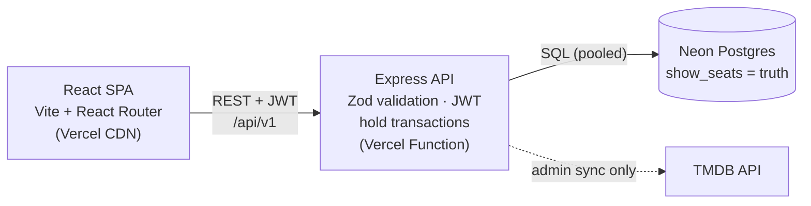

# CineBook — a BookMyShow clone

Browse currently-running movies, pick a city, theatre and showtime, choose seats on a live
seat map, pay through a simulated gateway and get an e-ticket with a QR code.

**The one thing this project proves: two users can never book the same seat.** Postgres —
not the Node process — decides who wins, and a test fires 50 concurrent requests at one
seat and asserts exactly 1 success and 49 × `409`.

| | |
|---|---|
| Frontend | React 18 + Vite, React Router v6 (lazy routes), TanStack Query, Tailwind, React Hook Form + Zod |
| Backend | Node 20, Express 4, TypeScript, Drizzle ORM, JWT + SQL-backed sessions |
| Database | Neon Postgres 16 (embedded PGlite for zero-setup local dev and tests) |
| Data | TMDB v3 (admin-triggered sync, cached in Postgres) |
| Tests | Vitest + Supertest (42 tests incl. the concurrency test), Playwright E2E, k6 load scripts |

## Quick start (no accounts needed)

```bash
npm install
npm start            # builds, then serves website + API together
#   ➜ Open the app:  http://localhost:4000      ← click it
```

For development with hot reload use `npm run dev` instead and open **http://localhost:5173**
(Vite serves the site there; the API runs on :4000, and its `/` redirects to :5173).
Don't run both at once — they share the local database, and the second one refuses to
start if the port is taken.

With no `DATABASE_URL`, the API runs on an embedded Postgres
(PGlite, persisted in `apps/api/.data/`) and seeds itself on first boot: 3 cities,
6 theatres, 12 screens, 7 days of showtimes and **real films in Indian cinemas** — two each in
Hindi, English, Tamil, Telugu, Malayalam and Kannada, plus three coming soon — with TMDB
posters, backdrops, cast and trailers. That list is a snapshot taken on 17 Oct 2026
(`apps/api/src/db/catalog-snapshot.ts`); add a TMDB key (below) for a live sync.

If the local database ever gets corrupted (e.g. the API was force-killed mid-write),
stop the dev server, delete `apps/api/.data/` and start again — it re-seeds itself.

- Admin: `admin@cinebook.dev` / `Admin@12345` → `/admin`
- Test cards: `4242 4242 4242 4242` succeeds · `4000 0200 0000 0000` (ends 0000) is declined ·
  `4111 1111 1111 1111` (ends 1111) times out — retrying is safe and returns the original result.
- UPI ids starting with `fail` are declined.

### Real movies from TMDB

Get a free key at https://www.themoviedb.org/settings/api, then:

```bash
cp apps/api/.env.example apps/api/.env   # set TMDB_API_KEY=...
npm run db:reset                         # wipe local data, re-seed with real now-playing movies (region IN)
```

Either the v3 API key or the v4 read-access token works. Admins can also re-sync from the dashboard.

### Use Neon instead of the embedded DB

Set `DATABASE_URL` in `apps/api/.env` to Neon's **pooled** connection string (`-pooler`
host), then `npm run db:seed`. The API uses a `pg` pool (max 10) and never opens a
connection per request.

## Scripts

| | |
|---|---|
| `npm start` | build, then run website + API as one server → http://localhost:4000 |
| `npm run dev` | hot-reload dev: web (Vite) on http://localhost:5173, API on :4000 |
| `npm test` | shared unit tests + API integration tests (in-memory PGlite) |
| `npm run test:e2e` | Playwright happy path + declined card, desktop and mobile |
| `npm run typecheck` / `npm run build` | all workspaces |
| `npm run db:migrate` / `db:seed` / `db:reset` / `sync:tmdb` | database tasks (`-w @cinebook/api`) |

Set `TEST_DATABASE_URL` to a throwaway Neon branch to run the API suite — including the
concurrency test — against real, truly concurrent Postgres. PGlite serialises every
statement, so locally the test proves the logic, and on Neon it proves it under real
row-lock contention.

## Architecture



The API is stateless and can scale horizontally; seat conflicts are settled by a
conditional `UPDATE` inside Postgres. TMDB is only touched by an admin sync, never on a
user request.

```
apps/web          React SPA (pages, components, lib/api.ts auth-aware fetch)
apps/api          Express API — routes/ services/ db/ middleware/ test/
packages/shared   Zod schemas, pricing + gateway rules, API types (used by both sides)
loadtest/         k6 scripts + results.md
e2e/              Playwright specs
```

## Seat selection

Like BookMyShow, the seat map opens with **"How many seats?"** — a vehicle illustrates the
party size (1 cycle · 2 scooter · 3 auto · 4 car · 5–6 SUV · 7–8 van · 9–10 bus) next to each
tier's price and availability. Tapping a seat then selects that many adjacent free seats in
the row (rightwards first, then leftwards), never jumping an aisle, gap or taken seat; tap
more seats to fill any remainder. *Proceed* unlocks only when the chosen number of seats is
selected, and the "N Tickets ✎" chip reopens the picker.

## How seat locking works

`show_seats` has one row per seat per showtime with primary key `(showtime_id, seat_id)`.
A hold is a single conditional update in one transaction:

```mermaid
sequenceDiagram
  autonumber
  participant A as User A
  participant B as User B
  participant API
  participant PG as Postgres
  A->>API: POST /showtimes/:id/holds {seatIds:[E7]}
  B->>API: POST /showtimes/:id/holds {seatIds:[E7]}
  API->>PG: BEGIN; UPDATE show_seats SET status='HELD'… WHERE seat=E7 AND (AVAILABLE OR hold expired) RETURNING
  API->>PG: BEGIN; same UPDATE (blocks on A's row lock)
  PG-->>API: A: 1 row → INSERT booking PENDING; COMMIT
  API-->>A: 201 {bookingId, holdExpiresAt, pricing}
  PG-->>API: B: row re-checked after A commits → status is HELD → 0 rows
  API->>PG: ROLLBACK
  API-->>B: 409 SEATS_UNAVAILABLE {seatIds:[E7]}
```

```sql
UPDATE show_seats
   SET status = 'HELD', held_by = $user, hold_id = $booking,
       hold_expires_at = now() + interval '10 minutes', version = version + 1
 WHERE showtime_id = $show
   AND seat_id = ANY($seatIds)
   AND (status = 'AVAILABLE' OR (status = 'HELD' AND hold_expires_at < now()))
RETURNING seat_id;
-- returned rows != requested → ROLLBACK, 409 with the missing ids (all-or-nothing)
```

- **Expired holds are reclaimable inline** (the `OR` clause), so correctness never depends
  on a background job. A sweeper (every 60 s) only tidies data: stale holds → `AVAILABLE`,
  their bookings → `EXPIRED`.
- **One active hold per user per showtime**: a new hold releases the previous one in the
  same transaction.
- **Deadlocks** between holds that lock overlapping seats in different orders are aborted
  by Postgres and surfaced as `409`, which is what they are.
- **Showtimes can't overlap** on a screen: an `EXCLUDE USING gist` constraint on
  `tstzrange(starts_at, ends_at)`.

### Payment (fake gateway)

`POST /bookings/:id/pay` needs an `Idempotency-Key` header (unique column on
`payments`). Same key → the original result is replayed; a double-click can never
double-charge. A partial unique index allows at most one in-flight/successful payment per
booking even across different keys. On success, a single transaction flips `HELD → BOOKED`
**only** where `hold_id` matches and the hold hasn't expired; if it has, the payment is
marked `REFUNDED` and the API returns `410 HOLD_EXPIRED`. Only the last 4 card digits are
stored, and the CVV never leaves the browser.

Booking states: `PENDING → CONFIRMED` (paid) · `PENDING → FAILED` (declined; seats released)
· `PENDING → EXPIRED` (timer) · `CONFIRMED → CANCELLED` (≥ 2 h before the show; fake refund).

### Auth

- Access token: JWT HS256, 15 min, `{sub, role, sid}`, kept **in memory** only.
- Refresh token: 32 random bytes in an `httpOnly; SameSite=Lax` cookie scoped to
  `/api/v1/auth`; only its SHA-256 hash is stored in `sessions`.
- Every refresh rotates the token within a `family_id`. Presenting an already-rotated
  token is treated as theft and revokes **all** of the user's sessions (a 10 s grace
  window covers two tabs refreshing at once).
- Middleware checks only the JWT signature on reads (no DB hit); pay and cancel also
  verify the session row is live, so "sign out everywhere" takes effect immediately.
- bcrypt cost 12 (`bcryptjs`, the pure-JS implementation of the same algorithm, so there's
  no native build on Windows/CI), Helmet, a CORS allow-list, and login rate-limited to
  5 failures / 15 min per IP + email.

## API

REST under `/api/v1`, JSON only, every body and query validated with Zod. Errors always use
`{ "error": { "code", "message", "details" } }`.

| Method | Path | Auth | |
|---|---|---|---|
| POST | `/auth/signup`, `/auth/login` | — | returns `{user, accessToken}` + refresh cookie |
| POST | `/auth/refresh` | cookie | rotate |
| POST | `/auth/logout`, `/auth/logout-all` | U | |
| GET/PATCH | `/me` | U | profile |
| GET | `/cities` | — | |
| GET | `/movies?status&city&lang&genre&format&q` | — | city ⇒ only movies with shows there |
| GET | `/movies/:id` | — | detail + top-10 cast |
| GET | `/movies/:id/showtimes?city&date` | — | next 7 days, grouped by theatre |
| GET | `/showtimes/:id/seats` | — (optional U) | layout + per-seat state + tier prices |
| POST | `/showtimes/:id/holds` | U | `{seatIds}` → `201` or `409` |
| DELETE | `/holds/:bookingId` | U | release early |
| POST | `/bookings/:id/pay` | U + session | `Idempotency-Key` header |
| GET | `/bookings?scope=upcoming\|past`, `/bookings/:id` | U | ticket includes QR data URL |
| POST | `/bookings/:id/cancel` | U + session | |
| * | `/admin/...` | A | stats, TMDB sync, theatres, screens, showtimes, auto-schedule, bookings |
| GET | `/health` | — | DB ping (load-test warm-up) |

Status codes: `401` expired token (client refreshes once), `409 SEATS_UNAVAILABLE`,
`410 HOLD_EXPIRED`, `422` validation, `429` rate limit.

**Pricing:** tiers per screen (e.g. Recliner ₹450, Prime ₹250, Classic ₹180), optional
per-showtime overrides; ₹30/ticket convenience fee + 18% GST on the fee. Money is integer
paise throughout.

## Deploy: Vercel + Neon

One Vercel project serves everything on one domain: the React site from Vercel's CDN and
the Express API as a single Vercel Function at `/api/*` (same origin, so the
`SameSite=Lax` refresh cookie just works). `scripts/build-vercel.mjs` produces this with
Vercel's [Build Output API](https://vercel.com/docs/build-output-api); `vercel.json` points
Vercel at it.

1. **Neon**: create a project (region **AWS Asia Pacific – Singapore**, next to the
   function's `sin1` region) and copy the **pooled** connection string (`-pooler` host).
2. **Load the data** once, from your machine:
   ```bash
   # apps/api/.env  →  DATABASE_URL=postgresql://…-pooler…/neondb?sslmode=require
   npm run db:seed      # schema + cities, theatres, screens, movies, cast, showtimes, admin
   ```
   Movies, posters (TMDB image CDN links), cast and trailers all come from the seed, so a
   fresh database looks exactly like local dev.
3. **Vercel**: *Add New → Project → import the GitHub repo* (keep Root Directory `./`;
   the framework preset and build settings come from `vercel.json`). Add environment variables:

   | Name | Value |
   |---|---|
   | `DATABASE_URL` | the Neon pooled connection string |
   | `JWT_ACCESS_SECRET` | 48+ random characters (`node -e "console.log(require('crypto').randomBytes(48).toString('base64url'))"`) |
   | `NODE_ENV` | `production` |
   | `TMDB_API_KEY` | optional — enables the admin "Sync from TMDB" button |

4. Deploy, open the URL, sign in as the seeded admin, and **change the admin password**
   (or set `ADMIN_EMAIL` / `ADMIN_PASSWORD` before seeding).

Notes: the 60 s expiry sweeper has no long-running process on Vercel; the function tidies
expired holds opportunistically, and correctness never depended on it (expired holds are
reclaimed inline). Neon's free compute sleeps when idle, so the first request after a
pause takes a second or two longer.

Prefer a single always-on server? `render.yaml` deploys the same app to Render instead
(`npm start` runs that mode locally).


## Scope

P0 is complete. Shipped P1: login rate limit, title search, cancellation, and the admin
bookings list and revenue. Not built (P1/P2): WebSocket/SSE seat push (the map polls
every 5 s), Google OAuth, scheduled TMDB cron, email tickets.

---
This product uses the TMDB API but is not endorsed or certified by TMDB.
