

<h1>Preventing Double Bookings under Concurrent Demand: A Multi-Dimensional Empirical Evaluation of a Serverless Ticket-Booking System</h1>

<b>Abstract.</b> When thousands of users try to buy the same seats at once, a booking system must guarantee that each seat is sold exactly once, while staying fast, reliable, secure and usable. This paper evaluates CineBook, a serverless cinema-booking system, along all of these dimensions in twelve experiments. First, seven concurrency-control strategies were compared on a cloud PostgreSQL database. Across 11 280 logged transactions, a naive read-check-write baseline double-booked in 60 of 60 contended trials, while the other six strategies produced none. CineBook's single conditional UPDATE had the lowest median latency (344 ms versus 435–445 ms) and 23% higher throughput than the next best strategy. Second, the deployed system was tested end to end. It served 13 860 requests from 10 to 500 simultaneous users without a single error. Its 95th-percentile latency stayed near 200 ms up to 50 users and rose to 1.7–1.8 s at 500. It passed all 48 failure-injection trials (declined cards, bank time-outs, dropped connections and holds expiring during payment) with no double charge and no inconsistent seat. It also passed 46 of 46 checks mapped to the OWASP API Security Top 10. Indexing a one-million-row seat table cut the seat-map query from 52.5 ms to 0.34 ms and the hold statement from 52.9 ms to 0.12 ms. Against BookMyShow and District, CineBook's public pages transferred 5–17 times fewer bytes with comparable Largest Contentful Paint. An accessibility audit found and fixed a keyboard trap, an unreachable seat grid and colour-contrast failures, taking keyboard-only booking from 0 of 3 to 3 of 3 completions. A simulation with 2 000 synthetic personas suggests that content-based ranking could raise mean reciprocal rank from 0.28 to 0.72. Finally, an embedded test database hid the double-booking defect entirely (0/15 versus 20/20 trials, p = 3×10⁻¹⁰).

<b>Keywords:</b> concurrency control, double booking, PostgreSQL, serverless computing, scalability, transaction reliability, idempotency, API security, web accessibility, usability, recommender systems, performance evaluation.

## 1. Introduction

Ticketing is a classic hot-spot workload: demand concentrates on a few rows—the best seats of a popular show—at the same instant. Recent launches illustrate the scale. Ticketmaster reported 3.5 billion system requests during the 2022 Eras Tour presale [15], and BookMyShow's site failed at the opening of the 2024 Coldplay India sale, when roughly 13 million users were reported to compete for about 180 000 tickets [16]. Under such contention, any gap between *checking* that a seat is free and *marking* it sold allows two buyers to purchase the same seat.

The product requirements of CineBook, the system studied here, state one non-negotiable property: two users can never book the same seat. CineBook enforces it with a single conditional UPDATE executed inside PostgreSQL. This paper first asks whether that design is (a) correct, (b) cheaper than the alternatives, and (c) correct and fast enough in the deployed system.

A booking platform is judged on much more than one invariant, however. Users notice how quickly pages appear, how many steps a booking takes and whether the site works with a keyboard or screen reader. Operators care about behaviour under load, recovery from failed payments, database cost and security. The paper therefore extends the evaluation to seven further questions:
- web performance and accessibility compared with two market leaders;
- booking-funnel efficiency;
- scalability;
- reliability under injected failures;
- database optimisation;
- API security;
- the potential of personalised discovery.

The contributions are:
1. a pre-registered experimental comparison of seven concurrency-control strategies on a production-grade stack;
2. an end-to-end, multi-dimensional evaluation of the deployed application, with mean, standard deviation, confidence intervals and non-parametric tests for every measure;
3. three accessibility defects found by measurement, fixed and re-measured;
4. an analysis of the architectural trade-offs that the measurements support;
5. evidence that the choice of test platform determines whether the central defect is observable at all.

## 2. Related Work

*A. Anomalies and Isolation.* Berenson *et al.* [1] showed that the ANSI isolation levels are ambiguous and defined anomalies such as the *lost update*—the exact failure behind double booking, in which two transactions read "available" and both write "sold." PostgreSQL's default READ COMMITTED level permits this for read-then-write logic. A single UPDATE ... WHERE status = 'AVAILABLE', however, is safe: when the target row is locked by a concurrent writer, PostgreSQL waits and re-evaluates the WHERE clause against the newly committed row version before updating [6].

*B. Pessimistic and Optimistic Control.* Two-phase locking (SELECT ... FOR UPDATE) serializes access but can deadlock when transactions acquire rows in different orders. Optimistic concurrency control [5] executes without locks, validates at commit and aborts on conflict; it is efficient when conflicts are rare and wasteful when they are frequent.

*C. Serializable Snapshot Isolation.* PostgreSQL implements SERIALIZABLE with SSI [3], which detects dangerous read–write dependency cycles and aborts one participant. Its authors report performance close to snapshot isolation on read-heavy workloads, but SSI may abort transactions that did not truly conflict. Independent testing by Jepsen found G2-item anomalies in the serializable mode of PostgreSQL 12.3 [10], underlining the value of empirical checks.

*D. Application Practice.* Bailis *et al.* [2] found that Rails applications enforce integrity mostly through application-level ("feral") checks, used over 37 times more often than transactions and often unsafe under concurrency. Warszawski and Bailis [4] demonstrated that such defects are exploitable (22 attacks in 12 applications) and are masked by low traffic. Locks held outside the database, such as Redis Redlock, add timing assumptions and require fencing tokens to be safe [11].

*E. Measurement Methodology.* Systems measurements are noisy and easily biased: Mytkowicz *et al.* [9] showed that innocuous setup changes can reverse conclusions and recommend setup randomization. Georges *et al.* [7] and Hoefler and Belli [8] call for repeated runs, confidence intervals and non-parametric statistics. Tail latency governs user experience [12], and serverless platforms add cold starts and variable performance [13].

*F. Web Performance and Accessibility.* Google's Core Web Vitals use Largest Contentful Paint (LCP) as the main loading metric, with 2.5 s as the "good" threshold [22]. The Web Content Accessibility Guidelines (WCAG) 2.2 [20] define testable success criteria. Among them are no keyboard trap (2.1.2), meaningful focus order (2.4.3) and a minimum text contrast of 4.5:1 (1.4.3). Automated engines such as axe-core [21] detect a subset of these rules reliably, but keyboard operation must be exercised directly. For composite widgets such as a seat grid, the WAI-ARIA Authoring Practices recommend a single Tab stop with arrow-key movement, a "roving tabindex" [25].

*G. Usability Measurement.* The System Usability Scale (SUS) is a ten-item questionnaire that yields a 0–100 score [17]. Bangor *et al.* map SUS scores to adjective ratings [18]. Where no participants are available, the Keystroke-Level Model (KLM) predicts expert task time from counts of keystrokes, pointing actions and mental preparations [19].

*H. API Security and Recommendation.* The OWASP API Security Top 10 (2023) ranks the most common API risks, led by broken object-level authorization and broken authentication [23]. For discovery, content-based recommenders match item attributes to a user profile [27]. They are evaluated with rank-aware measures such as normalized discounted cumulative gain (NDCG) [24]. Paired comparisons of per-user scores are usually tested with the Wilcoxon signed-rank test [26].

*I. Research Gap.* Prior work explains *why* naive code fails and *what* each mechanism guarantees. It rarely offers a reproducible, quantitative comparison for the seat-reservation pattern (one hot row; all-or-nothing multi-row holds) on a serverless and database-as-a-service stack, where wide-area round-trip time rather than CPU dominates cost. It seldom examines how the *test environment* affects whether such defects are visible. Booking systems are also rarely evaluated across correctness, performance, reliability, security, accessibility and discovery together, against real competitors. This study addresses these gaps.

## 3. Research Questions and Hypotheses

Table I lists the twelve research questions. Hypotheses H1–H5 and the full designs of E1–E5 were fixed in a configuration file before any experiment ran. The designs of E6–E12 (factors, levels and repetitions) were added to the same file before those experiments ran; their expectations are stated here, but they were not formally pre-registered.

TABLE I Research Questions, Hypotheses and Expectations

| | Question | Hypothesis / expectation |
|---|---|---|
| RQ1 | Does each strategy prevent double booking under simultaneous requests? | **H1** baseline double-books; **H2** all others never do |
| RQ2 | What does each correct strategy cost without collisions? | **H3** strategies differ; conditional UPDATE fastest, coarse lock slowest |
| RQ3 | How do strategies behave with overlapping multi-seat requests? | unordered locking deadlocks; SSI over-aborts |
| RQ4 | Is the deployed system correct and within p95 < 200 ms? | **H4** yes, for all read endpoints |
| RQ5 | Does the test platform change the observed outcome? | **H5** an embedded, serial database hides the race |
| RQ6 | How do page speed, weight and accessibility compare with BookMyShow and District? | lighter pages; fewer WCAG violations |
| RQ7 | How many steps, actions and seconds does a booking take, with a mouse and with a keyboard only? | booking possible with keyboard only |
| RQ8 | How do latency, throughput and errors change from 10 to 500 concurrent users? | no errors; latency rises with load |
| RQ9 | Do seat holds and payments stay consistent under injected failures? | no double charge; seats always released |
| RQ10 | Which indexes and data layouts make the hot queries fast, and at what cost? | key indexes give order-of-magnitude gains |
| RQ11 | Does the API resist the OWASP API Top 10 attack classes? | all checks pass |
| RQ12 | Could personalised ranking shorten film discovery? | content-based ranking beats default order |

## 4. Methodology

*A. System Under Test.* All strategies run against identical tables in an isolated research schema of the production Neon database (PostgreSQL 18.6, AWS ap-southeast-1, pooled connections). Each strategy holds 1–3 seats all-or-nothing and inserts one *claim* row per seat in the same transaction. The number of double bookings in a trial is therefore

D = Σs max(0, ns − 1), &nbsp;&nbsp;&nbsp;&nbsp;(1)

where ns is the number of committed claims on seat s. The seven strategies are:
- *naive* (the baseline): reads, checks in application code and updates unconditionally;
- *conditional_update*: CineBook's production logic;
- *pessimistic_sorted*: locks rows with FOR UPDATE in seat order;
- *pessimistic_unordered*: locks rows one at a time in request order;
- *optimistic_version*: validates a version number;
- *serializable*: runs the naive code under SERIALIZABLE;
- *advisory_lock*: takes one lock per show.

*B. Experimental Design.* Table II lists the factors and levels. The procedure was:
- each trial starts from freshly inserted seats;
- each client owns a dedicated connection;
- all clients are released from a barrier simultaneously;
- one warm-up trial per cell is logged and excluded;
- cells execute in a seeded random order to counter time-of-day drift [9];
- inputs (seat choice and request order) derive from a fixed seed.

TABLE II Factors, Levels and Replications (Concurrency Experiments)

| Exp. | Workload | Strat. | c | Trials |
|---|---|---|---|---|
| E1 | one hot seat; all clients request it | 7 | 2, 8, 32 | 20 |
| E2 | 10-seat pool; 3 random seats each | 6 | 16 | 15 |
| E3 | no collisions; 5 holds per client | 6 | 1, 16 | 6 |
| E4 | live deployment over HTTPS | prod. | 1/16/5 | 3/12/6 |
| E5 | as E1 on embedded PGlite | 3 | 8 | 15 |

*C. Metrics and Environment.* The metrics are:
- double bookings (1) and lost updates;
- aborts by SQLSTATE (deadlock 40P01, serialization failure 40001);
- per-transaction latency and trial makespan;
- throughput (successful holds per second);
- server-side pg_stat_database deltas.

The client was an Intel i5-12400F (12 threads, 15.9 GB RAM, Windows 10, Node.js 24.19) in India; the median round-trip time to the database in Singapore was 102 ms. The main run took place on 25 October 2026, 04:51–05:17 UTC.

*D. Extended Experiments.* Table III summarizes E6–E12, run on 30–31 October 2026.

TABLE III Design of the Extended Experiments (E6–E12)

| Exp. | Area | Target | Procedure | Replication |
|---|---|---|---|---|
| E6 | web performance, accessibility, responsiveness | CineBook home, movie and seat map; BookMyShow home; District movies | cold-cache Chromium loads; axe-core WCAG 2.2 A/AA audit; overflow at 360, 768 and 1440 px | 5 loads per page, 4 s apart |
| E7 | booking funnel, usability, keyboard access | live CineBook | instrumented sign-in-to-ticket booking; KLM time [19]; keyboard-only booking | 5 desktop, 5 mobile, 3 keyboard |
| E8 | scalability | live CineBook | 10, 50, 100, 500 simultaneous users; read (seat map ×5) and write (hold + release, distinct seats) | 3 repeats, random cell order |
| E9 | seat locking, transaction reliability | live CineBook | six injected failure scenarios plus database invariant checks | 8 trials each, random order |
| E10 | database optimisation | Neon, separate schema | 1 M show-seat rows, 200 000 bookings; EXPLAIN ANALYZE of index and layout variants | 30 timed runs after 3 warm-ups |
| E11 | security | local API on PGlite; live headers and stored data | 46 checks mapped to the OWASP API Top 10 [23] | 1 run (deterministic) |
| E12 | discovery | real catalogue of 12 films | 2 000 synthetic personas; four ranking policies; HR@3, MRR, NDCG@5 [24] | 3 preference-noise levels |

Several design details matter for interpreting the results:
- **E6.** Each load used a fresh browser context with no throttling. Largest Contentful Paint was read from the browser's PerformanceObserver.
- **E7.** Robot timings measure system response, not people, so human time is estimated with KLM. The operator values are K = 0.28 s, P = 1.1 s, B = 0.1 s, H = 0.4 s and M = 1.35 s.
- **E8.** Research accounts made the requests through a browser-grade HTTP client from one machine.
- **E9.** The fake gateway gives deterministic outcomes: a card ending 0000 is declined, and one ending 1111 settles but answers only after 20 s. Hold expiry was injected by moving the hold deadline in the database.
- **E10.** Times are server-side execution times, so they exclude the network.
- **E12.** This is a simulation. Each persona has a hidden utility over films, based on language and two favourite genres with Gumbel noise, and books the film with the highest utility. The ranking policies see only what an application could see: the chosen language and two noisy genre "likes".

All research accounts, bookings and synthetic tables were deleted after each run.

*E. Ethics and Competitor Data.* Competitor sites were measured only on public pages that their robots.txt files permit. Loads were spaced 4 s apart. No accounts, seat holds or checkout pages were used, and no bot-protection mechanism was bypassed. BookMyShow's film page refused automated access, so it was excluded. Funnel steps and SUS for the competitors therefore require human participants. A protocol, questionnaire, data sheet and scoring script are provided in the repository, and the paper reports no SUS score for any platform.

*F. Statistical Analysis.* The analyses are:
- **Proportions:** Wilson 95% intervals [14]; zero-event outcomes use the rule of three, with upper bound ≈ 3/n.
- **Latencies:** these are skewed, so medians and 95th percentiles are reported with percentile-bootstrap intervals (B = 2000). Small samples of repeated measurements are summarized as mean ± standard deviation (SD) with Student-t 95% intervals.
- **Group comparisons:** independent groups use the Kruskal–Wallis test, then pairwise Mann–Whitney U tests with Holm correction. Cliff's δ is the effect size (|δ| ≥ 0.474 is large).
- **Paired comparisons:** these use the Wilcoxon signed-rank test, with effect size r = |z|/√n.
- **Trends:** Spearman's ρ.
- **Two-group proportions:** Fisher's exact test.

The statistics module passes 15 checks against published or SciPy reference values. An independent re-analysis in Python agreed on all 154 reported figures of E1–E5.

*G. Data Management.* Every transaction attempt is appended to a JSON-lines log with:
- run identifier, sequence number and timestamp;
- inputs, outcome, SQLSTATE and error text;
- latency.

Every trial adds counts, makespan, client CPU and memory. Every run has a manifest recording:
- the code version and software versions;
- hardware and database host;
- network samples and execution order.

Validation against the design found the following:
- E1–E5: 12 020 log lines, none unparseable, no invalid latencies and no missing cells; 39 warm-up trials excluded.
- E6–E12: 38 854 log lines, none unparseable, and no request errors.

A live dashboard (Fig. 8) streamed progress, outcome mix, latency percentiles and iteration-wise makespan during the runs, refreshing as each transaction was logged.

<figure>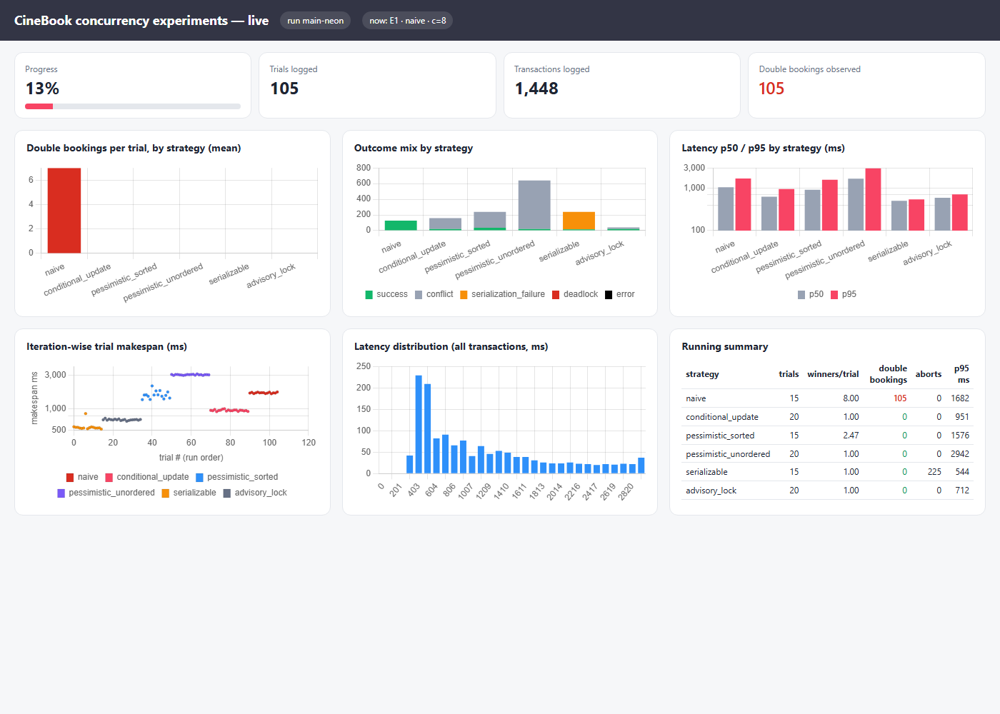<figcaption>Fig. 8. Real-time experiment dashboard captured during the main run (13% complete): progress, double bookings per strategy, outcome mix, latency percentiles, iteration-wise trial makespan and latency distribution.</figcaption></figure>

## 5. Results

*A. Correctness under Contention (RQ1).* The baseline double-booked in every contended trial: 60 of 60 (Wilson 95% CI 94.0–100%). Every client won the seat—mean winners per trial were 2, 8 and 32—producing 780 double bookings in E1 and 571 in E2. The other six strategies produced zero double bookings across 75 trials and 1080 transactions each (advisory lock: 60 trials, 840 transactions), a per-trial upper bound of 4% (5%) at 95% confidence. Against the conditional UPDATE the difference is decisive (Fisher's exact p = 2.1×10⁻³⁵). H1 and H2 are supported (Fig. 1).

<figure>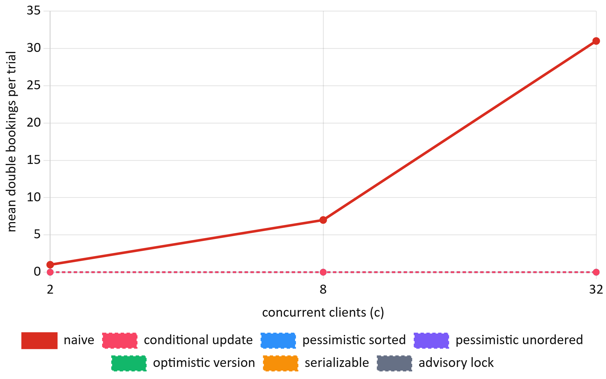<figcaption>Fig. 1. Mean double bookings per trial versus concurrent clients (E1). The six non-baseline strategies overlap at zero; the baseline grows as c − 1.</figcaption></figure>

The cost of correctness grows with contention because losers must wait for the winner's lock (Fig. 2). At c = 32 the conditional UPDATE, optimistic and pessimistic strategies cluster at a p95 of 2.9–3.0 s, while the advisory lock (5.7 s) and the baseline (5.6 s) are slowest. SERIALIZABLE stays near 0.5 s only because it aborts losers immediately, with abort rates of 50%, 88% and 97% at c = 2, 8 and 32; each loser receives an error that the application must handle or retry.

<figure><figcaption>Fig. 2. 95th-percentile transaction latency under contention (E1), by strategy and concurrency (log scale).</figcaption></figure>

*B. Overlapping Multi-Seat Requests (RQ3).* With 16 clients each requesting 3 of 10 seats (Fig. 3), unordered locking deadlocked on 93 of 240 requests (38.8%), confirmed by 101 deadlocks in PostgreSQL's own statistics (including the warm-up trial), and its p95 latency rose to 5.4 s. SERIALIZABLE sold only 3.0 seats per trial versus 6.8–7.4 for the other correct strategies, aborting 93.8% of requests even when a non-overlapping allocation existed. The conditional UPDATE, sorted locking and optimistic validation behaved alike, with no deadlocks. The baseline "sold" 9.9 of 10 seats per trial but with 38 double bookings per trial.

<figure>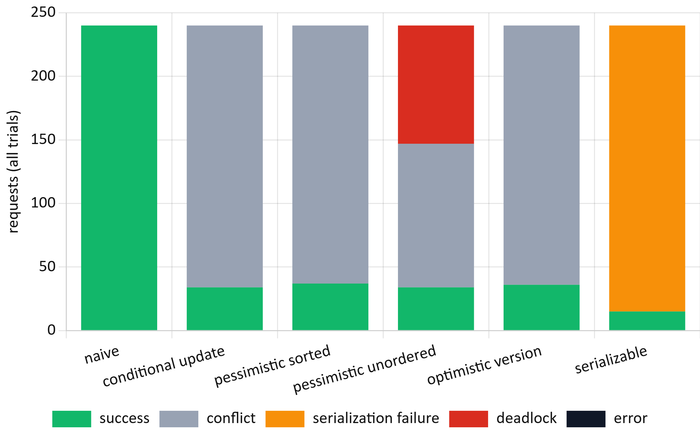<figcaption>Fig. 3. Outcome of every request with overlapping three-seat requests (E2, c = 16).</figcaption></figure>

*C. Cost without Collisions (RQ2).* When clients never collide, the cost is overhead, dominated here by network round trips. The strategies differed significantly (Kruskal–Wallis H = 1936, df = 5, p < 10⁻³⁰⁰ at c = 16; H = 154, p < 10⁻³⁰ at c = 1). The conditional UPDATE was fastest, with a median of 344 ms [342, 347] at c = 16 versus 435–445 ms for the baseline, sorted locking, optimistic validation and SERIALIZABLE (Fig. 4). All pairwise differences were significant after Holm correction (largest adjusted p = 4.4×10⁻⁷, baseline versus conditional at c = 1), with large effects (Cliff's δ = 0.76–1.00; 0.96–1.00 at c = 16).

<figure>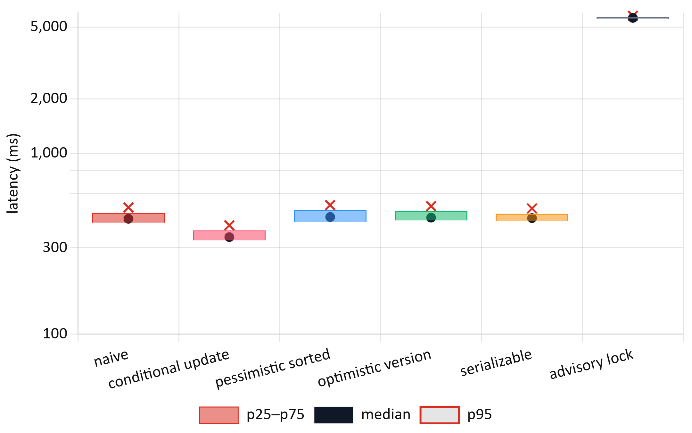<figcaption>Fig. 4. Latency without collisions (E3, c = 16). Box: interquartile range; dot: median; cross: 95th percentile (log scale).</figcaption></figure>

The conditional UPDATE also delivered the highest throughput, 38.3 holds/s [36.8, 39.8]—23% above sorted locking (31.1) and 26% above optimistic validation (30.5) (Fig. 5). The advisory lock serializes the whole show and fell to 2.8 holds/s, 13.5 times lower. SERIALIZABLE aborted 24 of 480 (5.0%) non-conflicting transactions, false positives of SSI's coarse conflict tracking. H3 is supported. The mechanism is simple: the conditional UPDATE decides and writes in one statement, whereas read-then-write strategies need an extra round trip per hold.

<figure>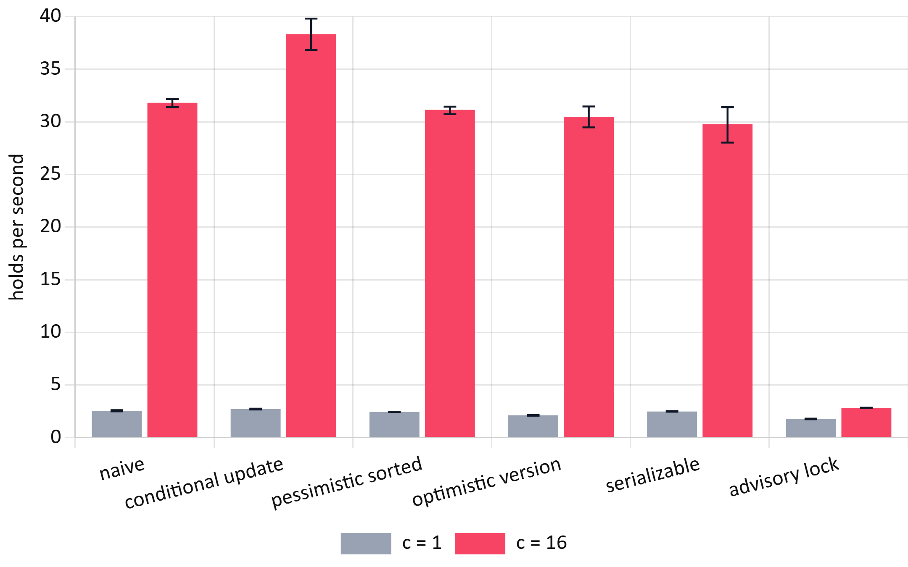<figcaption>Fig. 5. Throughput in successful holds per second with 95% bootstrap confidence intervals (E3).</figcaption></figure>

*D. The Deployed System (RQ4).* In 12 trials, 16 real user accounts raced through the public API for one seat; all 12 trials had exactly one winner (192 requests, no errors, no double bookings). Losers received HTTP 409, and every seat returned to *available* after release. Hold latency was 146 ms at the median and 352 ms at the 95th percentile. In 6 trials of five simultaneous payment submissions sharing one idempotency key, each produced exactly one HTTP 200, four HTTP 409 responses and one payment record; later retries were recognized as replays in 6 of 6 cases, with no double charges. Latency was measured end to end from the client (Table IV, Fig. 6); a static file served by the CDN gives the network baseline (median 33 ms).

TABLE IV Live Read Latency (117 Warm Samples per Endpoint)

| Endpoint | p50 (ms) | p95 (ms) [95% CI] | < 200 ms | Target met |
|---|---|---|---|---|
| health | 118 | 150 [140, 153] | 98.3% | yes |
| movies | 38 | 60 [52, 84] | 99.1% | yes |
| showtimes | 124 | 146 [138, 175] | 99.1% | yes |
| seats | 123 | 200 [144, 417] | 94.9% | not shown |

H4 is partially supported. Three endpoints meet p95 < 200 ms with their whole interval below the target. The seat map's p95 lies on the boundary and its interval reaches 417 ms, driven by occasional responses of up to 1.8 s.

<figure><figcaption>Fig. 6. Cumulative distribution of live end-to-end latency (E4a); the dashed line marks the 200 ms target.</figcaption></figure>

*E. Platform Effect (RQ5).* Running the identical baseline code with 8 clients on the embedded PGlite database used for local development produced 0 of 15 trials with double bookings, versus 20 of 20 on Neon (Fisher's exact p = 3.1×10⁻¹⁰; Fig. 7). PGlite executes one transaction at a time, so the race window never opens. H5 is supported: a test suite that passes on an embedded database demonstrates logic, not concurrency safety.

<figure><figcaption>Fig. 7. Share of trials with at least one double booking on networked PostgreSQL and embedded PGlite (c = 8). PGlite values are zero for all strategies.</figcaption></figure>

*F. Web Performance and Accessibility versus Competitors (RQ6).* Table V and Figs. 9–10 compare the five public pages.

Largest Contentful Paint did not differ detectably between the three home pages (Kruskal–Wallis H = 1.52, df = 2, p = 0.47). All pages were well inside the 2.5 s "good" threshold [22]. CineBook's seat map was the fastest page at 473 ± 97 ms.

Page weight did differ (H = 12.6, p = 0.0018). The CineBook home page transferred 695 KB, against 3 594 KB for BookMyShow and 2 933 KB for District (Holm-adjusted p = 0.032 for both comparisons, Cliff's δ = −1). The competitors also loaded 25–30 times more JavaScript and contacted 17–26 third-party hosts, against 3. The number of requests followed the same pattern (H = 9.96, p = 0.0069).

The comparison is of pages, not of products: CineBook's catalogue is 12 films in four cities, whereas the competitors serve whole regions and carry advertising and analytics.

TABLE V Public-Page Performance, Mean of 5 Cold Loads (E6)

| Page | LCP (ms), mean ± SD | FCP (ms) | TTFB (ms) | Transfer (KB) | JS (KB) | Requests | 3rd-party hosts |
|---|---|---|---|---|---|---|---|
| CineBook home | 981 ± 220 | 477 | 194 | 695 | 120 | 29 | 3 |
| CineBook movie | 1038 ± 263 | 486 | 129 | 339 | 119 | 20 | 3 |
| CineBook seat map | 473 ± 97 | 473 | 150 | 212 | 123 | 14 | 2 |
| BookMyShow home | 1153 ± 513 | 333 | 286 | 3594 ± 141 | 3062 | 88 | 26 |
| District movies | 1090 ± 128 | 634 | 305 | 2933 | 1644 | 84 | 17 |

<figure>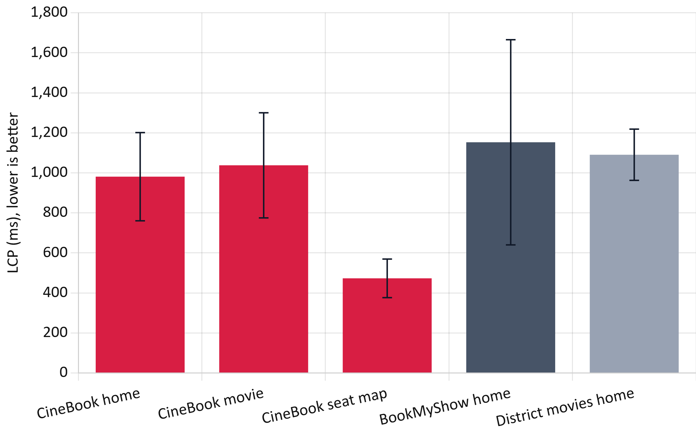<figcaption>Fig. 9. Largest Contentful Paint per page, mean ± SD of five cold loads (E6).</figcaption></figure>

<figure>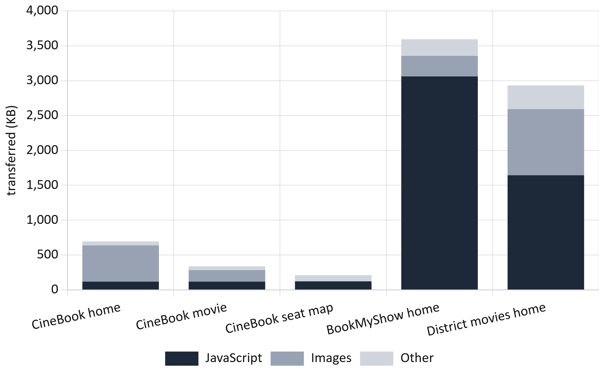<figcaption>Fig. 10. Bytes transferred per page by resource type (E6).</figcaption></figure>

The axe-core audit (Table VI, Fig. 11) counted affected elements, not rules:
- **CineBook before fixes:** 8 serious colour-contrast violations across its three pages. The brand pink (#F84464) gave only 3.5:1 under white button text.
- **BookMyShow home page:** 133 affected elements, 126 of them contrast failures.
- **District:** 52, of which 38 were critical: form fields without labels and elements whose ARIA attributes did not fit their role.

Both competitors also disable pinch-zoom in their viewport settings. No page overflowed horizontally at 360, 768 or 1440 px.

CineBook's colours were then darkened to meet 4.5:1, and the audit was repeated: all three pages had zero violations. LCP after the change was 921, 1076 and 494 ms, unchanged within noise.

TABLE VI WCAG 2.2 A/AA Violations Found by axe-core (Affected Elements)

| Page | Rules | Critical | Serious | Moderate | Main rules violated |
|---|---|---|---|---|---|
| CineBook, 3 pages, before | 1 | 0 | 8 | 0 | colour contrast |
| CineBook, 3 pages, after | 0 | 0 | 0 | 0 | — |
| BookMyShow home | 3 | 0 | 132 | 1 | contrast (126), link name (6), zoom disabled |
| District movies | 8 | 38 | 13 | 1 | missing labels (28), ARIA misuse (16), zoom disabled |

<figure>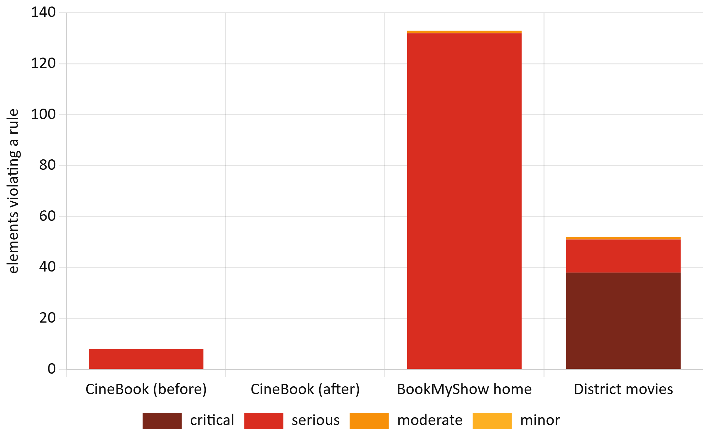<figcaption>Fig. 11. Elements violating WCAG 2.2 A/AA rules, by impact (E6).</figcaption></figure>

*G. Booking Funnel and Keyboard Access (RQ7).* A complete booking runs from sign-in to the ticket, through home, film, showtimes, seat map, booking summary and payment. Mouse or touch users needed (Table VII):
- 8 screens and 2 dialogs (city and seat count);
- 17 clicks or taps and 77 keystrokes, of which 34 were card details.

The system itself took 4.52 ± 0.32 s on desktop and 4.73 ± 0.26 s on a mobile profile (Mann–Whitney p = 0.60); this includes a 1.5 s simulated bank delay. KLM predicts 71.4 s for an expert user, 49.8 s of which comes after sign-in and 28.6 s of which is checkout. Typing is therefore the largest single cost. The fee and tax breakdown was visible before payment in 10 of 10 runs.

Competitor funnels could not be measured within the ethical limits above, so their columns are left to the human protocol rather than estimated.

TABLE VII Booking Funnel, Sign-in to Ticket (E7, 5 Runs per Device)

| Measure | Desktop | Mobile (Pixel 7) |
|---|---|---|
| Screens / dialogs | 8 / 2 | 8 / 2 |
| Clicks or taps / keystrokes | 17 / 77 | 17 / 77 |
| System time (s), mean ± SD [95% CI] | 4.52 ± 0.32 [4.12, 4.91] | 4.73 ± 0.26 [4.40, 5.05] |
| KLM expert time (s): total / after sign-in / checkout | 71.4 / 49.8 / 28.6 | 71.4 / 49.8 / 28.6 |
| Fee and tax shown before payment | 5 of 5 | 5 of 5 |
| BookMyShow, District | not measured (checkout not automatable; protocol provided) | — |

The keyboard-only test exposed three defects that automated scanning had not found (Table VIII):
1. **A keyboard trap.** The notification library returned focus to the previously focused element whenever focus left a toast. With a toast on screen, the Tab key therefore cycled between the last link and the toast indefinitely (WCAG 2.1.2).
2. **Lost focus after navigation.** After client-side navigation, focus stayed where the old page's element had been (WCAG 2.4.3).
3. **An unreachable Pay button.** Every seat was a separate Tab stop, so reaching the Pay button took more than 400 key presses.

The fixes, all verified by the end-to-end tests, were:
- toasts were removed from the Tab order (they remain announced to screen readers);
- focus now moves to the main region on navigation, with a skip link;
- the seat map became a single Tab stop with arrow-key movement [25].

After the fixes, 3 of 3 keyboard-only bookings succeeded, with 90–116 Tab presses (mean 100), 4 of them inside the seat map. No focus stop lacked a visible focus indicator.

TABLE VIII Keyboard-Only Booking Before and After the Fixes (E7, 3 Runs Each)

| Version | Completed | Tab presses | Where it failed |
|---|---|---|---|
| Original | 0 of 3 | 450–474, then trapped | trapped by toast on film page |
| Toast trap fixed | 0 of 3 | 483–610 | seat grid (one Tab stop per seat) |
| All fixes | 3 of 3 | 90–116 (seat map: 4) | — |

*H. Scalability (RQ8).* Across 24 randomized cells, the deployed system answered all 13 860 requests successfully. That is 0 errors, with a 95% upper bound of 0.03% (Table IX).

Latency stayed flat up to 50 users: the median was 125–167 ms and the p95 150–230 ms. It rose beyond that (Fig. 12). At 500 simultaneous users the p95 was 1.72 s for reads and 1.80 s for writes. Latency increased monotonically with load (Spearman ρ = 0.84 for reads, p = 0.0006; ρ = 0.97 for writes, p = 1.4×10⁻⁷, over the per-repeat p95 values). Throughput grew sub-linearly, from 65 to 466 requests/s for reads and from 68 to 371 holds or releases/s for writes (Fig. 13). Variation between repeats grew at higher load.

Every write touched a distinct seat. The database invariants (below) found no seat in an inconsistent state after the run.

TABLE IX Scalability on the Live Deployment (E8, 3 Repeats per Cell)

| Workload | Users | Requests | Errors | p50 (ms) | p95 (ms) | p99 (ms) | Throughput (req/s), mean ± SD |
|---|---|---|---|---|---|---|---|
| read | 10 | 150 | 0 | 125 | 211 | 251 | 65 ± 10 |
| read | 50 | 750 | 0 | 128 | 203 | 236 | 299 ± 34 |
| read | 100 | 1500 | 0 | 164 | 349 | 1024 | 364 ± 91 |
| read | 500 | 7500 | 0 | 309 | 1716 | 2702 | 466 ± 171 |
| write | 10 | 60 | 0 | 126 | 150 | 182 | 68 ± 4 |
| write | 50 | 300 | 0 | 167 | 230 | 242 | 219 ± 22 |
| write | 100 | 600 | 0 | 175 | 458 | 518 | 275 ± 102 |
| write | 500 | 3000 | 0 | 428 | 1805 | 1924 | 371 ± 167 |

<figure>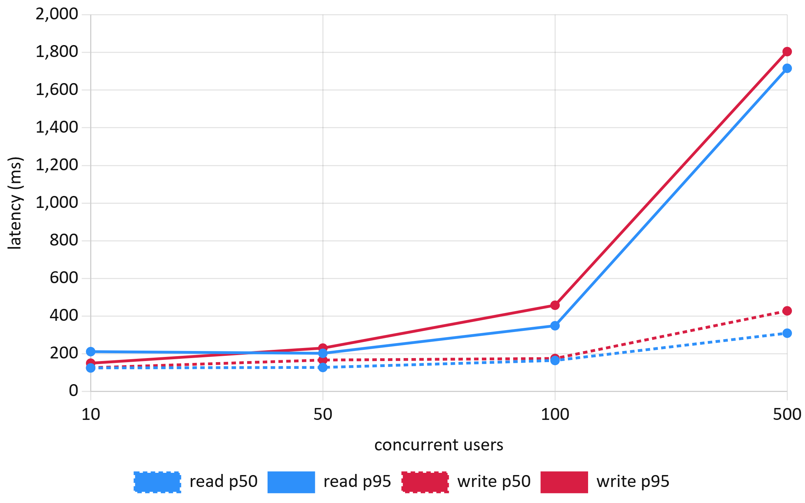<figcaption>Fig. 12. Median (dashed) and 95th-percentile (solid) latency versus concurrent users (E8).</figcaption></figure>

<figure>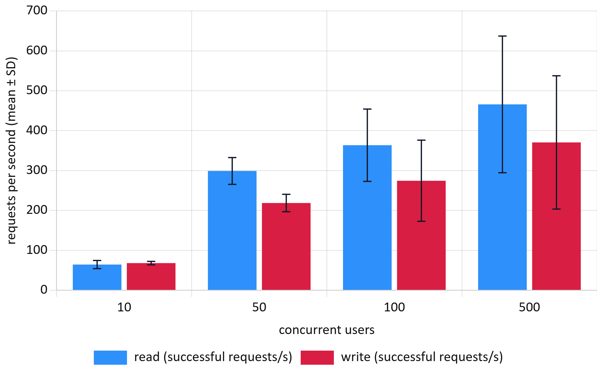<figcaption>Fig. 13. Throughput versus concurrent users, mean ± SD of three repeats (E8).</figcaption></figure>

*I. Seat-Lock and Transaction Reliability (RQ9).* All 48 failure-injection trials passed (Wilson 95% CI 92.6–100%; Table X). The scenarios behaved as follows:
- **Declined card:** marked the payment failed and released the seat within one request.
- **Bank time-out:** the client gave up after 8 s. A retry with the same idempotency key 0.31 ± 0.06 s later returned the original successful result as a replay. Exactly one charge was recorded.
- **Dropped connection at 300 ms:** retries saw "payment in progress" twice and then the single successful result, 1.56 ± 0.06 s after the drop.
- **Hold expiring during payment:** refunded automatically and released the seat. All 8 trials ended with 0 charges and 1 refund.
- **Expired hold:** another user could claim the seat at once (156 ms). The original holder's late payment was refused with HTTP 410.
- **Overlapping three-seat request:** rejected as a whole, leaving the two free seats untouched.

Database-wide invariant queries after E8 and E9 found:
- 0 sold seats without a confirmed booking;
- 0 bookings with more than one successful payment;
- 0 confirmed bookings whose seat count disagreed with their sold seats;
- 0 holds without an owner.

TABLE X Failure-Injection Results on the Live Deployment (E9, 8 Trials per Scenario)

| Scenario | Passed | Charges | Refunds | Latency (ms), mean ± SD | Final state |
|---|---|---|---|---|---|
| Declined card | 8/8 | 0 | 0 | 1640 ± 7 | booking failed, seat free |
| Bank time-out, client abort at 8 s, retry | 8/8 | 8 (1 each) | 0 | recovery 306 ± 63 | confirmed, seat sold |
| Connection dropped at 300 ms, retry | 8/8 | 8 (1 each) | 0 | recovery 1561 ± 56 | confirmed, seat sold |
| Hold expires during payment | 8/8 | 0 | 8 | 1639 ± 15 (HTTP 410) | expired, seat free |
| Expired hold reclaimed by another user | 8/8 | 0 | 0 | 156 ± 50 | new holder owns seat |
| Multi-seat hold with one seat taken | 8/8 | 0 | 0 | 135 ± 34 (HTTP 409) | other seats untouched |

*J. Database Optimisation (RQ10).* On a synthetic table of one million show-seat rows (Table XI, Fig. 14), each index or layout change was tested against its baseline. All differences were significant after Holm correction (p ≤ 2×10⁻⁹, except where noted below).
- **Seat-map read:** the composite primary key (showtime, seat) turned a 52.5 ms parallel sequential scan into a 0.34 ms index scan, 155× faster.
- **Conditional-UPDATE hold:** became 456× faster (52.9 to 0.12 ms).
- **"My bookings":** an index on user cut the query from 14.3 to 0.074 ms; the composite (user, date) index removed the sort (0.068 ms).
- **Expiry sweep:** this releases about 7 600 seats, so writing dominates its cost. Indexes helped only 1.7–1.9×. However, a partial index on held seats was 20 times smaller than a full index (0.34 versus 6.86 MB) and no slower.
- **Denormalization:** copying seat layout into each show-seat row made the seat map 8.1× faster (0.82 versus 6.64 ms). It cost 20% more storage (129 versus 108 MB), and a price change became 266× slower, because one tier update had to touch every future show seat.
- **Index maintenance:** four secondary indexes made bulk seat creation 2.5× slower (56.7 versus 22.7 ms per 10 000 rows). The partial index added nothing measurable.
- **Isolation level:** this did not change the cost of an uncontended hold (248, 249 and 246 ms; Holm p = 1).

CineBook's production schema already uses the winning variants: the composite key, the partial expiry index and the composite booking index.

TABLE XI Server-Side Execution Time per Variant, 30 Runs (E10)

| Query | Variant | Mean ± SD (ms) | Median (ms) | Speed-up | Plan |
|---|---|---|---|---|---|
| seat map | no index | 53.9 ± 3.8 | 52.49 | 1 | parallel seq. scan |
| seat map | primary key | 0.342 ± 0.021 | 0.339 | 155× | index scan |
| hold, 2 seats | no index | 53.6 ± 2.3 | 52.92 | 1 | seq. scan |
| hold, 2 seats | primary key | 0.116 ± 0.013 | 0.116 | 456× | index scan |
| expiry sweep | no index | 97.5 ± 8.7 | 93.97 | 1 | seq. scan |
| expiry sweep | full index (6.86 MB) | 57.9 ± 9.3 | 54.46 | 1.7× | index scan |
| expiry sweep | partial index (0.34 MB) | 56.2 ± 19.7 | 49.54 | 1.9× | index scan |
| my bookings | no index | 16.0 ± 6.1 | 14.32 | 1 | seq. scan + sort |
| my bookings | (user) | 0.074 ± 0.010 | 0.074 | 194× | index scan + sort |
| my bookings | (user, date) | 0.069 ± 0.006 | 0.068 | 211× | index scan |
| seat map + layout | normalized, 3-table join | 6.69 ± 0.17 | 6.64 | 1 | hash joins |
| seat map + layout | denormalized | 0.813 ± 0.075 | 0.822 | 8.1× | index scan |
| tier price change | normalized | 0.127 ± 0.014 | 0.124 | 1 | 3 rows |
| tier price change | denormalized | 39.0 ± 28.4 | 32.94 | 0.004× | thousands of rows |

<figure>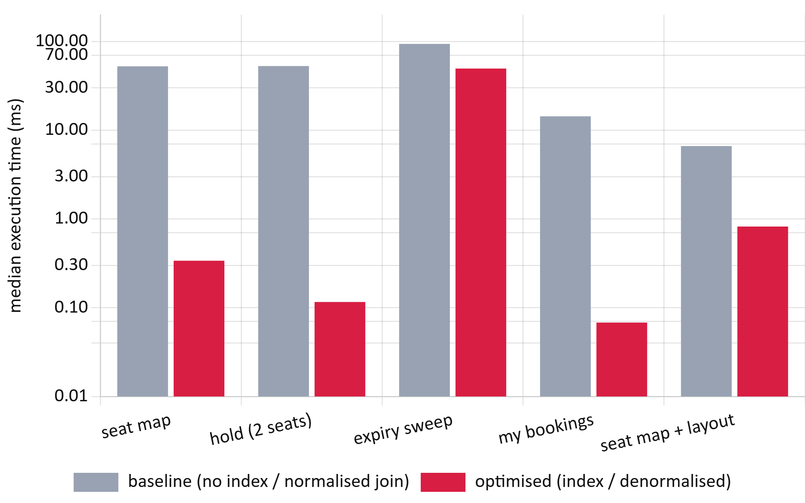<figcaption>Fig. 14. Median server-side execution time before and after optimisation on one million seat rows (E10, log scale).</figcaption></figure>

*K. Security (RQ11).* All 46 checks passed (Table XII). The checks covered:
- **Object-level access:** users could not read, pay for, cancel or release another user's booking or hold.
- **Token attacks:** edited claims, alg = none, a wrong key and expired tokens were all rejected.
- **Refresh tokens:** these rotate on each use. A replay after the 10 s multi-tab grace window revoked the whole token family.
- **Login:** brute force was limited after five failures, and unknown e-mails and wrong passwords produced identical replies.
- **Mass assignment:** role and e-mail fields in sign-up and profile requests were ignored.
- **Limits:** oversized bodies, pages and holds were refused.
- **Admin functions:** customers could not call them.
- **Injection:** SQL injection and stored-script payloads had no effect.
- **Headers:** the live site sent HSTS, a Content-Security-Policy, nosniff and frame protection, with no server banner and no reflected CORS origin.
- **Card data:** the live database stores only the last four card digits and has no CVV or card-number column.

QR tickets now carry an HMAC signature and are admitted once, atomically. The two pre-fix designs, a bare booking code and a forged signature, are both rejected. One documented trade-off remains: after logout, a stateless access token still works on read-only routes until it expires (at most 15 min). Payment and cancellation routes re-check the session and refused it.

TABLE XII Security Checks by OWASP API Security Top 10 (2023) Category (E11)

| Category | Checks | Passed | Examples |
|---|---|---|---|
| API1 Broken object-level authorization | 5 | 5 | another user's booking, payment, hold |
| API2 Broken authentication | 14 | 14 | tampered or unsigned JWT, refresh reuse, brute force |
| API3 Broken property-level authorization | 4 | 4 | role mass-assignment, hash or card exposure |
| API4 Unrestricted resource consumption | 3 | 3 | 150 KB body, page size, 11-seat hold |
| API5 Broken function-level authorization | 3 | 3 | customer calling admin endpoints |
| API6 Sensitive business flows (tickets) | 4 | 4 | forged or replayed QR ticket |
| API8 Security misconfiguration | 7 | 7 | HSTS, CSP, CORS, error leakage |
| Injection and data at rest | 6 | 6 | SQL injection, stored XSS, stored card data |

*L. Personalised Discovery (RQ12).* This result comes from a simulation, so it estimates potential benefit, not observed behaviour. Ranking films by language match and genre "likes" placed the persona's preferred film in the first three positions for 89.2% of personas, against 32.5% for the current release-date order (Table XIII, Fig. 15). It also reduced the scrolling needed on a two-column phone grid from 2.1 to 0.3 rows.

A plain language filter, which CineBook could add at once, recovered most of the gain (HR@3 71.7%). Popularity ranking helped little (42.0%). Paired Wilcoxon tests on reciprocal rank favoured the content-based policy over every baseline at every noise level (all Holm p < 10⁻¹⁵). The effects were large against default order and popularity (r = 0.62–0.78) and moderate against the language filter (r = 0.31–0.60).

The advantage shrank as preferences became noisier: MRR was 0.80, 0.72 and 0.62 at the three noise levels. The scoring rule shares its structure with the simulated preferences, so these figures are an upper bound until real interaction data are available.

TABLE XIII Discovery Quality by Ranking Policy, 2 000 Personas, Noise 0.5 (E12), Mean [95% CI]

| Policy | HR@3 | MRR | NDCG@5 | Rows scrolled |
|---|---|---|---|---|
| Default (release date) | 0.325 [0.304, 0.345] | 0.281 [0.270, 0.291] | 0.342 [0.332, 0.352] | 2.12 |
| Popularity | 0.420 [0.399, 0.442] | 0.366 [0.352, 0.379] | 0.426 [0.414, 0.439] | 1.78 |
| Language filter | 0.717 [0.697, 0.736] | 0.545 [0.531, 0.560] | 0.716 [0.707, 0.726] | 0.73 |
| Content-based | 0.892 [0.879, 0.906] | 0.716 [0.702, 0.729] | 0.838 [0.830, 0.846] | 0.29 |

<figure>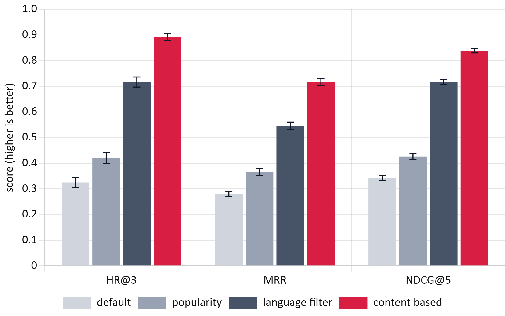<figcaption>Fig. 15. Hit rate at 3, mean reciprocal rank and NDCG at 5 for each ranking policy, with 95% confidence intervals (E12, simulation).</figcaption></figure>

## 6. Architecture and Trade-offs

CineBook has three parts:
- a React single-page application served from a CDN;
- an Express API running as serverless functions in Singapore;
- a pooled serverless PostgreSQL database (Neon).

All correctness-critical decisions are taken inside the database. Table XIV sets each architectural choice against its main alternative, the evidence gathered in this study and the cost that the choice accepts.

TABLE XIV Architectural Decisions, Alternatives and Measured Trade-offs

| Concern | CineBook choice | Alternative | Evidence | Cost accepted |
|---|---|---|---|---|
| Seat ownership | one conditional UPDATE in PostgreSQL | row locks, SERIALIZABLE, Redis lock | 0 double bookings; 344 ms; +23% throughput (E1–E3) | every hold needs a database round trip |
| Hold expiry | expired holds reclaimed inline; periodic sweep | timer-only release | reclaim 8/8 in 156 ms (E9); partial index 0.34 MB (E10) | expired rows stay until touched |
| Compute | serverless functions | always-on server | 0 errors up to 500 users (E8) | p95 1.7–1.8 s at 500 users; cold starts |
| Database | pooled serverless PostgreSQL | embedded or self-hosted database | embedded DB hides races (E5) | ~100 ms network round trip per statement |
| Payments | idempotency key + one live payment per booking | disable button on client | 0 double charges in 30 submits and 16 failure retries (E4, E9) | clients must keep and resend the key |
| Sessions | 15-min JWT + session check on money routes | server session on every request | 46/46 checks (E11) | read routes usable ≤ 15 min after logout |
| Tickets | HMAC-signed QR, atomic one-time check-in | look up plain booking code | forged and replayed tickets rejected (E11) | secret rotation invalidates old tickets |
| Data model | normalized layout + per-show seat state | denormalized seat map | reads 8.1× slower than denormalized but 6.6 ms (E10) | one extra join on the seat map |
| Front end | client-rendered SPA, small bundle | server-rendered pages | 5–17× lighter than competitors (E6) | needs explicit focus management (E7) |

Two trade-offs deserve emphasis. First, the serverless deployment absorbed a 50-fold increase in load without errors, but its tail latency at 500 users was about eight times that at 50. A flash sale would need a virtual waiting room, or regional database replicas for reads. Second, normalization keeps price changes cheap and storage small. Denormalizing the seat map would save only about 6 ms per request on the server, which is small next to the measured network latency, so the normalized design remains the better default.

## 7. Discussion

*A. Findings.* The main findings are:
- **Correctness.** Read-check-write in application code is not an edge-case risk: under simultaneous demand it oversold in every trial, and the damage scaled with the number of buyers. Every database-enforced strategy was correct, so the choice among them concerns cost and failure behaviour.
- **The best strategy.** For seat reservation on a high-latency serverless stack, the conditional UPDATE dominated: correct, fastest, highest throughput, with no deadlocks and no false aborts. Unordered locking added deadlocks, SERIALIZABLE added aborts that reduced seats sold, and a coarse lock destroyed throughput.
- **Integrity in the deployed system.** It preserved seat and payment integrity under real concurrent traffic, under failure injection and at 500 simultaneous users, and it resisted every tested attack class.
- **Quality versus large incumbents.** A small, carefully built system can match them on loading speed with a fraction of the page weight and far fewer accessibility violations.
- **Where defects hide.** Some of the most user-relevant defects were invisible to unit tests, end-to-end tests and automated accessibility scanning alike. They appeared only when the booking was actually operated with a keyboard, just as the double-booking defect appeared only on a truly concurrent database.

*B. Threats to Validity.*
- **Single load source.** All load came from one machine in India. Absolute latencies include a wide-area round trip of about 100 ms, so relative differences generalize better than absolute values. In E8 the single load generator may itself limit the request rate at 500 users. The tail-latency growth therefore marks an upper bound for one client site, not a server capacity limit.
- **Database setup.** A single Neon compute size and a connection pooler were used.
- **No retries.** Strategies were implemented without automatic retries; with retries, SERIALIZABLE and optimistic control would sell more seats at higher latency.
- **Concurrency range.** E1–E3 used at most 32 clients, whereas flash sales are far larger and normally shaped by virtual queues.
- **Sample sizes.** Live samples were small: 12 races, 6 payment trials, 8 trials per failure scenario and 3 repeats per scalability cell. They are reported with intervals.
- **Competitor comparison.** This covers public landing pages only, measured five times from one location on one day.
- **Usability.** The usability figures are system timings and KLM predictions, not observations of people, and no SUS data were collected.
- **Discovery.** The recommendation result is a simulation with assumed audience shares and preference structure.
- **Database data.** The E10 data set is synthetic, although sized like a busy city.
- **Security.** The security suite is a targeted test, not a penetration test.

*C. Practical Impact.* For booking and inventory systems, the evidence supports four rules:
1. Let one conditional statement in the database decide ownership.
2. Make every payment request idempotent.
3. Index exactly the hot predicates, using partial indexes for sparse states.
4. Test against a real concurrent database and with a keyboard.

For CineBook, the core requirement is now supported by measurement. Three accessibility defects were removed. The open items are tail latency above 100 users and the seat-map endpoint's 95th percentile. A language filter on the home page is the cheapest discovery improvement.

## 8. Conclusion and Future Work

This study compared seven concurrency-control strategies for seat reservation under controlled, repeated experiments. It then evaluated the deployed system across web performance, accessibility, usability, scalability, reliability, database design, security and discovery. The naive baseline failed in every contended trial, while database-enforced strategies were uniformly correct. Among them, the single conditional UPDATE offered the best latency and throughput without deadlocks or false aborts.

The deployed system:
- served 13 860 requests at up to 500 simultaneous users without an error;
- survived 48 injected failures with no double charge;
- passed 46 security checks;
- loaded as fast as BookMyShow and District with 5–17 times fewer bytes.

The evaluation also found and fixed a keyboard trap, an unreachable seat grid and contrast failures. The results show that embedded test databases can conceal concurrency defects.

Future work will:
- repeat the load tests from several regions behind a virtual queue;
- add retry policies to measure goodput;
- run the provided SUS and competitor-funnel protocol with 8–12 participants;
- deploy the language filter and an A/B test of content-based ranking on real interactions;
- optimize the seat-map query to bring its 95th percentile below 200 ms.

All code, the experimental designs, raw logs, analysis outputs and figure scripts are available in the project repository to support independent replication.

## Appendix: Detailed Results

Tables XV–XVII report every configuration of the database experiments, generated directly from the analysis outputs in the repository:
- DB denotes double bookings.
- Abort rate counts deadlock and serialization failures over all transactions.
- Intervals are 95% percentile-bootstrap intervals.
- Holm p is the Holm-adjusted Mann–Whitney p-value against the conditional UPDATE at the same concurrency.

Per-request data for E6–E12 are in data/processed.

TABLE XV Hot-Seat Results per Configuration (E1, 20 Trials per Row)

| Strategy | c | Trials w/ DB | DB total | Abort rate | p50 (ms) | p95 (ms) [95% CI] |
|---|---|---|---|---|---|---|
| naive | 2 | 20/20 | 20 | 0.0% | 651 | 724 [703, 972] |
| naive | 8 | 20/20 | 140 | 0.0% | 1016 | 1680 [1642, 1697] |
| naive | 32 | 20/20 | 620 | 0.0% | 3111 | 5608 [5493, 5697] |
| cond. UPDATE | 2 | 0/20 | 0 | 0.0% | 382 | 440 [433, 450] |
| cond. UPDATE | 8 | 0/20 | 0 | 0.0% | 629 | 951 [935, 961] |
| cond. UPDATE | 32 | 0/20 | 0 | 0.0% | 1594 | 2874 [2791, 2918] |
| pess. sorted | 2 | 0/20 | 0 | 0.0% | 449 | 496 [478, 527] |
| pess. sorted | 8 | 0/20 | 0 | 0.0% | 703 | 995 [969, 1020] |
| pess. sorted | 32 | 0/20 | 0 | 0.0% | 1677 | 2956 [2903, 3005] |
| pess. unordered | 2 | 0/20 | 0 | 0.0% | 449 | 504 [490, 526] |
| pess. unordered | 8 | 0/20 | 0 | 0.0% | 726 | 1037 [1018, 1045] |
| pess. unordered | 32 | 0/20 | 0 | 0.0% | 1680 | 2942 [2886, 2985] |
| optimistic | 2 | 0/20 | 0 | 0.0% | 442 | 511 [507, 520] |
| optimistic | 8 | 0/20 | 0 | 0.0% | 659 | 986 [960, 1006] |
| optimistic | 32 | 0/20 | 0 | 0.0% | 1665 | 2979 [2895, 3006] |
| serializable | 2 | 0/20 | 0 | 50.0% | 512 | 577 [567, 590] |
| serializable | 8 | 0/20 | 0 | 87.5% | 493 | 525 [517, 530] |
| serializable | 32 | 0/20 | 0 | 96.9% | 482 | 533 [527, 539] |
| advisory | 2 | 0/20 | 0 | 0.0% | 596 | 712 [704, 734] |
| advisory | 8 | 0/20 | 0 | 0.0% | 1089 | 1772 [1725, 1806] |
| advisory | 32 | 0/20 | 0 | 0.0% | 3032 | 5697 [5566, 5794] |

TABLE XVI Overlapping Multi-Seat Requests (E2, c = 16, 15 Trials, 240 Requests)

| Strategy | Success | Conflict | Deadlock | Ser. fail. | Seats sold / trial | DB total | p95 (ms) |
|---|---|---|---|---|---|---|---|
| naive | 240 | 0 | 0 | 0 | 9.9 | 571 | 2432 |
| cond. UPDATE | 34 | 206 | 0 | 0 | 6.8 | 0 | 1334 |
| pess. sorted | 37 | 203 | 0 | 0 | 7.4 | 0 | 1576 |
| pess. unordered | 34 | 113 | 93 | 0 | 6.8 | 0 | 5432 |
| optimistic | 36 | 204 | 0 | 0 | 7.2 | 0 | 1462 |
| serializable | 15 | 0 | 0 | 225 | 3.0 | 0 | 544 |

TABLE XVII Low-Contention Latency, Throughput and Pairwise Tests vs. Conditional UPDATE (E3)

| Strategy | c | n | Median (ms) [95% CI] | p95 (ms) | Throughput (holds/s) [95% CI] | Cliff's δ | Holm p |
|---|---|---|---|---|---|---|---|
| naive | 1 | 30 | 392 [386, 400] | 413 | 2.5 [2.5, 2.6] | 0.76 | 4.4e-7 |
| cond. UPDATE | 1 | 30 | 366 [361, 370] | 393 | 2.7 [2.7, 2.8] | — | ref. |
| pess. sorted | 1 | 30 | 410 [400, 412] | 435 | 2.4 [2.4, 2.5] | 0.98 | 2.4e-10 |
| optimistic | 1 | 30 | 474 [461, 480] | 508 | 2.1 [2.1, 2.1] | 1.00 | 1.5e-10 |
| serializable | 1 | 30 | 401 [397, 406] | 425 | 2.5 [2.5, 2.5] | 0.95 | 5.7e-10 |
| advisory | 1 | 30 | 565 [553, 575] | 598 | 1.8 [1.7, 1.8] | 1.00 | 1.5e-10 |
| naive | 16 | 480 | 435 [430, 440] | 502 | 31.8 [31.4, 32.2] | 0.96 | < 10⁻¹⁵ |
| cond. UPDATE | 16 | 480 | 344 [342, 347] | 400 | 38.3 [36.8, 39.8] | — | ref. |
| pess. sorted | 16 | 480 | 445 [438, 452] | 518 | 31.1 [30.7, 31.4] | 0.96 | < 10⁻¹⁵ |
| optimistic | 16 | 480 | 441 [438, 448] | 510 | 30.5 [29.5, 31.5] | 0.98 | < 10⁻¹⁵ |
| serializable | 16 | 456 | 439 [434, 442] | 496 | 29.8 [28.0, 31.4] | 0.97 | < 10⁻¹⁵ |
| advisory | 16 | 480 | 5614 [5605, 5619] | 5771 | 2.8 [2.8, 2.8] | 1.00 | < 10⁻¹⁵ |

## References

[1] H. Berenson, P. Bernstein, J. Gray, J. Melton, E. O'Neil, and P. O'Neil, "A critique of ANSI SQL isolation levels," in *Proc. ACM SIGMOD Int. Conf. Manage. Data*, 1995, pp. 1–10.

[2] P. Bailis, A. Fekete, M. J. Franklin, A. Ghodsi, J. M. Hellerstein, and I. Stoica, "Feral concurrency control: An empirical investigation of modern application integrity," in *Proc. ACM SIGMOD Int. Conf. Manage. Data*, 2015, doi: 10.1145/2723372.2737784.

[3] D. R. K. Ports and K. Grittner, "Serializable snapshot isolation in PostgreSQL," *Proc. VLDB Endow.*, vol. 5, no. 12, pp. 1850–1861, 2012, doi: 10.14778/2367502.2367523.

[4] T. Warszawski and P. Bailis, "ACIDRain: Concurrency-related attacks on database-backed web applications," in *Proc. ACM SIGMOD Int. Conf. Manage. Data*, 2017, doi: 10.1145/3035918.3064037.

[5] H. T. Kung and J. T. Robinson, "On optimistic methods for concurrency control," *ACM Trans. Database Syst.*, vol. 6, no. 2, pp. 213–226, Jun. 1981.

[6] PostgreSQL Global Development Group, "Transaction isolation," *PostgreSQL Documentation*, ch. 13.2. [Online]. Available: https://www.postgresql.org/docs/current/transaction-iso.html

[7] A. Georges, D. Buytaert, and L. Eeckhout, "Statistically rigorous Java performance evaluation," in *Proc. ACM OOPSLA*, 2007, pp. 57–76.

[8] T. Hoefler and R. Belli, "Scientific benchmarking of parallel computing systems: Twelve ways to tell the masses when reporting performance results," in *Proc. Int. Conf. High Perform. Comput., Netw., Storage Anal. (SC)*, 2015, doi: 10.1145/2807591.2807644.

[9] T. Mytkowicz, A. Diwan, M. Hauswirth, and P. F. Sweeney, "Producing wrong data without doing anything obviously wrong!," in *Proc. ASPLOS*, 2009, pp. 265–276.

[10] K. Kingsbury, "Jepsen: PostgreSQL 12.3," Jepsen, 2020. [Online]. Available: https://jepsen.io/analyses/postgresql-12.3

[11] M. Kleppmann, "How to do distributed locking," Feb. 8, 2016. [Online]. Available: https://martin.kleppmann.com/2016/02/08/how-to-do-distributed-locking.html

[12] J. Dean and L. A. Barroso, "The tail at scale," *Commun. ACM*, vol. 56, no. 2, pp. 74–80, 2013.

[13] L. Wang, M. Li, Y. Zhang, T. Ristenpart, and M. Swift, "Peeking behind the curtains of serverless platforms," in *Proc. USENIX Annu. Tech. Conf.*, 2018, pp. 133–146.

[14] L. D. Brown, T. T. Cai, and A. DasGupta, "Interval estimation for a binomial proportion," *Statist. Sci.*, vol. 16, no. 2, pp. 101–133, 2001.

[15] "Ticketmaster cancels public sale of Taylor Swift tour tickets," WSB-TV / Cox Media Group, Nov. 2022.

[16] "Coldplay India tour 2025: Band adds 3rd Mumbai show amid ticket chaos on BookMyShow," *Business Today*, Sep. 22, 2024.

[17] J. Brooke, "SUS: A 'quick and dirty' usability scale," in *Usability Evaluation in Industry*, P. W. Jordan, B. Thomas, B. A. Weerdmeester, and I. L. McClelland, Eds. London, U.K.: Taylor & Francis, 1996, pp. 189–194.

[18] A. Bangor, P. Kortum, and J. Miller, "Determining what individual SUS scores mean: Adding an adjective rating scale," *J. Usability Stud.*, vol. 4, no. 3, pp. 114–123, 2009.

[19] S. K. Card, T. P. Moran, and A. Newell, "The keystroke-level model for user performance time with interactive systems," *Commun. ACM*, vol. 23, no. 7, pp. 396–410, 1980.

[20] World Wide Web Consortium, "Web Content Accessibility Guidelines (WCAG) 2.2," W3C Recommendation, Oct. 5, 2023. [Online]. Available: https://www.w3.org/TR/WCAG22/

[21] Deque Systems, "axe-core: Accessibility engine for automated web UI testing." [Online]. Available: https://github.com/dequelabs/axe-core

[22] Google, "Largest Contentful Paint (LCP)," *web.dev*. [Online]. Available: https://web.dev/articles/lcp

[23] OWASP Foundation, "OWASP API Security Top 10 – 2023." [Online]. Available: https://owasp.org/API-Security/editions/2023/en/0x11-t10/

[24] K. Järvelin and J. Kekäläinen, "Cumulated gain-based evaluation of IR techniques," *ACM Trans. Inf. Syst.*, vol. 20, no. 4, pp. 422–446, 2002.

[25] World Wide Web Consortium, "Developing a keyboard interface," *ARIA Authoring Practices Guide*. [Online]. Available: https://www.w3.org/WAI/ARIA/apg/practices/keyboard-interface/

[26] F. Wilcoxon, "Individual comparisons by ranking methods," *Biometrics Bull.*, vol. 1, no. 6, pp. 80–83, 1945.

[27] M. J. Pazzani and D. Billsus, "Content-based recommendation systems," in *The Adaptive Web*, LNCS 4321. Berlin, Germany: Springer, 2007, pp. 325–341.

