% Comparative Benchmarking of Cinebook and Existing Online Movie Ticketing Platforms: A Study of Booking Efficiency, System Responsiveness, and Usability

::: cover
Research Report
CineBook: a web-based movie ticket booking system
November 2026
Source code, data and analysis workbook: github.com/Icoder05/cinebook
:::

::: abstract
Online movie-ticket platforms compete on how quickly and easily a customer can go from choosing a film to holding a ticket, and on whether the ticket they pay for is really theirs. I built CineBook, a working web-based ticketing system, and compared it with two established Indian platforms, BookMyShow and District, wherever a fair comparison was possible. The study had three objectives: to compare web performance on public pages, to evaluate the booking workflow and its accessibility, and to test whether CineBook books reliably when many requests arrive at once. Every measurement was automated and repeated, for example five cold loads of each public page, ten complete bookings, twenty trials of each same-seat test and three repeats of each load level, and was analysed in an Excel workbook using means, standard deviations, percentiles, 95% confidence intervals and non-parametric tests. CineBook's pages showed their main content in a similar time to the competitors' (home page 0.98 s against 1.15 s and 1.09 s; the difference was not significant), while downloading four to five times less data. An automated accessibility audit found 8 problems on CineBook, 133 on BookMyShow and 52 on District; CineBook's were fixed. A booking on CineBook needs 8 screens and an estimated 71 s for an experienced user, and keyboard-only booking, which first failed, worked after two rounds of fixes. In a same-seat test a simple check-then-update design sold one seat to several clients in every trial, while CineBook's design never did. In a controlled load test of up to 500 simulated clients sent from one computer, all 13,860 requests succeeded, although response times rose sharply above 100 clients. The comparison with the competitors covers their public pages only; their full booking process was not measured.
:::

Keywords: online ticketing, benchmarking, web performance, accessibility, booking workflow, concurrency, load testing, statistical analysis

[[TOC]]

[[LOF]]

[[LOT]]

[[PAGEBREAK]]

# 1 Introduction

## 1.1 Background and Motivation

Booking cinema tickets online is now the normal way to see a film in India. A customer picks a city, a film, a theatre and a show time, chooses seats, pays and receives a ticket. The journey is short, so small problems are noticeable: a slow page, an extra screen, a button that cannot be reached without a mouse. Usability research has long held that people notice delays of about one second and lose focus after about ten [@nielsen1993], and ISO 9241-11 describes usability as the effectiveness, efficiency and satisfaction with which people reach their goals [@iso9241].

Behind the screens there is a harder requirement: a seat must never be sold twice. When many people try to book the same popular show at once, two requests can arrive within milliseconds of each other. If the system checks that a seat is free and then marks it as sold in two separate steps, both customers may be told that the seat is theirs.

I built CineBook, a complete ticket-booking website, to study these questions on a system I could measure from end to end, and compared it with the two most widely used Indian platforms, BookMyShow and District, wherever the comparison could be made fairly.

## 1.2 Problem Statement

Comparisons between ticketing websites are usually informal: a page "feels" slow or a process "seems" long. Such impressions are hard to repeat and easy to bias. A newly built booking system also has to show, not just assume, that it handles simultaneous bookings correctly. This study replaces impressions with repeated measurements: it measures how a newly built ticketing website performs, how much effort booking takes, how accessible it is and how reliably it books, and compares it with existing platforms where their public pages allow.

## 1.3 Why the Problem Matters

For customers, slow or heavy pages cost time and mobile data, and inaccessible pages can stop some people from booking at all. For a ticketing business, a seat sold twice means a refund, an unhappy customer at the cinema door and a loss of trust. For a developer building such a system, these risks are easy to miss: everything works when one person tests the site, and the problems appear only under real conditions such as a slow connection, a keyboard instead of a mouse or many customers at once.

## 1.4 Research Objectives and Questions

The study has three objectives. Each is answered by one group of experiments (Section 4).

1. O1, web performance: how quickly and how heavily do CineBook's public pages load compared with BookMyShow and District, and how quickly does CineBook's server respond?
2. O2, booking workflow and accessibility: how much effort does a complete booking on CineBook take, and how accessible is CineBook compared with the competitors' public pages, including for people who use only a keyboard?
3. O3, booking reliability under concurrent use: does CineBook ever sell the same seat twice or charge a customer twice, and how does it behave as the number of simultaneous requests grows?

## 1.5 Scope and Expected Contribution

The study covers the web versions of the three platforms, measured from one location in India between 25 October and 31 October 2026. Competitor measurements are limited to public pages that their robots.txt files allow automated tools to load; I did not create accounts, select seats or pay on competitor sites, so their full booking process is not compared. CineBook's payment step uses a test gateway, so no real money is involved. Satisfaction measures such as the System Usability Scale (SUS) need human participants; the questionnaire and protocol are prepared (Appendix E) but have not yet been used.

The expected contribution is a repeatable benchmark for a ticketing website, with its data, scripts and an Excel workbook, together with evidence about which design choices kept CineBook light, accessible and reliable.

# 2 Literature Review

The review follows the three objectives: how web performance is measured, how booking effort and accessibility are evaluated, and how booking systems prevent double sales. It ends with how this study relates to that work.

## 2.1 Measuring Web Performance

Google's Core Web Vitals use Largest Contentful Paint (LCP), the time until the main content of a page is drawn, as the main measure of loading speed and treat values under 2.5 s as good [@lcp]. LCP reflects what a user sees, which makes it more useful for comparing websites than the time until every file has loaded. For server responses, averages hide the slow cases that users actually notice; Dean and Barroso show why the tail of the distribution, such as the 95th or 99th percentile, should be reported [@dean2013]. Measurements of this kind are noisy. Mytkowicz et al. found that small, innocent changes in the test set-up can change conclusions [@mytkowicz2009], and Georges et al. and Hoefler and Belli recommend repeated runs, confidence intervals and statistical tests rather than single numbers [@georges2007; @hoefler2015].

## 2.2 Evaluating Booking Effort and Accessibility

The simplest measures of booking effort are counts of screens, clicks and keystrokes. The Keystroke-Level Model (KLM) of Card, Moran and Newell turns a sequence of such actions into an estimated time for an experienced user, using standard times for keystrokes, pointing, button presses, hand movements and mental preparation [@card1980]. Satisfaction is usually measured with the System Usability Scale, a ten-item questionnaire scored from 0 to 100 [@brooke1996], whose scores Bangor et al. relate to adjectives such as "good" or "excellent" [@bangor2009].

Accessibility is defined by the Web Content Accessibility Guidelines (WCAG) 2.2, which include testable rules such as a minimum text contrast of 4.5:1 and the requirement that keyboard users are never trapped [@wcag22]. Automated engines such as axe-core check a reliable subset of these rules [@axe]. Large-scale audits such as the WebAIM Million find accessibility problems on most popular home pages, with low-contrast text the most common [@webaim]. Keyboard operation, however, has to be tested by actually using the keyboard, and for large groups of controls such as a seat map the W3C recommends a single Tab stop with arrow-key movement [@apg].

## 2.3 Preventing Double Bookings

Selling one seat twice is an example of a *lost update*: two transactions both read "available" and both write "sold" [@berenson1995]. Bailis et al. studied real web applications and found that many enforce such rules with checks in application code rather than in the database, and that these checks are often unsafe when requests arrive together [@bailis2015]. PostgreSQL offers several ways to make the check and the update safe, including row locks, stricter isolation levels and a single UPDATE whose condition the database re-checks while it holds the row [@pgiso]. Database design also affects speed: an index on the columns a query filters by lets the database read a few rows instead of the whole table, and a partial index covers only the rows that a query needs [@pgindex].

## 2.4 How This Study Relates to Previous Work

Each method above is well established, but they are rarely used together to evaluate one everyday service. This study applies them to a single ticketing system and its competitors: Web Vitals and percentile response times for performance, action counts, KLM and WCAG audits for the booking workflow, and controlled concurrency and load tests for reliability. Because I built CineBook myself, I could measure parts of the journey that the competitors do not expose, find defects and measure again after fixing them.

# 3 System Overview and Architecture

## 3.1 CineBook Application Overview

CineBook is a complete movie-ticket booking website. It lists the films showing in four cities, with posters and details from The Movie Database (TMDB), and lets customers filter them by language, genre and format. Customers can book 1 to 10 seats for a show, pay through a test payment gateway and receive a ticket with a QR code. An administrator can manage theatres, screens and show times and check tickets in at the cinema door.

## 3.2 Main Booking Workflow

{fig:flow} shows the booking workflow. The important step for reliability is the seat hold: when a customer confirms their seats, CineBook reserves them for ten minutes while the customer pays. If payment is not completed in time, the seats are released for other customers.

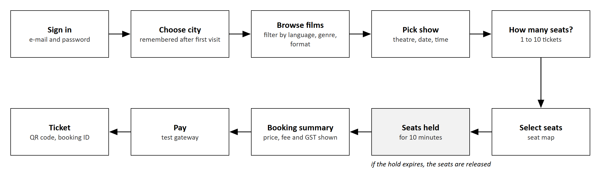 The main booking workflow in CineBook

## 3.3 Technology Stack

{tab:stack} lists the technologies used.

Table: tab:stack CineBook technology stack
| Layer | Technology | Purpose |
|---|---|---|
| Website | React, TypeScript, Tailwind CSS | pages, seat map and forms in the browser |
| API | Node.js, Express | catalogue, seat holds, payments, tickets, sign-in |
| Database | PostgreSQL (Neon, Singapore) | films, shows, seats, bookings and payments |
| Hosting | Vercel CDN and serverless functions (Singapore) | delivers the website and runs the API |
| External data | The Movie Database (TMDB) | film posters and details |
| Testing tools | Playwright, axe-core, Node.js scripts, Excel | measurements and analysis |

## 3.4 Architecture

{fig:arch} shows how the parts fit together. The website is a single-page application delivered from Vercel's content delivery network (CDN). It calls an API that runs as serverless functions in Singapore and stores its data in a PostgreSQL database in the same region.

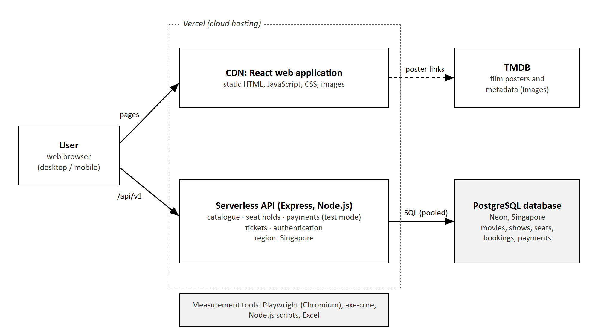 CineBook architecture and the tools used for measurement

## 3.5 Database Design and Important Components

{fig:db-design} shows the main tables. Two of them carry the booking logic. The show_seats table has one row for every seat in every show, with a status of AVAILABLE, HELD or BOOKED and the time a hold expires. The payments table stores an idempotency key for each payment request, which lets the system recognise a payment that is sent twice.

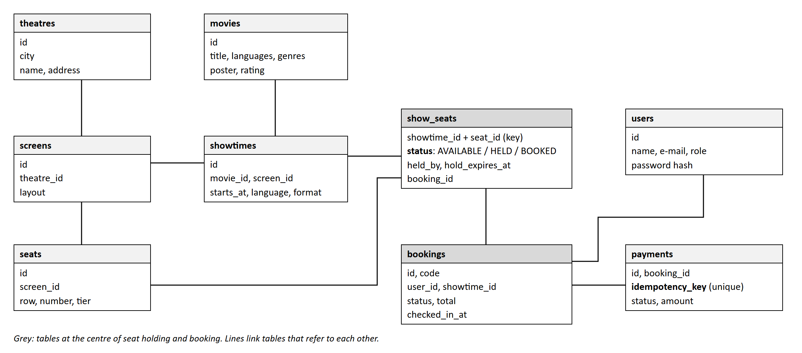 Main tables of the CineBook database

Three components matter most for this study:

- **Seat hold.** A hold is a single database statement that changes the chosen seats from AVAILABLE to HELD only if they are still available (or their earlier hold has expired), and only if all requested seats can be held. PostgreSQL re-checks this condition while it holds each row, so two customers cannot both succeed [@pgiso].
- **Idempotent payment.** Every payment request carries a unique key. If the same request arrives twice, for example after a double click or a lost connection, the second request returns the first result instead of charging again.
- **Signed ticket.** The QR code on a ticket contains a signature that the server checks at the cinema door, and a ticket can be checked in only once.

## 3.6 Application Screenshots

{fig:screens} shows four of the main screens; more are in Appendix F.

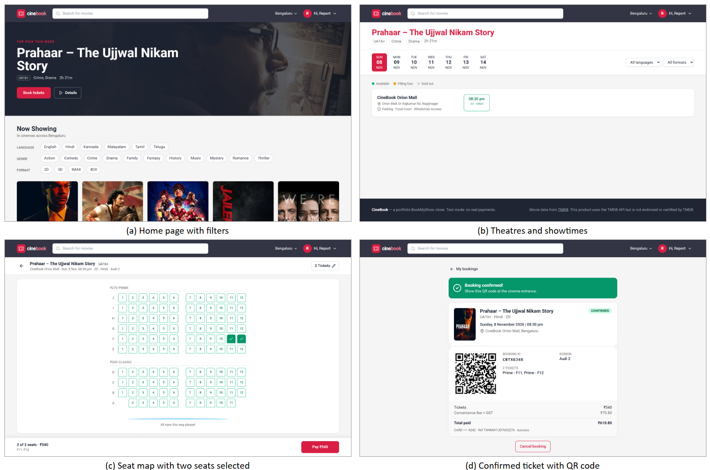 Main CineBook screens: (a) home page, (b) showtimes, (c) seat map and (d) confirmed ticket

# 4 Research Methodology

## 4.1 Research Design

This is a quantitative, comparative study. CineBook is compared with BookMyShow and District where the same measurement can be made on all three platforms, and with fixed targets where it cannot: Google's 2.5 s threshold for LCP [@lcp], WCAG 2.2 level AA [@wcag22], and CineBook's own requirements of a booking in under two minutes and API responses under 200 ms at the 95th percentile. When a measurement revealed a defect in CineBook, I fixed it and repeated the measurement, so some experiments were run in several iterations (Appendix C).

## 4.2 Objectives and Measurable KPIs

{tab:kpi} links each objective to its key performance indicators (KPIs), the experiment that measures them and the platforms it covers.

Table: tab:kpi Objectives, KPIs and experiments
| Objective | KPI | Experiment | Platforms |
|---|---|---|---|
| O1 web performance | Largest Contentful Paint (ms) | E1 page loads | all three |
| O1 web performance | page weight (KB) and number of requests | E1 page loads | all three |
| O1 web performance | API response time, median and 95th percentile (ms) | E3 API sampling | CineBook |
| O2 workflow and accessibility | screens, clicks, keystrokes; estimated time (s) | E4 booking runs, KLM | CineBook |
| O2 workflow and accessibility | accessibility violations by impact | E2 accessibility audit | all three |
| O2 workflow and accessibility | keyboard-only booking completed; Tab presses | E5 keyboard test | CineBook |
| O3 reliability | seats sold to more than one client | E6 same-seat test, E7 live seat race | CineBook |
| O3 reliability | double charges after failures or repeated requests | E8 payment tests | CineBook |
| O3 reliability | errors and response time at 10 to 500 simulated clients | E9 load test | CineBook |

Two outcomes were expected in advance and were tested formally: that CineBook's pages would load no slower than the competitors' while being lighter (O1), and that a check-then-update design would sell seats twice under simultaneous requests while CineBook's design would not (O3). The other KPIs were compared with the fixed targets above.

## 4.3 Experimental Environment

All measurements were taken from one computer in India (Intel Core i5-12400F, 16 GB RAM, Windows 10) over a home broadband connection, between 25 and 31 October 2026. CineBook ran in its normal deployed configuration on Vercel and Neon in Singapore. The median network time from the test computer was 33 ms to the CDN and 102 ms to the database. Full details are in Appendix D.

## 4.4 Tools and Technologies

Page loads, booking runs and keyboard tests used Playwright, which controls a real Chromium browser [@playwright]. Accessibility was checked with axe-core [@axe] against WCAG 2.0, 2.1 and 2.2 at levels A and AA. Concurrency and load tests were small Node.js scripts that send many requests at once. All results were analysed in Microsoft Excel and checked against the scripts' own calculations.

## 4.5 Benchmarking Procedure

The procedure was the same for every experiment:

1. define the KPI, the conditions and the number of repetitions before running;
2. run the measurement with a script, so that every repetition is identical;
3. write every raw measurement to a log file with its time, inputs and result;
4. delete any test accounts and bookings created on CineBook;
5. load the raw data into the Excel workbook and calculate the statistics;
6. if a defect was found, fix CineBook and repeat the experiment.

For the competitors, only pages allowed by their robots.txt files were loaded, following the Robots Exclusion Protocol [@rfc9309]; loads were spaced four seconds apart and no attempt was made to get around bot protection. BookMyShow's film pages refused automated access, so the comparison uses BookMyShow's Bengaluru home page and District's movies page.

## 4.6 Experimental Scenarios and Repetitions

{tab:exp} lists the experiments. The number of repetitions was chosen to balance stable averages against the load placed on other companies' servers: five loads per competitor page is negligible for them, while CineBook could be tested more heavily.

Table: tab:exp Experimental scenarios and repetitions
| Exp. | Scenario | Conditions | Repetitions | Date |
|---|---|---|---|---|
| E1 | page loads | 3 CineBook pages, 2 competitor pages; new browser profile each time | 5 per page | 30 Oct |
| E2 | accessibility audit | same 5 pages; widths 360, 768 and 1440 px | 1 per page; repeated after fixes | 30-31 Oct |
| E3 | API response time | 4 CineBook endpoints and one static file | 117 per endpoint | 25 Oct |
| E4 | complete booking | desktop and mobile (Pixel 7) browser profiles | 5 per profile | 31 Oct |
| E5 | keyboard-only booking | 3 versions of CineBook | 3 per version | 30-31 Oct |
| E6 | same-seat test | 2, 8 or 32 clients request one seat at the same instant | 20 per level | 25 Oct |
| E7 | live seat race | 16 test accounts request one seat on the live site | 12 | 25 Oct |
| E8 | payment tests | repeated payment requests and six failure scenarios | 6 and 8 per scenario | 25-30 Oct |
| E9 | controlled load test | 10, 50, 100 and 500 simulated clients; read and write | 3 per level | 30 Oct |

E6 compares CineBook's single conditional update with a simple design that first reads whether a seat is free and then marks it sold in a second step. Both run against identical copies of the seat tables in a separate area of the cloud database, so they face exactly the same conditions. In E9, the "clients" are requests sent at the same moment by a script on one computer; they are not real customers, and that computer may itself limit how fast requests can be sent at the highest level.

## 4.7 Data Collection and Statistical Analysis

For every condition I report the number of measurements n, the mean, the sample standard deviation s, the median and, for response times, the 95th and 99th percentiles:

$$ x̄ = (1/n) Σ x_i,    s = √( Σ (x_i − x̄)² / (n − 1) ) $$

Response times are skewed: most requests are fast and a few are much slower ({fig:hist}). In such data the mean is pulled up by the slow requests, so the median and the 95th percentile describe what users experience better, and rank-based tests are more appropriate than tests that assume a normal distribution.

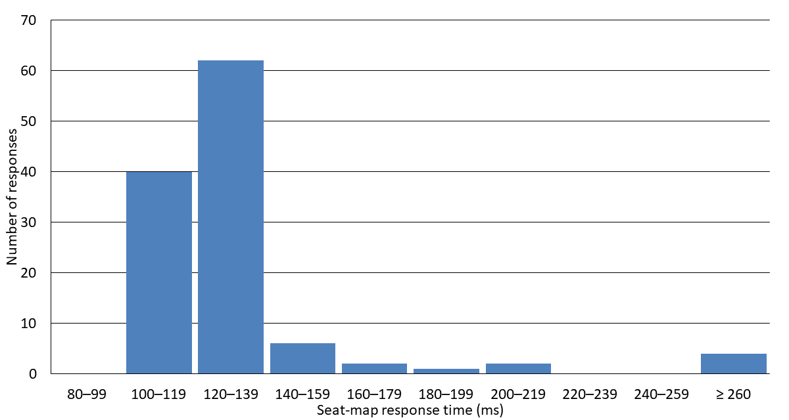 Distribution of 117 seat-map response times (E3)

A 95% confidence interval for a mean is x̄ ± t × s / √n, where t comes from Student's t-distribution with n − 1 degrees of freedom. For example, CineBook's home page had a mean LCP of 980.8 ms with s = 220.4 ms over five loads; with t = 2.776 the interval is 707 to 1,254 ms. Intervals this wide are normal with five loads and are a reason to be careful about small differences.

Platforms were compared with the Kruskal-Wallis test [@kruskal1952], and pairs of platforms with the Mann-Whitney U test [@mann1947], using Holm's correction when several pairs were compared [@holm1979]. Cliff's delta [@cliff1993] shows how large a difference is: −1 means every value in one group was smaller than every value in the other. Proportions such as "trials with a double booking" use Wilson confidence intervals [@brown2001]. A difference was treated as real only when p < 0.05 after correction. All calculations are in the Excel workbook (Appendix B), where each result is a visible formula; the main tests are listed in Appendix C.

## 4.8 Experimental Flowchart

{fig:process} summarises the research process. The loop on the right is the iteration step: when interpretation showed a defect, CineBook was fixed and the experiment was run again.

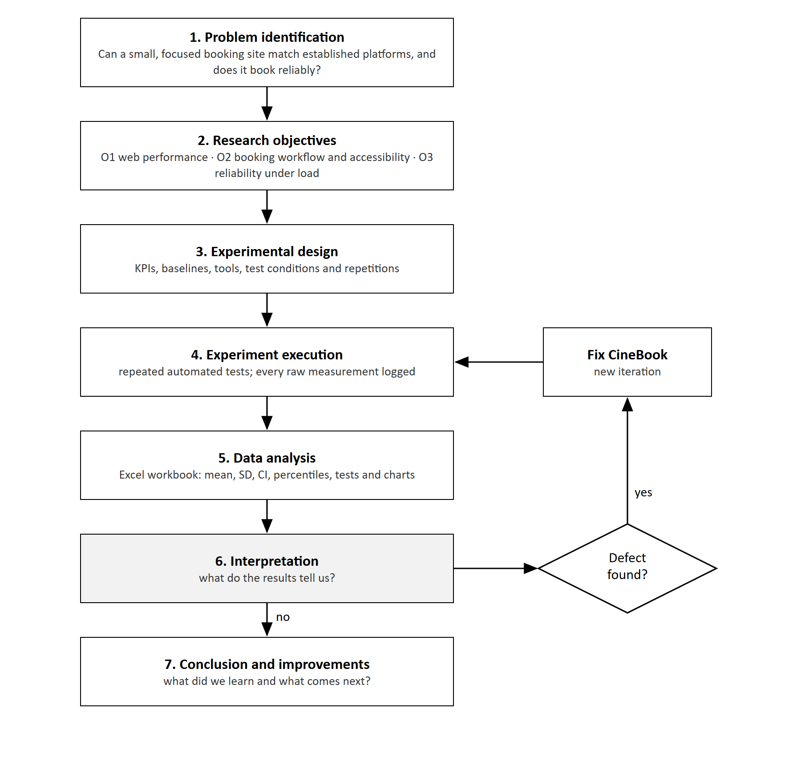 Research process followed in this study

# 5 Results and Findings

This chapter reports what was observed. The meaning of the results is discussed in Chapter 6.

## 5.1 Comparative Web Performance

{fig:lcp} shows the mean LCP of each page with its standard deviation. All five pages showed their main content in less than half of the 2.5 s "good" threshold. CineBook's home page had the lowest mean of the three home pages (981 ms against 1,153 ms for BookMyShow and 1,090 ms for District), but the difference was not statistically significant (Kruskal-Wallis H = 1.52, p = 0.47). BookMyShow's results varied most: its first two loads downloaded 121 files and its later loads 65 to 68, which gave it the largest standard deviation (513 ms). CineBook's seat map was the fastest page measured (473 ms).

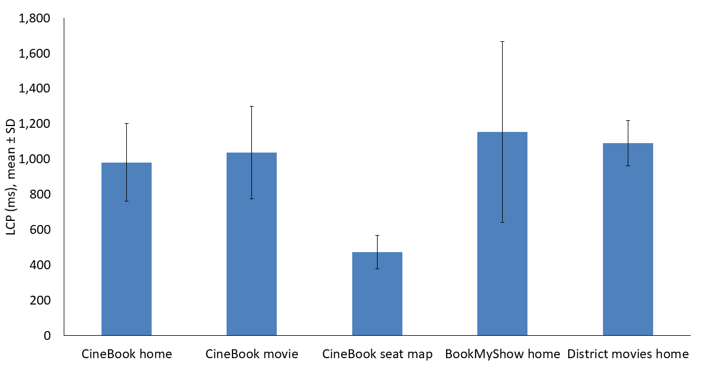 Largest Contentful Paint per page, mean ± SD of five cold loads (E1)

{fig:weight} shows how much data each page downloaded. CineBook's home page transferred 695 KB, against 3,594 KB for BookMyShow and 2,933 KB for District. Every one of CineBook's five loads was lighter than every competitor load (Cliff's δ = −1; Holm-corrected p = 0.032 for both comparisons). Most of the competitors' extra weight was JavaScript (3,062 KB and 1,644 KB, against 120 KB), and their pages contacted 17 to 26 other servers, against 2 to 3 for CineBook.

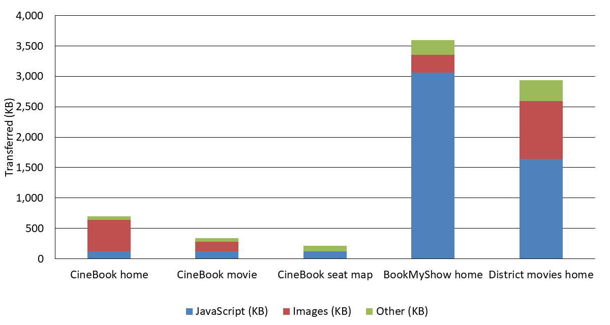 Data transferred per page by type of file (E1)

## 5.2 Booking Workflow Evaluation

A complete booking on CineBook, from signing in to seeing the ticket, passed through 8 screens and 2 small dialogs and needed 17 clicks or taps and 77 keystrokes, 34 of them for card details. Driven by a script, the website took 4.5 ± 0.3 s on the desktop profile and 4.7 ± 0.3 s on the mobile profile, including a 1.5 s simulated bank delay; the two did not differ significantly (p = 0.60). The fee and tax breakdown was shown before payment in all ten runs.

{fig:klm} shows the Keystroke-Level Model estimate for an experienced user: 71 s in total, within the two-minute requirement. Signing in and paying took 70% of this time, almost all of it typing. Choosing the city, film, show and seats took about 21 s.

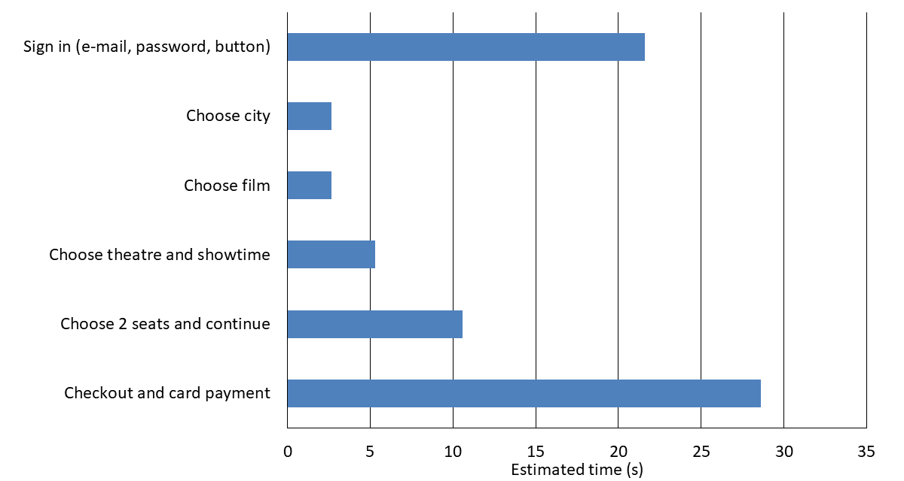 Estimated time per booking stage for an experienced user (Keystroke-Level Model)

The same measures could not be taken on BookMyShow or District, because their booking pages could not be automated within the ethical limits of this study (Section 4.5).

## 5.3 Accessibility Evaluation

{fig:a11y} shows the number of page elements that broke a WCAG 2.2 A or AA rule. CineBook's three pages had 8 serious problems, all text with too little contrast: the brand pink gave 3.5:1 under white text, below the required 4.5:1. BookMyShow's home page had 133 problems, 126 of them contrast. District's movies page had 52, of which 38 were critical, mostly form fields and buttons without a label that a screen reader could announce. Both competitors also prevent zooming on mobile. After CineBook's colours were darkened, a repeated audit found no problems. None of the five pages scrolled sideways at 360, 768 or 1440 px width.

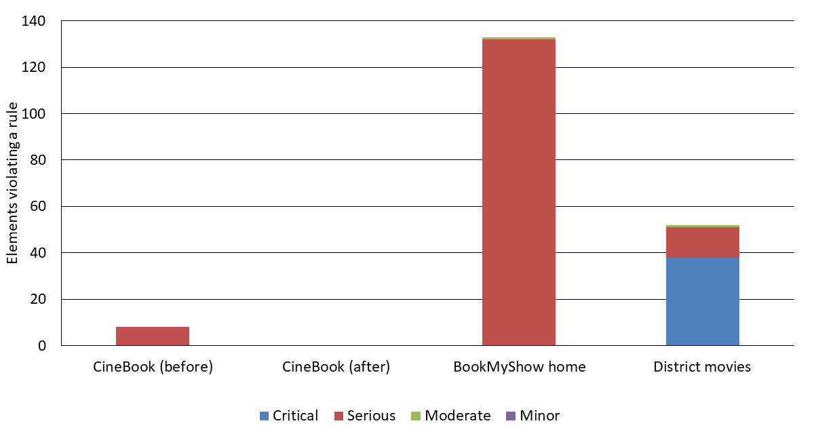 Elements breaking a WCAG 2.2 A or AA rule, by impact (E2)

The keyboard-only test ({fig:kbd}) found three problems that the automated audit had not:

- In the original version, a "Welcome back" notification caught the Tab key in an endless loop, and none of three attempts could finish.
- After that was fixed, every one of the roughly 120 seats on the seat map was a separate Tab stop, so getting past the seat map took well over 100 presses; no attempt finished (one reached the payment page but was then stopped by an error in my test script, which I corrected).
- After the seat map was changed to one Tab stop with arrow keys [@apg], and focus was moved to the new page after each navigation, all three attempts finished with 90 to 116 Tab presses.

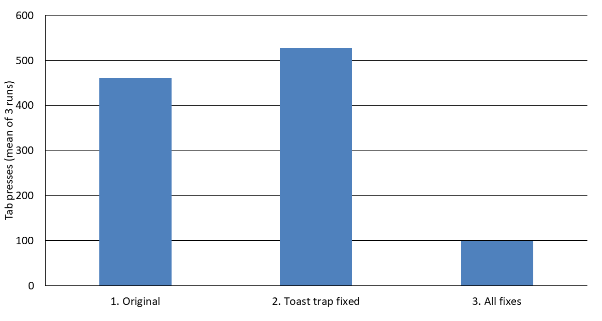 Mean Tab presses in keyboard-only booking across three versions of CineBook (E5)

## 5.4 Concurrency and Booking Reliability

{fig:conc} shows the result of the same-seat test (E6). With the check-then-update design, every client that asked for the seat was told it was theirs: one extra sale per trial with 2 clients, 7 with 8 clients and 31 with 32 clients, in 60 of 60 trials (Wilson 95% CI 94-100%). With CineBook's single conditional update, exactly one client got the seat in every trial and the others were refused, with no double bookings in 60 of 60 trials (upper 95% bound 6%; Fisher's exact test p < 0.001). CineBook's design was also faster: its median time with 8 clients was 629 ms against 1,016 ms for the check-then-update design. Two other safe approaches, row locks and the strictest isolation level, are compared in Appendix C.

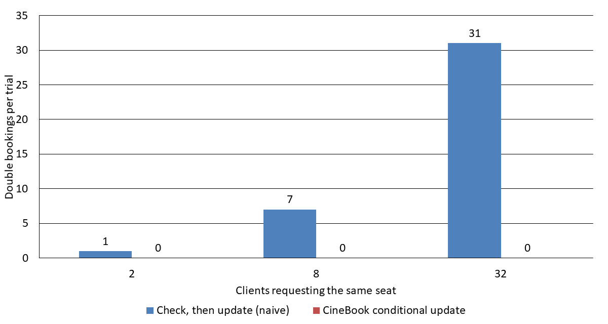 Seats sold more than once per trial when several clients request the same seat (E6)

On the live website (E7), 16 test accounts asked for the same seat at the same moment, twelve times. Every time exactly one account got the seat and fifteen were refused; no seat was sold twice. In the payment tests (E8), five identical payment requests sent at once always produced exactly one payment (6 of 6 trials), and all 48 failure tests passed: declined cards, a bank that did not answer, a lost connection, a hold that expired during payment, an expired hold taken by another customer and a request for seats of which one was already taken (Appendix C). No customer was charged twice, and no seat was left in an inconsistent state.

## 5.5 Scalability and Performance

**Server response time.** {fig:api} shows CineBook's API response times. The movie list was the fastest (median 38 ms). The other endpoints took 118 to 124 ms at the median, of which about 33 ms was network time. Three endpoints met the 200 ms target at the 95th percentile; the seat map was exactly on the limit (200 ms), with 94.9% of its responses under 200 ms and a few slow responses of up to 1.8 s.

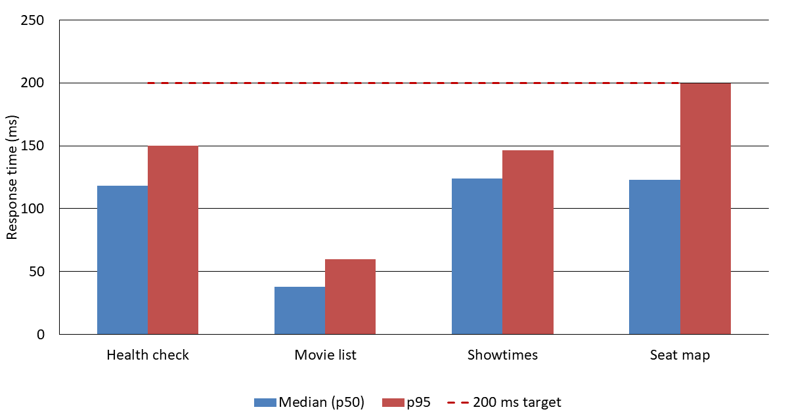 CineBook API response time, median and 95th percentile, against the 200 ms target (E3)

**Controlled load test.** {fig:load} shows how response times changed as the number of simultaneous simulated clients grew from 10 to 500. All 13,860 requests succeeded, with no errors (95% upper bound 0.03%). Up to 50 clients, the median stayed between 125 and 167 ms and the 95th percentile around 200 ms. Above 100 clients the slowest requests grew much faster than the typical ones: at 500 clients the median was 309 ms for reads and 428 ms for writes, while the 95th percentile reached 1.7 and 1.8 s. Throughput rose from about 65 to about 470 requests per second for reads, but varied a lot between repeats at the higher levels (Appendix A).

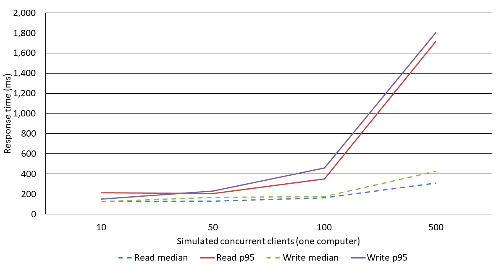 Response time against the number of simulated concurrent clients, sent from one computer (E9)

**Database indexing.** As a supporting test, the main queries were timed on a synthetic table of one million seat rows. Without an index, drawing one seat map took 52.5 ms; with an index on show and seat it took 0.34 ms. Holding two seats became 456 times faster and listing a customer's bookings about 200 times faster with suitable indexes (Appendix A). CineBook's live database already uses these indexes.

# 6 Discussion

## 6.1 Interpretation of Results

For web performance (O1), CineBook was as fast as the competitors but not demonstrably faster: with five loads per page, a difference of 100 to 200 ms could easily go undetected. The difference in page weight, by contrast, was large and consistent, and its cause is clear: the competitors load several megabytes of JavaScript and many third-party services, such as advertising and analytics, that CineBook does not have. The two results together suggest that this extra code does not make the competitors' pages appear faster, but it does make them heavier, which matters most on slow or metered mobile connections.

For the booking workflow (O2), the result I expected was that the number of screens would decide booking time. The KLM estimate showed otherwise: most of an experienced user's time goes into typing an e-mail address, a password and card details. The keyboard test was the most revealing part of the study. CineBook passed its automated tests and, after the colour change, its automated accessibility audit, yet a customer who cannot use a mouse could not have booked a ticket at all.

For reliability (O3), the same-seat test showed that the double-booking problem is not theoretical: the simple design failed in every trial, and the number of extra sales grew with the number of clients. CineBook's single statement prevented this without slowing bookings down. The load test showed that the deployed system stayed correct up to 500 simulated clients, but that its slowest responses grew quickly above about 100.

## 6.2 Comparison with Existing Studies

All three platforms stayed close to Nielsen's one-second limit for keeping a user's flow of thought [@nielsen1993] on most loads, and well inside Google's 2.5 s threshold [@lcp], so for users the three are likely to feel similarly fast; the difference that remains is in how much data each page costs. The accessibility results also match the WebAIM Million, where low-contrast text is the most frequent problem [@webaim]; it was the most frequent problem on CineBook and BookMyShow too. The failure of the check-then-update design is the lost update described by Berenson et al. [@berenson1995] and matches the unsafe application-level checks that Bailis et al. found in real applications [@bailis2015]. Finally, the load test shows the effect Dean and Barroso describe: as load rises, the tail of the response-time distribution grows much faster than the median [@dean2013], which is why the 95th percentile, not the average, is the measure to watch.

## 6.3 Important Observations

Three observations stand out. First, the most serious usability problem, the keyboard trap, was invisible to every automated check and was found only by using the website in a different way. Second, the first attempt at almost every experiment needed correction: test accounts that were already signed in, a test card number that the payment form rejected, and timing in the keyboard script. Keeping every raw measurement made these problems visible instead of quietly producing wrong numbers. Third, the testing platform mattered: the same check-then-update code that failed on the cloud database never failed on the small embedded database used during development, because that database handles one request at a time (Appendix C).

## 6.4 Engineering Trade-offs

{tab:tradeoffs} summarises the main design choices behind these results and what each one costs.

Table: tab:tradeoffs Design choices, evidence and trade-offs
| Design choice | Alternative | Evidence from this study | Cost accepted |
|---|---|---|---|
| seat ownership decided by one database statement | check in application code, then update | no double bookings in 60 trials; check-then-update failed in 60 of 60 | every hold needs a round trip to the database |
| 10-minute seat hold, released automatically | release only by a scheduled job | expired holds were reclaimed immediately in 8 of 8 tests | expired rows remain until touched or cleaned |
| idempotency key on every payment | disable the pay button in the browser | one charge in every repeated-payment and failure test | the client must keep and resend the key |
| serverless hosting | an always-running server | no errors up to 500 simulated clients | slow responses grow above 100 clients; cold starts |
| small single-page website | feature-rich pages with third-party services | 4 to 5 times less data, similar LCP | fewer features; focus must be managed by the app |
| normalised tables with indexes | copying seat details into every show | key queries under 1 ms on one million rows | one extra join when drawing the seat map |

## 6.5 Practical Implications

For developers of booking systems, the results suggest four practical rules: let the database decide who owns a seat in one statement; make every payment request safe to repeat; keep pages light, because extra code did not make pages appear faster; and test with a keyboard, because automated checks do not find every barrier. For CineBook itself, the next improvements are to reduce typing (for example by staying signed in) and to make the seat-map query faster so that its slowest responses fall clearly below 200 ms.

# 7 Limitations and Threats to Validity

## 7.1 Experimental Limitations

The comparison with BookMyShow and District covers their public landing pages only. Their booking process, keyboard operation and response under load could not be measured without creating accounts, holding seats or getting around bot protection, which this study did not do. The booking-effort results are therefore for CineBook alone. The KLM estimate describes an experienced user who makes no mistakes; real users, especially first-time users, will take longer. No human participants took part, so satisfaction, one of the three parts of usability [@iso9241], was not measured.

## 7.2 Dataset and Sample Limitations

Only five loads were made of each competitor page, which keeps the load on their servers negligible but limits statistical power; small differences in LCP may exist without being detected. Live tests used small numbers of trials (12 seat races, 6 repeated-payment trials and 8 trials per failure scenario), so they show that failures are rare, not that they are impossible. The database indexing test used synthetic data, and CineBook's catalogue of 12 films is much smaller than the competitors', which affects page content and weight.

## 7.3 Testing Environment Limitations

All measurements came from one computer at one location over one week, so absolute times include that location's network and may differ elsewhere. The load test sent all requests from that one computer: the "500 clients" were simulated requests, not 500 real customers on different networks, and the computer itself may have limited the request rate at the highest level. The competitors' pages may also have changed between loads, as BookMyShow's varying number of files suggests.

## 7.4 Generalizability of Results

The results describe these three websites at one point in time. The finding that lighter pages did not load more slowly, and the design lessons for preventing double bookings, are likely to apply to other booking websites, but the exact numbers will not. CineBook was built by the author of this study; to reduce this bias, every measurement was automated, every result can be traced to raw data, and the competitors were measured with exactly the same scripts.

# 8 Conclusion and Future Work

## 8.1 Summary of Findings

CineBook's pages showed their main content about as quickly as BookMyShow's and District's while downloading four to five times less data. A booking takes 8 screens and an estimated 71 s for an experienced user, most of it typing. CineBook had far fewer accessibility problems than either competitor, and three keyboard problems were found and fixed. Its seat-hold design never sold a seat twice in any test, unlike a simple check-then-update design, and the deployed system answered all requests in a controlled load test of up to 500 simulated clients, with slower responses above 100.

## 8.2 Whether the Objectives Were Achieved

{tab:objectives} summarises how far each objective was met.

Table: tab:objectives Achievement of the research objectives
| Objective | Achieved? | Main evidence |
|---|---|---|
| O1 web performance | mostly | similar LCP (p = 0.47), 4-5 times lighter (p = 0.032); API met the target on 3 of 4 endpoints |
| O2 workflow and accessibility | partly | CineBook measured fully (71 s, 0 violations after fixes, keyboard booking works); competitors compared on public pages only |
| O3 reliability under concurrent use | yes, within the tested limits | no double booking or double charge in any test; no errors up to 500 simulated clients |

## 8.3 Main Contribution

The main contribution is a repeatable benchmark for a ticketing website, with the scripts, raw data and an Excel workbook in which every number can be traced to its calculation. Its findings show that a small booking site can match established platforms on loading speed with far lighter pages, that typing rather than the number of screens dominates booking effort, that keyboard testing finds problems automated audits miss, and that seat ownership should be decided by the database in a single statement.

## 8.4 Improvements and Future Investigations

Future work should:

1. run the prepared protocol with 8 to 12 participants to measure booking time and SUS scores on all three platforms, which would complete the comparison of the booking experience (Appendix E);
2. repeat the page measurements from several cities and on a real mobile network;
3. repeat the load test from several computers, so that the client does not limit the request rate;
4. optimise the seat-map query so that its 95th percentile falls clearly below 200 ms;
5. measure the effect of reducing typing, such as staying signed in or saved payment methods, on booking time.

# References

[[BIBLIOGRAPHY]]

# Appendix A: Detailed Experimental Data

Table: tab:a1 Page-load results per page, mean of five cold loads (E1)
| Page | LCP mean ± SD (ms) | LCP 95% CI (ms) | FCP (ms) | TTFB (ms) | Transfer (KB) | JavaScript (KB) | Requests | Third-party hosts |
|---|---|---|---|---|---|---|---|---|
| CineBook home | 981 ± 220 | 707 – 1,254 | 477 | 194 | 695 | 120 | 29 | 3 |
| CineBook film | 1,038 ± 263 | 711 – 1,364 | 486 | 129 | 339 | 119 | 20 | 3 |
| CineBook seat map | 473 ± 97 | 353 – 593 | 473 | 150 | 212 | 123 | 14 | 2 |
| BookMyShow home | 1,153 ± 513 | 516 – 1,789 | 333 | 286 | 3,594 | 3,062 | 88 | 26 |
| District movies | 1,090 ± 128 | 931 – 1,250 | 634 | 305 | 2,933 | 1,644 | 84 | 17 |

FCP is First Contentful Paint (first text or image drawn); TTFB is Time to First Byte (first response from the server).

Table: tab:a2 Accessibility violations per page (E2)
| Page | Rules broken | Critical | Serious | Moderate | Rules (affected elements) |
|---|---|---|---|---|---|
| CineBook home, before | 1 | 0 | 1 | 0 | colour contrast (1) |
| CineBook film, before | 1 | 0 | 3 | 0 | colour contrast (3) |
| CineBook seat map, before | 1 | 0 | 4 | 0 | colour contrast (4) |
| CineBook, all pages, after | 0 | 0 | 0 | 0 | none |
| BookMyShow home | 3 | 0 | 132 | 1 | colour contrast (126), link without name (6), zoom disabled (1) |
| District movies | 8 | 38 | 13 | 1 | missing form labels (28), ARIA misuse (16), button without name (2), colour contrast (3), other (3) |

Table: tab:a3 Booking runs by device, mean of five runs (E4)
| Measure | Desktop | Mobile (Pixel 7) |
|---|---|---|
| Clicks or taps / keystrokes | 17 / 77 | 17 / 77 |
| System time, mean ± SD [95% CI] (s) | 4.52 ± 0.32 [4.12, 4.91] | 4.73 ± 0.26 [4.40, 5.05] |
| Sign-in / discovery / showtime (s) | 1.05 / 0.06 / 0.52 | 1.06 / 0.06 / 0.50 |
| Seats / checkout including 1.5 s bank delay (s) | 0.67 / 2.21 | 0.78 / 2.32 |
| Fee and tax breakdown shown before payment | 5 of 5 | 5 of 5 |

Table: tab:a4 CineBook API response time, 117 warm requests per endpoint (E3)
| Endpoint | Mean ± SD (ms) | Median (ms) | p95 (ms) | p99 (ms) | Max (ms) | Under 200 ms |
|---|---|---|---|---|---|---|
| Health check | 123 ± 26 | 119 | 150 | 234 | 346 | 98.3% |
| Movie list | 42 ± 22 | 38 | 60 | 86 | 242 | 99.1% |
| Showtimes | 127 ± 16 | 124 | 146 | 193 | 230 | 99.1% |
| Seat map | 152 ± 176 | 123 | 200 | 833 | 1,822 | 94.9% |
| Static file (CDN, 27 requests) | 37 ± 17 | 33 | 54 | 96 | 110 | 100% |

Table: tab:a5 Controlled load test, simulated clients sent from one computer (E9)
| Workload | Clients | Requests | Errors | Median (ms) | p95 (ms) | p99 (ms) | Throughput, mean ± SD (req/s) |
|---|---|---|---|---|---|---|---|
| read (seat map) | 10 | 150 | 0 | 125 | 211 | 251 | 65 ± 10 |
| read (seat map) | 50 | 750 | 0 | 128 | 203 | 236 | 299 ± 34 |
| read (seat map) | 100 | 1,500 | 0 | 164 | 349 | 1,024 | 364 ± 91 |
| read (seat map) | 500 | 7,500 | 0 | 309 | 1,716 | 2,702 | 466 ± 171 |
| write (hold and release) | 10 | 60 | 0 | 126 | 150 | 182 | 68 ± 4 |
| write (hold and release) | 50 | 300 | 0 | 167 | 230 | 242 | 219 ± 22 |
| write (hold and release) | 100 | 600 | 0 | 175 | 458 | 518 | 275 ± 102 |
| write (hold and release) | 500 | 3,000 | 0 | 428 | 1,805 | 1,924 | 371 ± 167 |

Table: tab:a6 Database query time on one million seat rows, 30 runs per variant
| Query | Variant | Mean ± SD (ms) | Median (ms) | Speed-up |
|---|---|---|---|---|
| Seat map | no index | 53.9 ± 3.8 | 52.49 | 1 |
| Seat map | index (show, seat) | 0.342 ± 0.021 | 0.339 | 155 x |
| Hold two seats | no index | 53.6 ± 2.3 | 52.92 | 1 |
| Hold two seats | index (show, seat) | 0.116 ± 0.013 | 0.116 | 456 x |
| Release expired holds | no index | 97.5 ± 8.7 | 93.97 | 1 |
| Release expired holds | partial index, 0.34 MB | 56.2 ± 19.7 | 49.54 | 1.9 x |
| My bookings | no index | 16.0 ± 6.1 | 14.32 | 1 |
| My bookings | index (user, date) | 0.069 ± 0.006 | 0.068 | 211 x |
| Seat map with layout | normalised, 3-table join | 6.69 ± 0.17 | 6.64 | 1 |
| Seat map with layout | denormalised, 1 table | 0.813 ± 0.075 | 0.822 | 8.1 x |
| Change a ticket price | normalised | 0.127 ± 0.014 | 0.124 | 1 |
| Change a ticket price | denormalised | 39.0 ± 28.4 | 32.94 | 266 x slower |

# Appendix B: Excel Calculation Workbook

All tables, calculations and charts in this report were built in the Excel workbook experiments/results/cinebook-analysis.xlsx in the project repository. Each sheet holds the raw measurements on the left and the summary on the right; every summary cell is a formula, so clicking on a number shows how it was calculated (for example =AVERAGE, =STDEV.S, =PERCENTILE.INC and =T.INV.2T for confidence intervals). The statistical tests are built step by step from ranks on sheet 8_Stats_Tests.

Table: tab:b1 Sheets of the analysis workbook
| Sheet | Contents | Used for |
|---|---|---|
| 1_PageLoads | 25 page loads; mean, SD and 95% CI per page | {fig:lcp}, {fig:weight}, {tab:a1} |
| 2_Accessibility | violations per page and impact, before and after fixes | {fig:a11y}, {tab:a2} |
| 3_API_Latency | 117 requests per endpoint; percentiles; histogram | {fig:hist}, {fig:api}, {tab:a4} |
| 4_Funnel | 10 booking runs; summary by device | {tab:a3} |
| 5_KLM | operator times and estimated time per stage | {fig:klm} |
| 6_Keyboard | keyboard-only attempts across three versions | {fig:kbd} |
| 7_DB_Queries | 30 runs per query variant; speed-up | {tab:a6} |
| 8_Stats_Tests | Kruskal-Wallis and Mann-Whitney tests built from ranks | {tab:c2} |
| 9_Supplementary | payment failure tests and security checks | {tab:c3}, {tab:c4} |
| 10_Concurrency | same-seat test and live seat race | {fig:conc}, {tab:c1} |
| 11_LoadTest | 13,860 load-test requests; percentiles and throughput | {fig:load}, {tab:a5} |

# Appendix C: Additional Tables and Graphs

Table: tab:c1 Same-seat test: four approaches, 20 trials per level (E6)
| Approach | Clients | Trials with a double booking | Seats sold twice (total) | Requests refused with an error | Median time (ms) | p95 time (ms) |
|---|---|---|---|---|---|---|
| Check, then update | 2 / 8 / 32 | 20 / 20 / 20 | 20 / 140 / 620 | 0% | 651 / 1,016 / 3,111 | 724 / 1,680 / 5,608 |
| CineBook conditional update | 2 / 8 / 32 | 0 / 0 / 0 | 0 | 0% | 382 / 629 / 1,594 | 440 / 951 / 2,874 |
| Row locks (SELECT FOR UPDATE) | 2 / 8 / 32 | 0 / 0 / 0 | 0 | 0% | 449 / 703 / 1,677 | 496 / 995 / 2,956 |
| Strictest isolation (SERIALIZABLE) | 2 / 8 / 32 | 0 / 0 / 0 | 0 | 50% / 88% / 97% | 512 / 493 / 482 | 577 / 525 / 533 |

The strictest isolation level was fast only because it rejected most requests with an error, which the website would then have to retry. The same check-then-update test run on the small embedded database used during development produced no double bookings in 15 of 15 trials, against 20 of 20 on the cloud database (Fisher's exact test p < 0.001), because the embedded database handles one request at a time.

Table: tab:c2 Main statistical tests
| Comparison | Test | Statistic | p-value | Effect size | Result |
|---|---|---|---|---|---|
| Home-page LCP, 3 platforms | Kruskal-Wallis | H = 1.52, df = 2 | 0.468 | | no significant difference |
| Home-page transfer size, 3 platforms | Kruskal-Wallis | H = 12.64, df = 2 | 0.002 | | significant |
| Transfer size, CineBook vs BookMyShow | Mann-Whitney | U = 0 | 0.032 (Holm) | δ = −1 | CineBook smaller |
| Transfer size, CineBook vs District | Mann-Whitney | U = 0 | 0.032 (Holm) | δ = −1 | CineBook smaller |
| Booking time, desktop vs mobile | Mann-Whitney | | 0.600 | | no significant difference |
| Double bookings, check-then-update vs CineBook | Fisher's exact | 60/60 vs 0/60 trials | < 0.001 | | CineBook safer |
| Load test: clients vs p95 response time | Spearman | ρ = 0.84 (read), 0.97 (write) | < 0.001 | | p95 rises with load |

Table: tab:c3 Payment and seat-hold failure tests, eight trials per scenario (E8)
| Scenario | Passed | Charges | Refunds | Final state |
|---|---|---|---|---|
| Card declined | 8 / 8 | 0 | 0 | booking failed, seat released |
| Bank does not answer; customer retries | 8 / 8 | one per booking | 0 | booking confirmed once |
| Connection lost during payment; customer retries | 8 / 8 | one per booking | 0 | booking confirmed once |
| Seat hold expires during payment | 8 / 8 | 0 | 8 | booking expired, seat released |
| Expired hold taken by another customer | 8 / 8 | 0 | 0 | new customer holds the seat |
| Request for three seats when one is taken | 8 / 8 | 0 | 0 | request refused, other seats untouched |

Table: tab:c4 Supporting security checks, grouped by OWASP API Security Top 10 (2023) category
| Category | Checks | Passed | Examples |
|---|---|---|---|
| Access to other users' data | 5 | 5 | reading or cancelling another user's booking |
| Authentication | 14 | 14 | edited or expired login tokens, repeated wrong passwords |
| Hidden fields | 4 | 4 | trying to make oneself an administrator at sign-up |
| Resource limits | 3 | 3 | very large requests, holding more than 10 seats |
| Administrator functions | 3 | 3 | customer calling administrator pages |
| Tickets | 4 | 4 | forged or reused QR tickets |
| Configuration | 7 | 7 | security headers, error messages |
| Injection and stored card data | 6 | 6 | database injection; only the last four card digits are stored |

The categories follow the OWASP API Security Top 10 [@owasp2023]. These checks were run on a local copy of the API and on the live site's headers; they are a targeted test, not a full penetration test.

Table: tab:c5 Iteration log: what was measured, what happened and what was changed
| Iteration | Measured | What happened | Action taken |
|---|---|---|---|
| 1 | API response time (E3) | 3 of 4 endpoints under 200 ms at p95; seat map on the limit | recorded as an open issue |
| 2 | Competitor pages (E1) | BookMyShow film pages refused automated access | comparison limited to public landing pages |
| 3 | Page speed and accessibility (E1, E2) | all CineBook pages failed colour contrast (8 elements) | brand colours darkened |
| 4 | Booking runs (E4) | first runs failed because test accounts were already signed in | test script corrected; runs repeated |
| 5 | Payment failure tests (E8) | one scenario failed because the test card number was invalid | test card corrected; all scenarios repeated |
| 6 | Keyboard-only booking (E5) | Tab key trapped by a notification | notification removed from the Tab order; focus moved on navigation |
| 7 | Keyboard-only booking (E5) | about 120 separate Tab stops on the seat map | seat map made one Tab stop with arrow keys |
| 8 | All CineBook checks repeated | 0 accessibility violations; keyboard booking 3 of 3 | final results |

# Appendix D: Testing Configurations

Table: tab:d1 Measurement environment
| Item | Value |
|---|---|
| Client computer | Intel Core i5-12400F, 16 GB RAM, Windows 10, home broadband in India |
| Browser | Chromium controlled by Playwright 1.64; desktop 1366 x 860, mobile Pixel 7 profile |
| Accessibility engine | axe-core 4.14, rules for WCAG 2.0, 2.1 and 2.2 at levels A and AA |
| CineBook hosting | Vercel (CDN and serverless functions, Singapore); Neon PostgreSQL 18 (Singapore) |
| Network baseline | median 33 ms to the CDN, 102 ms to the database |
| Competitor pages | in.bookmyshow.com/explore/home/bengaluru; www.district.in/movies/ |
| Dates | 25 October 2026 (API, concurrency); 30-31 October 2026 (all other experiments) |

All code, raw data and analysis files are in the project's GitHub repository. Each experiment can be repeated with one command, for example npm run experiments:web for the page measurements, and the analysis and charts can be rebuilt from the committed data without access to any website. The repository's reproducibility guide lists every command, its expected run time and the data it produces.

# Appendix E: Questionnaires and Testing Protocols

**E.1 System Usability Scale.** After using each platform, a participant rates the ten statements in {tab:sus} from 1 (strongly disagree) to 5 (strongly agree) [@brooke1996]. Odd items score the rating minus 1, even items score 5 minus the rating, and the sum is multiplied by 2.5 to give a score from 0 to 100.

Table: tab:sus System Usability Scale statements
| No. | Statement |
|---|---|
| 1 | I think that I would like to use this system frequently. |
| 2 | I found the system unnecessarily complex. |
| 3 | I thought the system was easy to use. |
| 4 | I think that I would need the support of a technical person to be able to use this system. |
| 5 | I found the various functions in this system were well integrated. |
| 6 | I thought there was too much inconsistency in this system. |
| 7 | I would imagine that most people would learn to use this system very quickly. |
| 8 | I found the system very cumbersome to use. |
| 9 | I felt very confident using the system. |
| 10 | I needed to learn a lot of things before I could get going with this system. |

**E.2 Booking-task protocol (all three platforms).**

1. Recruit 8 to 12 adults who have booked a cinema ticket online in the past year; record only an anonymous code, age band and how often they book.
2. Vary the order of the platforms between participants so that each platform is used first, second and third equally often.
3. Give the same task on every platform: find a 2D evening show of any film in Bengaluru tomorrow, choose two seats next to each other and continue to the payment page. Participants stop at the payment page and never pay.
4. Record task time, screens seen, taps or clicks, errors (wrong turns or going back) and whether the fee breakdown was visible before payment.
5. Straight after each platform, the participant completes the SUS questionnaire.

**E.3 Keyboard-only protocol (CineBook).** Starting from the sign-in page, complete a booking for two seats using only Tab, Shift+Tab, Enter, Space, the arrow keys and typing. Record whether the booking finishes, the number of Tab presses, and every point where the keyboard focus is lost, trapped or not visible.

# Appendix F: Additional Screenshots

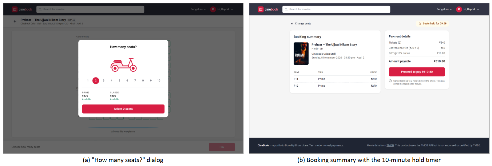 Additional CineBook screens: (a) choosing the number of seats and (b) the booking summary with the hold timer
