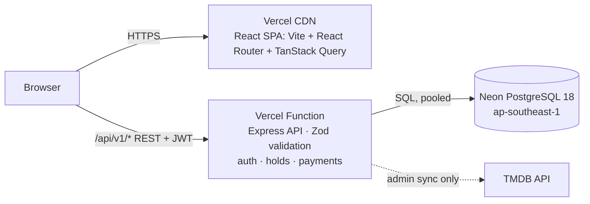
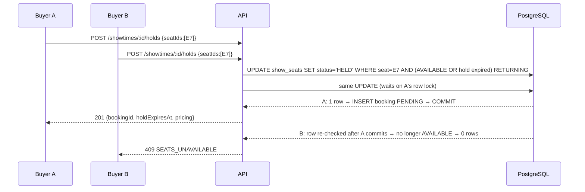
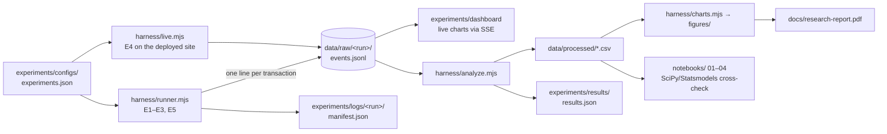

# System architecture

CineBook has two parts: the **booking application** (the system under study) and the **research harness**
(the apparatus that measures it).

## 1. Booking application

| Layer | Technology | Location |
|---|---|---|
| Web client | React 18, Vite, React Router, TanStack Query, Tailwind, React Hook Form + Zod | `apps/web/` |
| API | Node.js, Express 4, TypeScript, Drizzle ORM, JWT with SQL-backed sessions | `apps/api/` |
| Shared contract | Zod schemas, pricing and payment rules, API types (used by both sides) | `packages/shared/` |
| Database | Neon PostgreSQL (production); embedded PGlite for local development and tests | `apps/api/src/db/` |
| Deployment | One Vercel project: static site on the CDN plus one function at `/api/*` (Build Output API) | `vercel.json`, `scripts/build-vercel.mjs` |

### Seat-hold protocol (the property under study)

* **Seat state table.** `show_seats` holds one row per seat per showtime, with primary key `(showtime_id, seat_id)`.
* **Atomic holds.** A hold is one conditional `UPDATE`, all-or-nothing: if fewer rows are updated than requested, the transaction rolls back and the API returns 409.
* **Expired holds.** Expired holds are reclaimable inline, so correctness never depends on the clean-up sweeper.
* **Idempotent payment.** Payment requires an `Idempotency-Key` header, and the key column is unique. A partial unique index allows at most one in-flight or successful payment per booking. On success, `HELD` changes to `BOOKED` only where the hold is still valid; otherwise the payment is refunded and the API returns 410.
* **Overlapping shows.** An `EXCLUDE USING gist` constraint makes it impossible to schedule two overlapping shows on the same screen.

### Data model

`users` · `sessions` (refresh-token hashes, rotation families) · `cities` · `theatres` · `screens` · `seat_tiers` ·
`seats` · `movies` · `cast_members` · `showtimes` · `show_seats` · `bookings` · `booking_seats` · `payments`.
The full schema is in [`apps/api/src/db/migrations/0001_init.ts`](../apps/api/src/db/migrations/0001_init.ts).

## 2. Research harness

* **Isolation.** The strategies run against a separate `research` schema in the same database, so the application's tables are never touched by experiments E1–E3 and E5.
* **Live test accounts.** E4 uses accounts named `research+<run>-<n>@cinebook.test`. They are deleted, with their bookings and payments, at the end of each run.
* **Dashboard.** `node experiments/dashboard/server.mjs` follows the newest raw log (named in `experiments/logs/LATEST`) and streams new lines to the browser.
