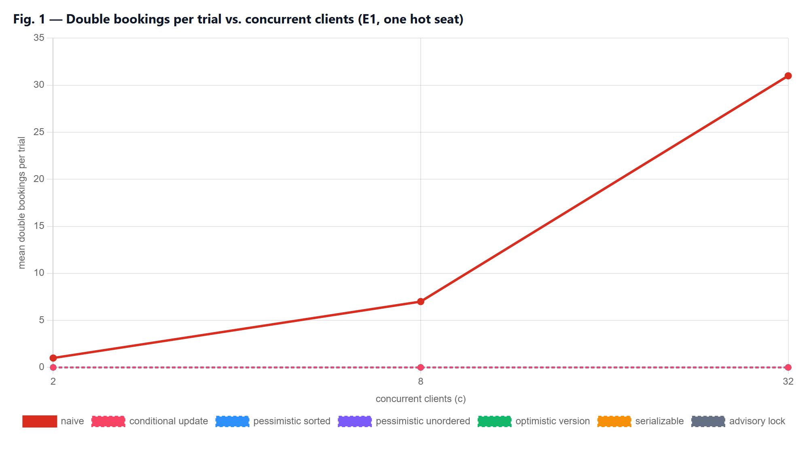
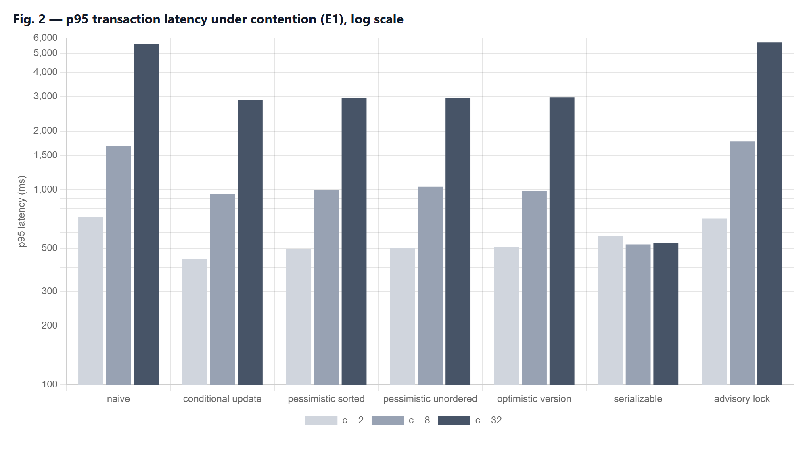
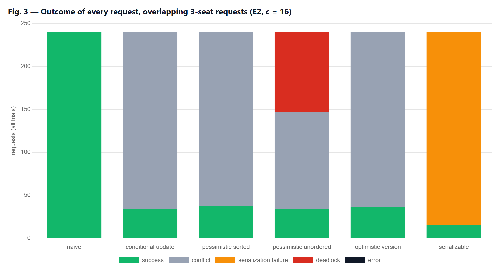
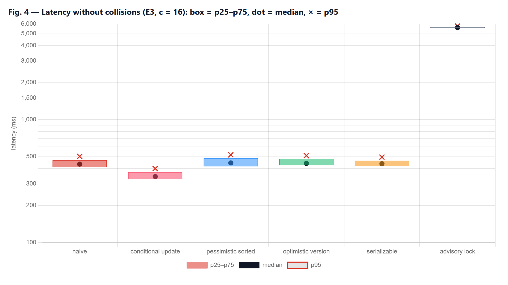
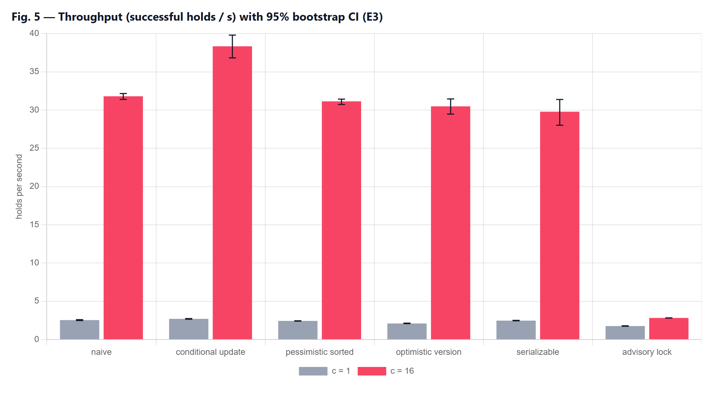
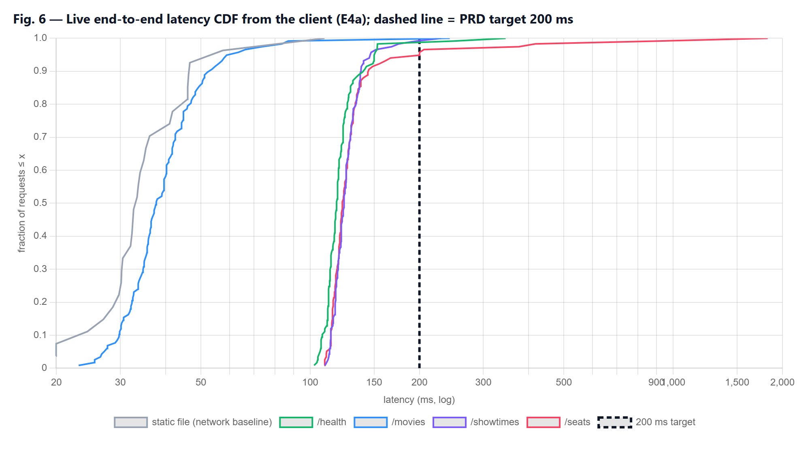
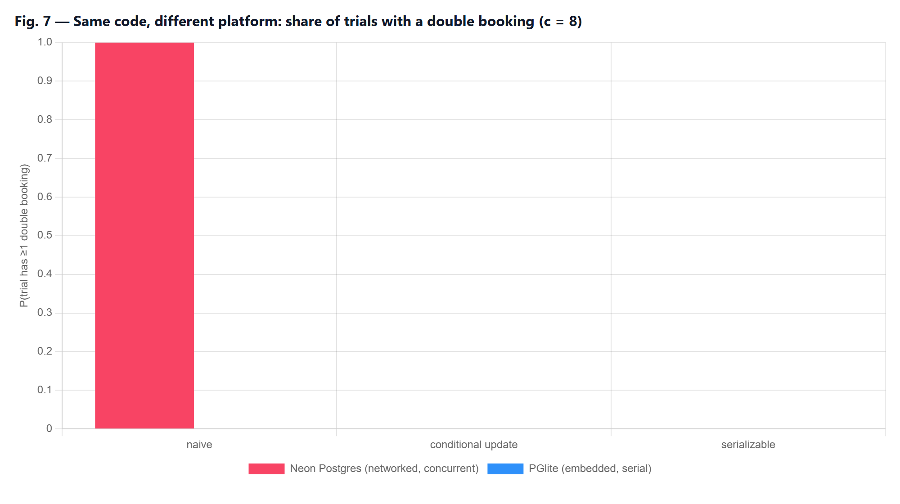

# Preventing Double Bookings under Concurrent Demand: An Empirical Comparison of Concurrency-Control Strategies in a Serverless Ticket-Booking System

Case study: CineBook (BookMyShow-style clone) — React SPA, Express API on Vercel Functions, Neon PostgreSQL 18.6 (ap-southeast-1) Experiments run 25 Oct 2026 · code and raw data: <code>github.com/Icoder05/cinebook</code>, folder <code>research/</code>

**Abstract.** When thousands of users try to buy the same seats at once, a booking system must guarantee that each seat is sold exactly once. This study compares seven concurrency-control strategies for seat reservation — a naive read-check-write baseline, the conditional `UPDATE` used by CineBook, two pessimistic-locking variants, optimistic version checking, PostgreSQL's SERIALIZABLE isolation, and a coarse advisory lock — on a real cloud PostgreSQL database, and validates the deployed system end to end. Across 11,280 logged transactions in 621 trials, the baseline double-booked in **60 of 60** contended trials (95% CI 94–100%), with every competing client "winning" the seat; all six other strategies produced **zero** double bookings (≤ 4% per-trial upper bound, rule of three). The strategies differed sharply in cost: the conditional `UPDATE` had the lowest median latency (344 ms vs 435–445 ms, Cliff's δ ≥ 0.96) and **23% higher throughput** than the next best, unordered row locking deadlocked on 38.8% of multi-seat requests, and SERIALIZABLE aborted up to 97% of contending transactions and 5% of non-conflicting ones. On the live deployment, 12/12 sixteen-way races for one seat produced exactly one winner and 6/6 parallel payment double-submits charged once. Three of four read endpoints met the PRD target p95 < 200 ms; the seat-map endpoint did not demonstrably do so. Finally, the same buggy code showed **no** double bookings on an embedded test database (0/15 vs 20/20, p = 3×10⁻¹⁰), showing that local tests can hide this class of bug.

## 1. Introduction

Ticketing is a textbook hot-spot workload: demand concentrates on a few rows (the best seats of a popular show) at the same instant. Real launches show the scale: Ticketmaster reported 3.5 billion system requests during the 2022 Eras Tour presale [15], and BookMyShow's site went down at the start of the 2024 Coldplay India sale, with roughly 13 million users reported competing for about 180,000 tickets [16]. Under such contention, any gap between *checking* that a seat is free and *marking* it sold allows two buyers to purchase the same seat.

The CineBook PRD names one non-negotiable property: *two users can never book the same seat*. CineBook enforces it with a single conditional `UPDATE` executed inside PostgreSQL. This report asks whether that design is (a) correct, (b) cheaper than the alternatives, and (c) correct and fast enough in the deployed system.

## 2. Literature review

**Anomalies and isolation.** Berenson et al. [1] showed that the ANSI isolation levels are ambiguous and defined anomalies such as *lost update*, the exact failure behind double booking: two transactions read "available" and both write "sold". PostgreSQL's default READ COMMITTED level permits this for read-then-write logic. However, a single `UPDATE … WHERE status='AVAILABLE'` is safe because, when a row is locked by a concurrent writer, PostgreSQL waits and *re-evaluates the WHERE clause against the committed version* before updating [6].

**Pessimistic and optimistic control.** Two-phase locking (`SELECT … FOR UPDATE`) serialises access but can deadlock when transactions lock rows in different orders. Optimistic concurrency control [5] avoids locks, validates at commit time and aborts on conflict, which is efficient when conflicts are rare and wasteful when they are common.

**Serializable Snapshot Isolation.** PostgreSQL implements SERIALIZABLE with SSI [3], detecting dangerous read-write dependency cycles and aborting one transaction. Its authors report performance close to snapshot isolation on read-heavy workloads, but SSI may abort transactions that did not truly conflict (false positives). Independent testing (Jepsen) found G2-item anomalies in PostgreSQL 12.3's serializable mode [10], a reminder that isolation guarantees deserve empirical checks.

**How applications actually do it.** Bailis et al. [2] found that Rails applications enforce integrity mostly with application-level ("feral") checks, used over 37× more often than transactions, many of them unsafe under concurrency. Warszawski and Bailis [4] showed that such bugs are exploitable (*ACIDRain*: 22 attacks in 12 applications), and that low traffic hides them during normal operation. Distributed locks outside the database (e.g. Redis Redlock) add timing assumptions; Kleppmann argues they need fencing tokens to be safe [11].

**Measurement methodology.** Systems measurements are noisy and easily biased: Mytkowicz et al. [9] showed that innocuous setup changes can flip conclusions, and recommend setup randomisation. Georges et al. [7] and Hoefler and Belli [8] call for repeated runs, confidence intervals and non-parametric statistics. Tail latency matters more than averages for user experience [12], and serverless platforms add cold starts and variable performance [13].

**Research gap and opportunity.** The literature explains *why* naive code fails and *what* each mechanism guarantees, but rarely gives a reproducible, quantitative comparison of these strategies for the specific seat-reservation pattern (one hot row; all-or-nothing multi-row holds) on a modern serverless + DBaaS stack, where wide-area round-trip time, not CPU, dominates cost. It also rarely examines how the *test environment* affects whether such bugs are visible. This study addresses both gaps.

## 3. Research questions and hypotheses

| | Question | Hypothesis (stated before running) |
|---|---|---|
| RQ1 | Does each strategy prevent double booking when clients request the same seat simultaneously? | **H1** the baseline double-books; **H2** every other strategy never does |
| RQ2 | What latency/throughput does each correct strategy cost when requests do not collide? | **H3** strategies differ; the single-statement conditional `UPDATE` is fastest, coarse locking slowest |
| RQ3 | How do strategies behave with overlapping multi-seat requests? | unordered locking deadlocks; SSI over-aborts |
| RQ4 | Does the deployed system stay correct and meet the PRD target p95 < 200 ms? | **H4** yes, for all read endpoints |
| RQ5 | Does the test platform change the observed outcome? | **H5** an embedded single-connection database hides the race |

## 4. Methodology (Design of Experiments)

**System under test.** All seven strategies run against identical tables in an isolated `research` schema of the production Neon database (PostgreSQL 18.6, AWS ap-southeast-1, pooled connections). Each strategy holds 1–3 seats all-or-nothing and records a *claim* row per seat in the same transaction, so a seat with more than one claim is a double booking. The baseline (`naive`) reads, checks in application code, then updates unconditionally. `conditional_update` is CineBook's production logic. `pessimistic_sorted` locks rows with `FOR UPDATE` in seat order; `pessimistic_unordered` locks them one by one in the client's order. `optimistic_version` validates a version number. `serializable` runs the naive code under SERIALIZABLE. `advisory_lock` takes one lock per show.

**Factors and levels (pre-registered in `research/config/experiments.json`).**

| Exp. | Workload | Strategies | Concurrency c | Trials / cell |
|---|---|---|---|---|
| E1 | one hot seat, all clients request it | all 7 | 2, 8, 32 | 20 |
| E2 | 10-seat pool, each client requests 3 random seats in random order | 6 | 16 | 15 |
| E3 | no collisions: each client books its own seats, 5 holds each | 6 | 1, 16 | 6 |
| E4 | live deployment over HTTPS (reads, 16-user race, payment double-submit) | production | 1 / 16 / 5 | 3 rounds / 12 / 6 |
| E5 | as E1 on embedded PGlite | 3 | 8 | 15 |

**Controls.** Each trial starts from freshly inserted seats; each client has a dedicated connection; all clients are released from a barrier at the same instant; one warm-up trial per cell is logged but excluded; cells run in a *seeded random order* to counter time-of-day drift [9]. Inputs (seat choices, request order) derive from a fixed seed. **Metrics:** double bookings, lost updates, aborts by SQLSTATE (deadlock 40P01, serialization failure 40001), per-transaction latency, trial makespan, throughput (successful holds/s), and server-side `pg_stat_database` deltas. **Environment:** client Intel i5-12400F (12 threads), 15.9 GB RAM, Windows 10, Node 24.19; median network round trip to the database 102 ms (client in India, database in Singapore); main run 04:51–05:17 UTC.

**Statistical analysis.** Proportions use Wilson 95% intervals [14]; zero-event outcomes use the rule of three (upper bound ≈ 3/n). Latencies are skewed, so we report medians and 95th percentiles with percentile-bootstrap CIs (B = 2000) and compare groups non-parametrically: Kruskal–Wallis across strategies, then pairwise Mann–Whitney U against the conditional `UPDATE` with Holm correction, and Cliff's δ as effect size (|δ| ≥ 0.474 = large). Two-group proportions use Fisher's exact test. The statistics module passes 12 checks against published reference values.

**Data management.** Every transaction attempt is appended to a JSON-lines log with run id, sequence number, timestamp, inputs, outcome, SQLSTATE, error text and latency; every trial adds counts, makespan, client CPU and memory; every run has a manifest (git commit, versions, hardware, database host, RTT samples, execution order). The analysis validates completeness against the design: 12,020 log lines, 0 unparseable, 0 invalid latencies, 39 warm-up trials excluded, and no missing cells. A live dashboard (`research/dashboard`) streamed progress, outcome mix, latency percentiles and iteration-wise makespan during the runs.

## 5. Results

### 5.1 Correctness under contention (RQ1 — E1, E2)

The baseline double-booked in **every** contended trial: 60/60 (Wilson 95% CI 94.0–100%). Every client won the seat (mean winners per trial = 2, 8 and 32), producing 780 double bookings in E1 and 571 in E2. The other six strategies produced **0** double bookings across 75 trials and 1,080 transactions each (advisory lock: 60 trials, 840 transactions), giving a per-trial upper bound of 4% (5%) at 95% confidence. Against the conditional `UPDATE`, the difference is decisive (Fisher's exact p = 2.1×10⁻³⁵). **H1 and H2 are supported.**

<em class="caption">The six non-baseline lines overlap at zero. The baseline's double bookings grow as c − 1: every extra concurrent buyer is an extra oversold ticket.</em>

**Cost under contention.** Fig. 2 shows p95 latency in E1. The cost of being correct grows with contention because losers must wait for the winner's lock: at c = 32 the conditional `UPDATE`, optimistic and pessimistic strategies cluster at p95 2.9–3.0 s, while the advisory lock (5.7 s) and the baseline (5.6 s) are slowest. SERIALIZABLE stays near 0.5 s only because it **aborts** losers immediately (abort rate 50% at c = 2, 88% at c = 8, 97% at c = 32). Each loser receives an error that the application must handle or retry.

### 5.2 Overlapping multi-seat requests (RQ3 — E2)

With 16 clients each requesting 3 of 10 seats (Fig. 3), the strategies diverged in ways the hot-seat test cannot show. **Unordered locking deadlocked on 93 of 240 requests (38.8%)**, confirmed by 101 deadlocks in PostgreSQL's own statistics (including the warm-up trial), and its p95 latency rose to 5.4 s. **SERIALIZABLE sold only 3.0 seats per trial** versus 6.8–7.4 for the other correct strategies, aborting 93.8% of requests even when a different, non-overlapping allocation was possible. The conditional `UPDATE`, sorted pessimistic locking and optimistic validation behaved alike (6.8–7.4 seats sold, no deadlocks). The baseline "sold" 9.9 of 10 seats per trial but with 38 double bookings per trial.

### 5.3 Cost without collisions (RQ2 — E3)

When clients never collide, the only cost is overhead, dominated here by network round trips (median RTT 102 ms). The strategies differed significantly (Kruskal–Wallis H = 1936, df = 5, p < 10⁻³⁰⁰ at c = 16; H = 154, p < 10⁻³⁰ at c = 1). The conditional `UPDATE` was fastest: median 344 ms [95% CI 342–347] at c = 16, versus 435–445 ms for the baseline, sorted pessimistic, optimistic and SERIALIZABLE (Fig. 4). Every pairwise difference was significant after Holm correction (largest adjusted p = 4.4×10⁻⁷, baseline vs conditional at c = 1) with *large* effect sizes (Cliff's δ = 0.76–1.00; 0.96–1.00 at c = 16). It also delivered the highest throughput: **38.3 holds/s [36.8–39.8]**, 23% above sorted pessimistic locking (31.1) and 26% above optimistic validation (30.5) (Fig. 5). The advisory lock serialises the whole show and collapsed to **2.8 holds/s**, 13.5× lower, with median latency 5.6 s. SERIALIZABLE also aborted **24 of 480 (5.0%) non-conflicting** transactions: false positives from SSI's coarse-grained conflict tracking. **H3 is supported.** The mechanism is simple: the conditional `UPDATE` decides availability and writes in one statement (two round trips plus commit), while read-then-write strategies need an extra round trip per hold.

### 5.4 The deployed system (RQ4 — E4)

**Correctness, live.** In 12 trials, 16 real user accounts raced through the public API for one seat: **all 12 had exactly one winner** (192 requests, 0 errors, 0 double bookings). The losers received HTTP 409 `SEATS_UNAVAILABLE`, and every seat returned to *available* after the winner released it. Hold latency was p50 146 ms and p95 352 ms. In 6 trials of five simultaneous payment submissions with one idempotency key, each produced exactly one HTTP 200, four 409 `PAYMENT_IN_PROGRESS` responses and **one payment row**; a later retry was recognised as a replay in 6/6 cases, and there were **0 double charges**. With 12 trials, the 95% upper bound on the per-race failure rate is 25%. The live test confirms the deployment behaves as E1 predicts, but E1 carries the statistical weight.

**Latency, live.** Fig. 6 shows 117 warm samples per endpoint over three rounds, measured end to end from the client in India; a static file from Vercel's CDN (p50 33 ms) gives the network baseline.

| Endpoint | p50 (ms) | p95 (ms) [95% CI] | share < 200 ms | meets target |
|---|---|---|---|---|
| `/health` (server DB time median 2 ms) | 118 | 150 [140–153] | 98.3% | yes |
| `/movies` (in-memory cache) | 38 | 60 [52–84] | 99.1% | yes |
| `/movies/:id/showtimes` | 124 | 146 [138–175] | 99.1% | yes |
| `/showtimes/:id/seats` (never cached) | 123 | 200 [144–417] | 94.9% | **not shown** |

**H4 is partially supported:** three endpoints meet p95 < 200 ms with their whole confidence interval below the target. The seat map's p95 point estimate sits on the boundary (199.9 ms) and its interval extends to 417 ms, driven by occasional slow responses up to 1.8 s, so the claim cannot be made for it.

### 5.5 Platform effect (RQ5 — E5)

Running the identical baseline code with 8 clients on the embedded PGlite database used for local development produced **0/15** trials with double bookings, versus **20/20** on Neon (Fisher p = 3.1×10⁻¹⁰; Fig. 7). PGlite executes one transaction at a time, so the race window never opens. **H5 is supported:** a test suite that passes locally on an embedded database proves logic, not concurrency safety. CineBook's suite therefore also supports running against a real Postgres branch (`TEST_DATABASE_URL`).

<em class="caption">The PGlite bars are zero for all three strategies; only networked Postgres exposes the baseline's race.</em>

## 6. Discussion

**Findings.** (1) Read-check-write in application code is not a rare-edge-case risk: under simultaneous demand it oversold in 100% of trials, and the damage scales with the number of buyers. (2) Every database-enforced strategy was correct, so the choice between them is about cost and failure behaviour. (3) For the seat-reservation pattern on a high-latency serverless stack, the conditional `UPDATE` dominated: correct, lowest latency, highest throughput, no deadlocks and no false aborts. Unordered locking added deadlocks, SERIALIZABLE added aborts that applications must retry and that reduced seats sold in multi-seat requests, and a coarse lock destroyed throughput. (4) The live system preserved both seat and payment integrity under real concurrent HTTP traffic.

**Threats to validity and limitations.**
- **Single client location.** All load came from one machine in India. Absolute latencies include a roughly 100 ms wide-area round trip, so *relative* differences generalise better than absolute numbers.
- **One database configuration.** One Neon compute size, with connections through a pooler; other sizes or direct connections may shift the numbers.
- **Strategy variants.** Strategies were implemented without automatic retries. With retries, SERIALIZABLE and optimistic control would sell more seats at the cost of more latency.
- **Concurrency range.** Concurrency was capped at 32 (E1) and 16 (E2/E3); flash-sale traffic is orders of magnitude larger and would normally be shaped by a virtual queue.
- **Live sample sizes.** These are small (12 races, 6 payment trials), and the latency rounds span about 6 minutes on one day.
- **Uncommitted code at run time.** The research code was not yet committed when the runs started (manifest `dirty: true`); it was committed immediately afterwards, unchanged.

**Practical impact.** For teams building booking or inventory systems, the evidence supports a simple rule: let one conditional statement in the database decide ownership, and make tests run against a real concurrent database. For CineBook, the core PRD claim is now backed by measurements. The one open item is the seat-map endpoint's tail latency.

**Future work.**
- Repeat from several regions and at larger concurrency, behind a virtual queue.
- Add retry policies and measure goodput.
- Test `SKIP LOCKED`-style seat suggestion.
- Profile and cache the seat-map query to bring its p95 under 200 ms.

## 7. Reproducibility

All code, the pre-registered design, raw logs (`research/results/*/events.jsonl`), manifests, plot-ready CSVs (`research/analysis/`) and figure scripts are in the repository. `research/README.md` lists the eight commands that rebuild every number and figure in this report. Inputs are seeded, and outcomes are timing-dependent, so a re-run should reproduce every qualitative conclusion and the latencies within their intervals under similar network conditions.

## References

1. H. Berenson, P. Bernstein, J. Gray, J. Melton, E. O'Neil, P. O'Neil. A Critique of ANSI SQL Isolation Levels. *SIGMOD* 1995, 1–10.
2. P. Bailis, A. Fekete, M. Franklin, A. Ghodsi, J. Hellerstein, I. Stoica. Feral Concurrency Control: An Empirical Investigation of Modern Application Integrity. *SIGMOD* 2015. doi:10.1145/2723372.2737784
3. D. R. K. Ports, K. Grittner. Serializable Snapshot Isolation in PostgreSQL. *PVLDB* 5(12):1850–1861, 2012. doi:10.14778/2367502.2367523
4. T. Warszawski, P. Bailis. ACIDRain: Concurrency-Related Attacks on Database-Backed Web Applications. *SIGMOD* 2017. doi:10.1145/3035918.3064037
5. H. T. Kung, J. T. Robinson. On Optimistic Methods for Concurrency Control. *ACM TODS* 6(2):213–226, 1981.
6. PostgreSQL Global Development Group. *Transaction Isolation* (Read Committed), PostgreSQL documentation.
7. A. Georges, D. Buytaert, L. Eeckhout. Statistically Rigorous Java Performance Evaluation. *OOPSLA* 2007, 57–76.
8. T. Hoefler, R. Belli. Scientific Benchmarking of Parallel Computing Systems. *SC* 2015. doi:10.1145/2807591.2807644
9. T. Mytkowicz, A. Diwan, M. Hauswirth, P. Sweeney. Producing Wrong Data Without Doing Anything Obviously Wrong! *ASPLOS* 2009, 265–276.
10. K. Kingsbury (Jepsen). PostgreSQL 12.3 analysis, 2020. jepsen.io/analyses/postgresql-12.3
11. M. Kleppmann. How to do distributed locking. Blog post, 8 Feb 2016.
12. J. Dean, L. A. Barroso. The Tail at Scale. *Communications of the ACM* 56(2):74–80, 2013.
13. L. Wang, M. Li, Y. Zhang, T. Ristenpart, M. Swift. Peeking Behind the Curtains of Serverless Platforms. *USENIX ATC* 2018, 133–146.
14. L. D. Brown, T. T. Cai, A. DasGupta. Interval Estimation for a Binomial Proportion. *Statistical Science* 16(2):101–133, 2001. Also: J. A. Hanley, A. Lippman-Hand. If nothing goes wrong, is everything all right? *JAMA* 249(13):1743–1745, 1983; N. Cliff. Dominance statistics. *Psychological Bulletin* 114(3):494–509, 1993.
15. Ticketmaster statement on the Taylor Swift Eras Tour on-sale, Nov 2022 (via Cox Media Group / WSB-TV).
16. Reports on the BookMyShow Coldplay India ticket sale, 22 Sep 2024 (Business Today; Malay Mail).
