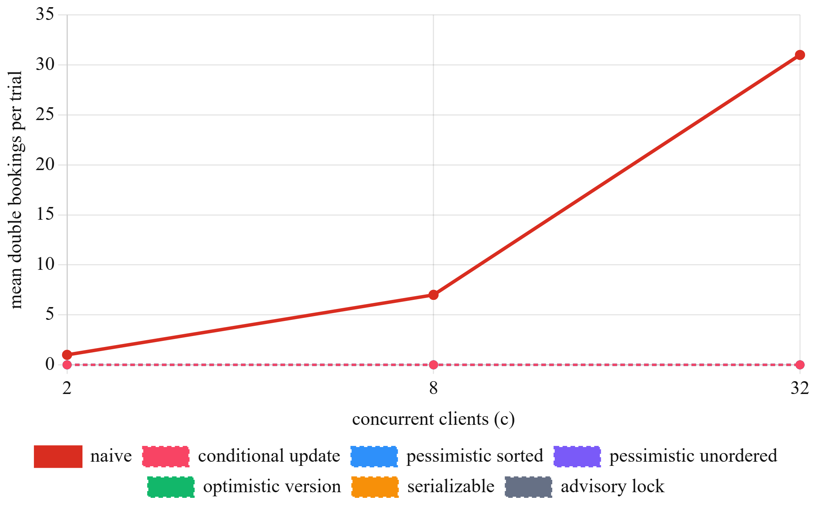
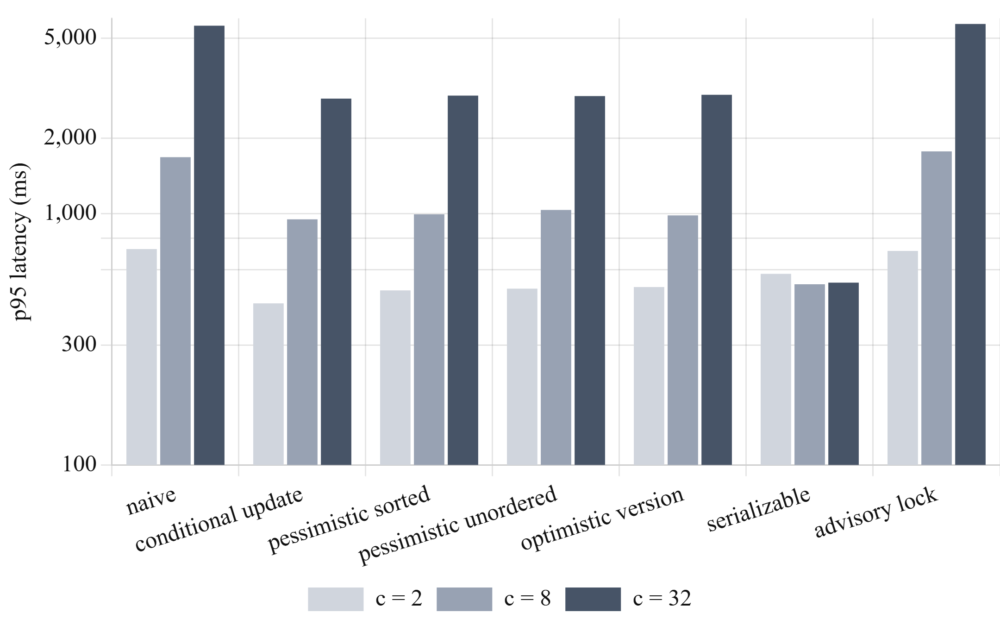
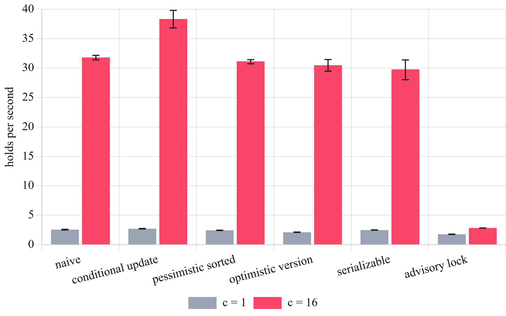
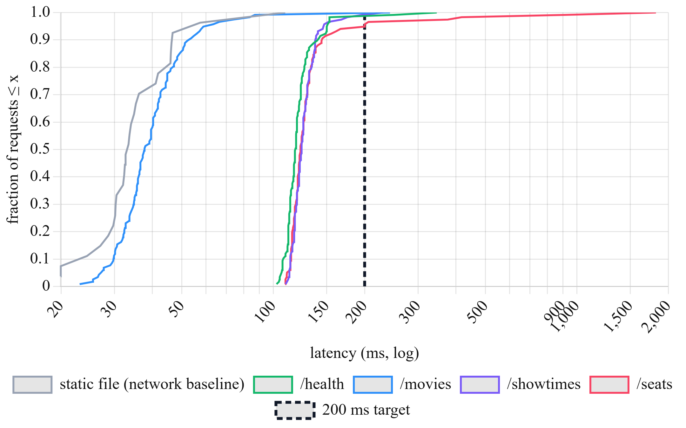
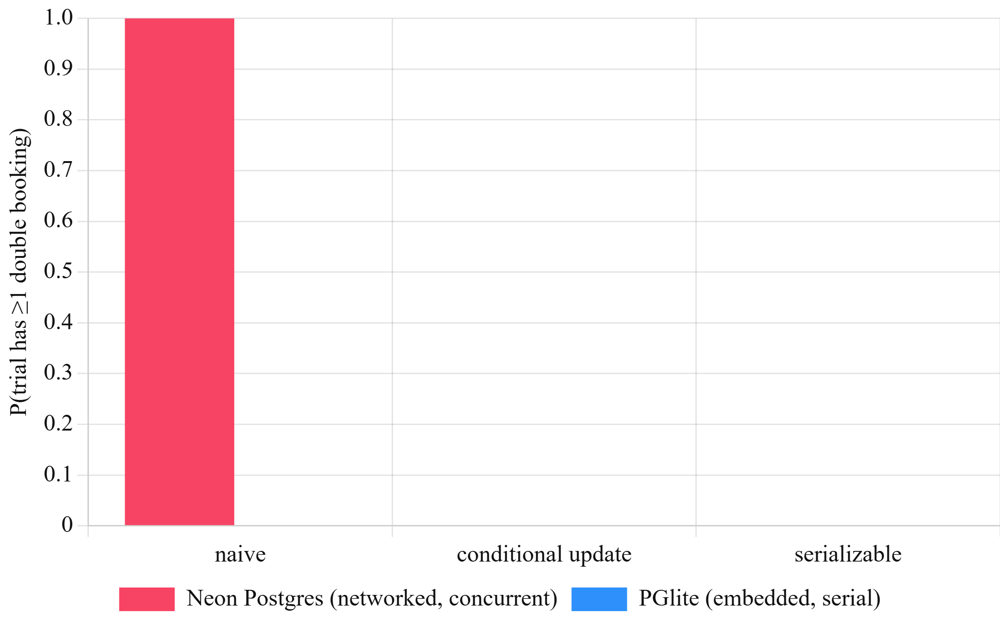

<h1>Preventing Double Bookings under Concurrent Demand: An Empirical Comparison of Concurrency-Control Strategies in a Serverless Ticket-Booking System</h1>

[Author Name] [Department of Computer Science and Engineering] [Institution Name], [City], India [email address]

<b><i>Abstract</i>—When thousands of users try to buy the same seats at once, a booking system must guarantee that each seat is sold exactly once. This paper compares seven concurrency-control strategies for seat reservation—a naive read-check-write baseline, the conditional UPDATE used by the CineBook system, two pessimistic-locking variants, optimistic version checking, PostgreSQL SERIALIZABLE isolation, and a coarse advisory lock—on a cloud PostgreSQL database, and validates the deployed system end to end. Across 11 280 logged transactions in 621 trials, the baseline double-booked in 60 of 60 contended trials (95% CI 94–100%), while all six other strategies produced zero double bookings (per-trial upper bound 4%). The conditional UPDATE had the lowest median latency (344 ms versus 435–445 ms, Cliff's δ ≥ 0.96) and 23% higher throughput than the next best strategy; unordered row locking deadlocked on 38.8% of multi-seat requests and SERIALIZABLE aborted up to 97% of contending transactions. On the live deployment, 12/12 sixteen-way races produced exactly one winner and 6/6 parallel payment double-submits charged once. Finally, the same faulty code showed no double bookings on an embedded test database (0/15 versus 20/20, p = 3×10⁻¹⁰), showing that local tests can hide this class of defect.</b>

<b><i>Index Terms</i>—concurrency control, transaction isolation, double booking, PostgreSQL, serializable snapshot isolation, optimistic concurrency control, serverless computing, performance evaluation.</b>

## I. Introduction

Ticketing is a classic hot-spot workload: demand concentrates on a few rows—the best seats of a popular show—at the same instant. Recent launches illustrate the scale. Ticketmaster reported 3.5 billion system requests during the 2022 Eras Tour presale [15], and BookMyShow's site failed at the opening of the 2024 Coldplay India sale, when roughly 13 million users were reported to compete for about 180 000 tickets [16]. Under such contention, any gap between *checking* that a seat is free and *marking* it sold allows two buyers to purchase the same seat.

The product requirements of CineBook, the system studied here, state one non-negotiable property: two users can never book the same seat. CineBook enforces it with a single conditional UPDATE executed inside PostgreSQL. This paper asks whether that design is (a) correct, (b) cheaper than the alternatives, and (c) correct and fast enough in the deployed system. Its contributions are a pre-registered experimental comparison of seven strategies on a production-grade stack, an end-to-end validation of the deployed application, and evidence that the choice of test platform determines whether the defect is observable at all.

## II. Related Work

*A. Anomalies and Isolation.* Berenson *et al.* [1] showed that the ANSI isolation levels are ambiguous and defined anomalies such as the *lost update*—the exact failure behind double booking, in which two transactions read "available" and both write "sold." PostgreSQL's default READ COMMITTED level permits this for read-then-write logic. A single UPDATE ... WHERE status = 'AVAILABLE', however, is safe: when the target row is locked by a concurrent writer, PostgreSQL waits and re-evaluates the WHERE clause against the newly committed row version before updating [6].

*B. Pessimistic and Optimistic Control.* Two-phase locking (SELECT ... FOR UPDATE) serializes access but can deadlock when transactions acquire rows in different orders. Optimistic concurrency control [5] executes without locks, validates at commit and aborts on conflict; it is efficient when conflicts are rare and wasteful when they are frequent.

*C. Serializable Snapshot Isolation.* PostgreSQL implements SERIALIZABLE with SSI [3], which detects dangerous read–write dependency cycles and aborts one participant. Its authors report performance close to snapshot isolation on read-heavy workloads, but SSI may abort transactions that did not truly conflict. Independent testing by Jepsen found G2-item anomalies in the serializable mode of PostgreSQL 12.3 [10], underlining the value of empirical checks.

*D. Application Practice.* Bailis *et al.* [2] found that Rails applications enforce integrity mostly through application-level ("feral") checks, used over 37 times more often than transactions and often unsafe under concurrency. Warszawski and Bailis [4] demonstrated that such defects are exploitable (22 attacks in 12 applications) and are masked by low traffic. Locks held outside the database, such as Redis Redlock, add timing assumptions and require fencing tokens to be safe [11].

*E. Measurement Methodology.* Systems measurements are noisy and easily biased: Mytkowicz *et al.* [9] showed that innocuous setup changes can reverse conclusions and recommend setup randomization. Georges *et al.* [7] and Hoefler and Belli [8] call for repeated runs, confidence intervals and non-parametric statistics. Tail latency governs user experience [12], and serverless platforms add cold starts and variable performance [13].

*F. Research Gap.* Prior work explains *why* naive code fails and *what* each mechanism guarantees, but rarely offers a reproducible, quantitative comparison for the seat-reservation pattern (one hot row; all-or-nothing multi-row holds) on a serverless and database-as-a-service stack, where wide-area round-trip time rather than CPU dominates cost. It also seldom examines how the *test environment* affects whether such defects are visible. This study addresses both gaps.

## III. Research Questions and Hypotheses

The questions and hypotheses in Table I were fixed in a configuration file before any experiment was run.

TABLE I Research Questions and Pre-Registered Hypotheses

| | Question | Hypothesis |
|---|---|---|
| RQ1 | Does each strategy prevent double booking under simultaneous requests? | **H1** baseline double-books; **H2** all others never do |
| RQ2 | What does each correct strategy cost without collisions? | **H3** strategies differ; conditional UPDATE fastest, coarse lock slowest |
| RQ3 | How do strategies behave with overlapping multi-seat requests? | unordered locking deadlocks; SSI over-aborts |
| RQ4 | Is the deployed system correct and within p95 < 200 ms? | **H4** yes, for all read endpoints |
| RQ5 | Does the test platform change the observed outcome? | **H5** an embedded, serial database hides the race |

## IV. Methodology

*A. System Under Test.* All strategies run against identical tables in an isolated research schema of the production Neon database (PostgreSQL 18.6, AWS ap-southeast-1, pooled connections). Each strategy holds 1–3 seats all-or-nothing and inserts one *claim* row per seat in the same transaction. The number of double bookings in a trial is therefore

D = Σs max(0, ns − 1), &nbsp;&nbsp;&nbsp;&nbsp;(1)

where ns is the number of committed claims on seat s. The baseline (*naive*) reads, checks in application code and updates unconditionally; *conditional_update* is CineBook's production logic; *pessimistic_sorted* locks rows with FOR UPDATE in seat order; *pessimistic_unordered* locks them one at a time in request order; *optimistic_version* validates a version number; *serializable* runs the naive code under SERIALIZABLE; and *advisory_lock* takes one lock per show.

*B. Experimental Design.* Table II lists the factors and levels. Each trial starts from freshly inserted seats; each client owns a dedicated connection; all clients are released from a barrier simultaneously; one warm-up trial per cell is logged and excluded; and cells execute in a seeded random order to counter time-of-day drift [9]. Inputs (seat choice and request order) derive from a fixed seed.

TABLE II Factors, Levels and Replications

| Exp. | Workload | Strat. | c | Trials |
|---|---|---|---|---|
| E1 | one hot seat; all clients request it | 7 | 2, 8, 32 | 20 |
| E2 | 10-seat pool; 3 random seats each | 6 | 16 | 15 |
| E3 | no collisions; 5 holds per client | 6 | 1, 16 | 6 |
| E4 | live deployment over HTTPS | prod. | 1/16/5 | 3/12/6 |
| E5 | as E1 on embedded PGlite | 3 | 8 | 15 |

*C. Metrics and Environment.* Metrics are double bookings (1), lost updates, aborts by SQLSTATE (deadlock 40P01, serialization failure 40001), per-transaction latency, trial makespan, throughput (successful holds per second) and server-side pg_stat_database deltas. The client was an Intel i5-12400F (12 threads, 15.9 GB RAM, Windows 10, Node.js 24.19) in India; the median round-trip time to the database in Singapore was 102 ms. The main run took place on 25 October 2026, 04:51–05:17 UTC.

*D. Statistical Analysis.* Proportions use Wilson 95% intervals [14]; zero-event outcomes use the rule of three, with upper bound ≈ 3/n. Latencies are skewed, so medians and 95th percentiles are reported with percentile-bootstrap intervals (B = 2000). Groups are compared with the Kruskal–Wallis test, followed by pairwise Mann–Whitney U tests against the conditional UPDATE with Holm correction; Cliff's δ is the effect size (|δ| ≥ 0.474 is large). Two-group proportions use Fisher's exact test. The statistics module passes 12 checks against published reference values.

*E. Data Management.* Every transaction attempt is appended to a JSON-lines log with run identifier, sequence number, timestamp, inputs, outcome, SQLSTATE, error text and latency; every trial adds counts, makespan, client CPU and memory; every run has a manifest recording the code version, software versions, hardware, database host, network samples and execution order. Validation against the design found 12 020 log lines, none unparseable, no invalid latencies and no missing cells, with 39 warm-up trials excluded. A live dashboard (Fig. 8) streamed progress, outcome mix, latency percentiles and iteration-wise makespan during the runs, refreshing as each transaction was logged.

<figure class="wide"><figcaption>Fig. 8. Real-time experiment dashboard captured during the main run (13% complete): progress, double bookings per strategy, outcome mix, latency percentiles, iteration-wise trial makespan and latency distribution.</figcaption></figure>

## V. Results

*A. Correctness under Contention (RQ1).* The baseline double-booked in every contended trial: 60 of 60 (Wilson 95% CI 94.0–100%). Every client won the seat—mean winners per trial were 2, 8 and 32—producing 780 double bookings in E1 and 571 in E2. The other six strategies produced zero double bookings across 75 trials and 1080 transactions each (advisory lock: 60 trials, 840 transactions), a per-trial upper bound of 4% (5%) at 95% confidence. Against the conditional UPDATE the difference is decisive (Fisher's exact p = 2.1×10⁻³⁵). H1 and H2 are supported (Fig. 1).

<figure><figcaption>Fig. 1. Mean double bookings per trial versus concurrent clients (E1). The six non-baseline strategies overlap at zero; the baseline grows as c − 1.</figcaption></figure>

The cost of correctness grows with contention because losers must wait for the winner's lock (Fig. 2). At c = 32 the conditional UPDATE, optimistic and pessimistic strategies cluster at a p95 of 2.9–3.0 s, while the advisory lock (5.7 s) and the baseline (5.6 s) are slowest. SERIALIZABLE stays near 0.5 s only because it aborts losers immediately, with abort rates of 50%, 88% and 97% at c = 2, 8 and 32; each loser receives an error that the application must handle or retry.

<figure class="wide"><figcaption>Fig. 2. 95th-percentile transaction latency under contention (E1), by strategy and concurrency (log scale).</figcaption></figure>

*B. Overlapping Multi-Seat Requests (RQ3).* With 16 clients each requesting 3 of 10 seats (Fig. 3), unordered locking deadlocked on 93 of 240 requests (38.8%), confirmed by 101 deadlocks in PostgreSQL's own statistics (including the warm-up trial), and its p95 latency rose to 5.4 s. SERIALIZABLE sold only 3.0 seats per trial versus 6.8–7.4 for the other correct strategies, aborting 93.8% of requests even when a non-overlapping allocation existed. The conditional UPDATE, sorted locking and optimistic validation behaved alike, with no deadlocks. The baseline "sold" 9.9 of 10 seats per trial but with 38 double bookings per trial.

<figure><figcaption>Fig. 3. Outcome of every request with overlapping three-seat requests (E2, c = 16).</figcaption></figure>

*C. Cost without Collisions (RQ2).* When clients never collide, the cost is overhead, dominated here by network round trips. The strategies differed significantly (Kruskal–Wallis H = 1936, df = 5, p < 10⁻³⁰⁰ at c = 16; H = 154, p < 10⁻³⁰ at c = 1). The conditional UPDATE was fastest, with a median of 344 ms [342, 347] at c = 16 versus 435–445 ms for the baseline, sorted locking, optimistic validation and SERIALIZABLE (Fig. 4). All pairwise differences were significant after Holm correction (largest adjusted p = 4.4×10⁻⁷, baseline versus conditional at c = 1), with large effects (Cliff's δ = 0.76–1.00; 0.96–1.00 at c = 16).

<figure><figcaption>Fig. 4. Latency without collisions (E3, c = 16). Box: interquartile range; dot: median; cross: 95th percentile (log scale).</figcaption></figure>

The conditional UPDATE also delivered the highest throughput, 38.3 holds/s [36.8, 39.8]—23% above sorted locking (31.1) and 26% above optimistic validation (30.5) (Fig. 5). The advisory lock serializes the whole show and fell to 2.8 holds/s, 13.5 times lower. SERIALIZABLE aborted 24 of 480 (5.0%) non-conflicting transactions, false positives of SSI's coarse conflict tracking. H3 is supported. The mechanism is simple: the conditional UPDATE decides and writes in one statement, whereas read-then-write strategies need an extra round trip per hold.

<figure><figcaption>Fig. 5. Throughput in successful holds per second with 95% bootstrap confidence intervals (E3).</figcaption></figure>

*D. The Deployed System (RQ4).* In 12 trials, 16 real user accounts raced through the public API for one seat; all 12 trials had exactly one winner (192 requests, no errors, no double bookings). Losers received HTTP 409, and every seat returned to *available* after release. Hold latency was 146 ms at the median and 352 ms at the 95th percentile. In 6 trials of five simultaneous payment submissions sharing one idempotency key, each produced exactly one HTTP 200, four HTTP 409 responses and one payment record; later retries were recognized as replays in 6 of 6 cases, with no double charges. Latency was measured end to end from the client (Table III, Fig. 6); a static file served by the CDN gives the network baseline (median 33 ms).

TABLE III Live Read Latency (117 Warm Samples per Endpoint)

| Endpoint | p50 (ms) | p95 (ms) [95% CI] | < 200 ms | Target met |
|---|---|---|---|---|
| health | 118 | 150 [140, 153] | 98.3% | yes |
| movies | 38 | 60 [52, 84] | 99.1% | yes |
| showtimes | 124 | 146 [138, 175] | 99.1% | yes |
| seats | 123 | 200 [144, 417] | 94.9% | not shown |

H4 is partially supported. Three endpoints meet p95 < 200 ms with their whole interval below the target. The seat map's p95 lies on the boundary and its interval reaches 417 ms, driven by occasional responses of up to 1.8 s.

<figure class="wide"><figcaption>Fig. 6. Cumulative distribution of live end-to-end latency (E4a); the dashed line marks the 200 ms target.</figcaption></figure>

*E. Platform Effect (RQ5).* Running the identical baseline code with 8 clients on the embedded PGlite database used for local development produced 0 of 15 trials with double bookings, versus 20 of 20 on Neon (Fisher's exact p = 3.1×10⁻¹⁰; Fig. 7). PGlite executes one transaction at a time, so the race window never opens. H5 is supported: a test suite that passes on an embedded database demonstrates logic, not concurrency safety.

<figure><figcaption>Fig. 7. Share of trials with at least one double booking on networked PostgreSQL and embedded PGlite (c = 8). PGlite values are zero for all strategies.</figcaption></figure>

## VI. Discussion

*A. Findings.* First, read-check-write in application code is not an edge-case risk: under simultaneous demand it oversold in every trial, and the damage scaled with the number of buyers. Second, every database-enforced strategy was correct, so the choice among them concerns cost and failure behaviour. Third, for seat reservation on a high-latency serverless stack the conditional UPDATE dominated—correct, fastest, highest throughput, with no deadlocks and no false aborts—whereas unordered locking added deadlocks, SERIALIZABLE added aborts that reduced seats sold, and a coarse lock destroyed throughput. Fourth, the live system preserved seat and payment integrity under real concurrent traffic.

*B. Threats to Validity.* All load originated from one machine in India, so absolute latencies include a wide-area round trip of about 100 ms and relative differences generalize better than absolute values. A single Neon compute size and a connection pooler were used. Strategies were implemented without automatic retries; with retries, SERIALIZABLE and optimistic control would sell more seats at higher latency. Concurrency was limited to 32 clients, whereas flash sales are far larger and normally shaped by virtual queues. Live sample sizes were small (12 races and 6 payment trials), and the latency rounds spanned about six minutes on one day.

*C. Practical Impact.* For booking and inventory systems, the evidence supports a simple rule: let one conditional statement in the database decide ownership, and run tests against a real concurrent database. For CineBook, the core requirement is now supported by measurement; the open item is the tail latency of the seat-map endpoint.

## VII. Conclusion and Future Work

This study compared seven concurrency-control strategies for seat reservation under controlled, repeated experiments and validated a deployed system end to end. The naive baseline failed in every contended trial, while database-enforced strategies were uniformly correct; among them, the single conditional UPDATE offered the best latency and throughput without deadlocks or false aborts. The results also show that embedded test databases can conceal concurrency defects. Future work will repeat the study from multiple regions and at higher concurrency behind a virtual queue, add retry policies to measure goodput, evaluate SKIP LOCKED-based seat suggestion, and optimize the seat-map query to bring its 95th percentile below 200 ms. All code, the pre-registered design, raw logs, analysis outputs and figure scripts are available in the project repository to support independent replication.

## Appendix: Detailed Results

Tables IV–VI report every configuration of the database experiments, generated directly from the analysis outputs in the repository. DB denotes double bookings; abort rate counts deadlock and serialization failures over all transactions; intervals are 95% percentile-bootstrap intervals; Holm p is the Holm-adjusted Mann–Whitney p-value against the conditional UPDATE at the same concurrency.

TABLE IV Hot-Seat Results per Configuration (E1, 20 Trials per Row)

| Strategy | c | Trials w/ DB | DB total | Abort rate | p50 (ms) | p95 (ms) [95% CI] |
|---|---|---|---|---|---|---|
| naive | 2 | 20/20 | 20 | 0.0% | 651 | 724 [703, 972] |
| naive | 8 | 20/20 | 140 | 0.0% | 1016 | 1680 [1642, 1697] |
| naive | 32 | 20/20 | 620 | 0.0% | 3111 | 5608 [5493, 5697] |
| cond. UPDATE | 2 | 0/20 | 0 | 0.0% | 382 | 440 [433, 450] |
| cond. UPDATE | 8 | 0/20 | 0 | 0.0% | 629 | 951 [935, 961] |
| cond. UPDATE | 32 | 0/20 | 0 | 0.0% | 1594 | 2874 [2791, 2918] |
| pess. sorted | 2 | 0/20 | 0 | 0.0% | 449 | 496 [478, 527] |
| pess. sorted | 8 | 0/20 | 0 | 0.0% | 703 | 995 [969, 1020] |
| pess. sorted | 32 | 0/20 | 0 | 0.0% | 1677 | 2956 [2903, 3005] |
| pess. unordered | 2 | 0/20 | 0 | 0.0% | 449 | 504 [490, 526] |
| pess. unordered | 8 | 0/20 | 0 | 0.0% | 726 | 1037 [1018, 1045] |
| pess. unordered | 32 | 0/20 | 0 | 0.0% | 1680 | 2942 [2886, 2985] |
| optimistic | 2 | 0/20 | 0 | 0.0% | 442 | 511 [507, 520] |
| optimistic | 8 | 0/20 | 0 | 0.0% | 659 | 986 [960, 1006] |
| optimistic | 32 | 0/20 | 0 | 0.0% | 1665 | 2979 [2895, 3006] |
| serializable | 2 | 0/20 | 0 | 50.0% | 512 | 577 [567, 590] |
| serializable | 8 | 0/20 | 0 | 87.5% | 493 | 525 [517, 530] |
| serializable | 32 | 0/20 | 0 | 96.9% | 482 | 533 [527, 539] |
| advisory | 2 | 0/20 | 0 | 0.0% | 596 | 712 [704, 734] |
| advisory | 8 | 0/20 | 0 | 0.0% | 1089 | 1772 [1725, 1806] |
| advisory | 32 | 0/20 | 0 | 0.0% | 3032 | 5697 [5566, 5794] |

TABLE V Overlapping Multi-Seat Requests (E2, c = 16, 15 Trials, 240 Requests)

| Strategy | Success | Conflict | Deadlock | Ser. fail. | Seats sold / trial | DB total | p95 (ms) |
|---|---|---|---|---|---|---|---|
| naive | 240 | 0 | 0 | 0 | 9.9 | 571 | 2432 |
| cond. UPDATE | 34 | 206 | 0 | 0 | 6.8 | 0 | 1334 |
| pess. sorted | 37 | 203 | 0 | 0 | 7.4 | 0 | 1576 |
| pess. unordered | 34 | 113 | 93 | 0 | 6.8 | 0 | 5432 |
| optimistic | 36 | 204 | 0 | 0 | 7.2 | 0 | 1462 |
| serializable | 15 | 0 | 0 | 225 | 3.0 | 0 | 544 |

TABLE VI Low-Contention Latency, Throughput and Pairwise Tests vs. Conditional UPDATE (E3)

| Strategy | c | n | Median (ms) [95% CI] | p95 (ms) | Throughput (holds/s) [95% CI] | Cliff's δ | Holm p |
|---|---|---|---|---|---|---|---|
| naive | 1 | 30 | 392 [386, 400] | 413 | 2.5 [2.5, 2.6] | 0.76 | 4.4e-7 |
| cond. UPDATE | 1 | 30 | 366 [361, 370] | 393 | 2.7 [2.7, 2.8] | — | ref. |
| pess. sorted | 1 | 30 | 410 [400, 412] | 435 | 2.4 [2.4, 2.5] | 0.98 | 2.4e-10 |
| optimistic | 1 | 30 | 474 [461, 480] | 508 | 2.1 [2.1, 2.1] | 1.00 | 1.5e-10 |
| serializable | 1 | 30 | 401 [397, 406] | 425 | 2.5 [2.5, 2.5] | 0.95 | 5.7e-10 |
| advisory | 1 | 30 | 565 [553, 575] | 598 | 1.8 [1.7, 1.8] | 1.00 | 1.5e-10 |
| naive | 16 | 480 | 435 [430, 440] | 502 | 31.8 [31.4, 32.2] | 0.96 | < 10⁻¹⁵ |
| cond. UPDATE | 16 | 480 | 344 [342, 347] | 400 | 38.3 [36.8, 39.8] | — | ref. |
| pess. sorted | 16 | 480 | 445 [438, 452] | 518 | 31.1 [30.7, 31.4] | 0.96 | < 10⁻¹⁵ |
| optimistic | 16 | 480 | 441 [438, 448] | 510 | 30.5 [29.5, 31.5] | 0.98 | < 10⁻¹⁵ |
| serializable | 16 | 456 | 439 [434, 442] | 496 | 29.8 [28.0, 31.4] | 0.97 | < 10⁻¹⁵ |
| advisory | 16 | 480 | 5614 [5605, 5619] | 5771 | 2.8 [2.8, 2.8] | 1.00 | < 10⁻¹⁵ |

## References

[1] H. Berenson, P. Bernstein, J. Gray, J. Melton, E. O'Neil, and P. O'Neil, "A critique of ANSI SQL isolation levels," in *Proc. ACM SIGMOD Int. Conf. Manage. Data*, 1995, pp. 1–10.

[2] P. Bailis, A. Fekete, M. J. Franklin, A. Ghodsi, J. M. Hellerstein, and I. Stoica, "Feral concurrency control: An empirical investigation of modern application integrity," in *Proc. ACM SIGMOD Int. Conf. Manage. Data*, 2015, doi: 10.1145/2723372.2737784.

[3] D. R. K. Ports and K. Grittner, "Serializable snapshot isolation in PostgreSQL," *Proc. VLDB Endow.*, vol. 5, no. 12, pp. 1850–1861, 2012, doi: 10.14778/2367502.2367523.

[4] T. Warszawski and P. Bailis, "ACIDRain: Concurrency-related attacks on database-backed web applications," in *Proc. ACM SIGMOD Int. Conf. Manage. Data*, 2017, doi: 10.1145/3035918.3064037.

[5] H. T. Kung and J. T. Robinson, "On optimistic methods for concurrency control," *ACM Trans. Database Syst.*, vol. 6, no. 2, pp. 213–226, Jun. 1981.

[6] PostgreSQL Global Development Group, "Transaction isolation," *PostgreSQL Documentation*, ch. 13.2. [Online]. Available: https://www.postgresql.org/docs/current/transaction-iso.html

[7] A. Georges, D. Buytaert, and L. Eeckhout, "Statistically rigorous Java performance evaluation," in *Proc. ACM OOPSLA*, 2007, pp. 57–76.

[8] T. Hoefler and R. Belli, "Scientific benchmarking of parallel computing systems: Twelve ways to tell the masses when reporting performance results," in *Proc. Int. Conf. High Perform. Comput., Netw., Storage Anal. (SC)*, 2015, doi: 10.1145/2807591.2807644.

[9] T. Mytkowicz, A. Diwan, M. Hauswirth, and P. F. Sweeney, "Producing wrong data without doing anything obviously wrong!," in *Proc. ASPLOS*, 2009, pp. 265–276.

[10] K. Kingsbury, "Jepsen: PostgreSQL 12.3," Jepsen, 2020. [Online]. Available: https://jepsen.io/analyses/postgresql-12.3

[11] M. Kleppmann, "How to do distributed locking," Feb. 8, 2016. [Online]. Available: https://martin.kleppmann.com/2016/02/08/how-to-do-distributed-locking.html

[12] J. Dean and L. A. Barroso, "The tail at scale," *Commun. ACM*, vol. 56, no. 2, pp. 74–80, 2013.

[13] L. Wang, M. Li, Y. Zhang, T. Ristenpart, and M. Swift, "Peeking behind the curtains of serverless platforms," in *Proc. USENIX Annu. Tech. Conf.*, 2018, pp. 133–146.

[14] L. D. Brown, T. T. Cai, and A. DasGupta, "Interval estimation for a binomial proportion," *Statist. Sci.*, vol. 16, no. 2, pp. 101–133, 2001.

[15] "Ticketmaster cancels public sale of Taylor Swift tour tickets," WSB-TV / Cox Media Group, Nov. 2022.

[16] "Coldplay India tour 2025: Band adds 3rd Mumbai show amid ticket chaos on BookMyShow," *Business Today*, Sep. 22, 2024.

